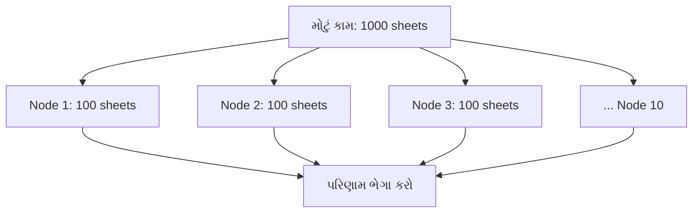
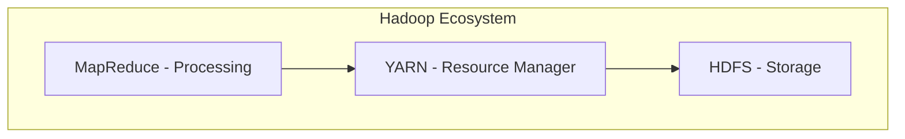
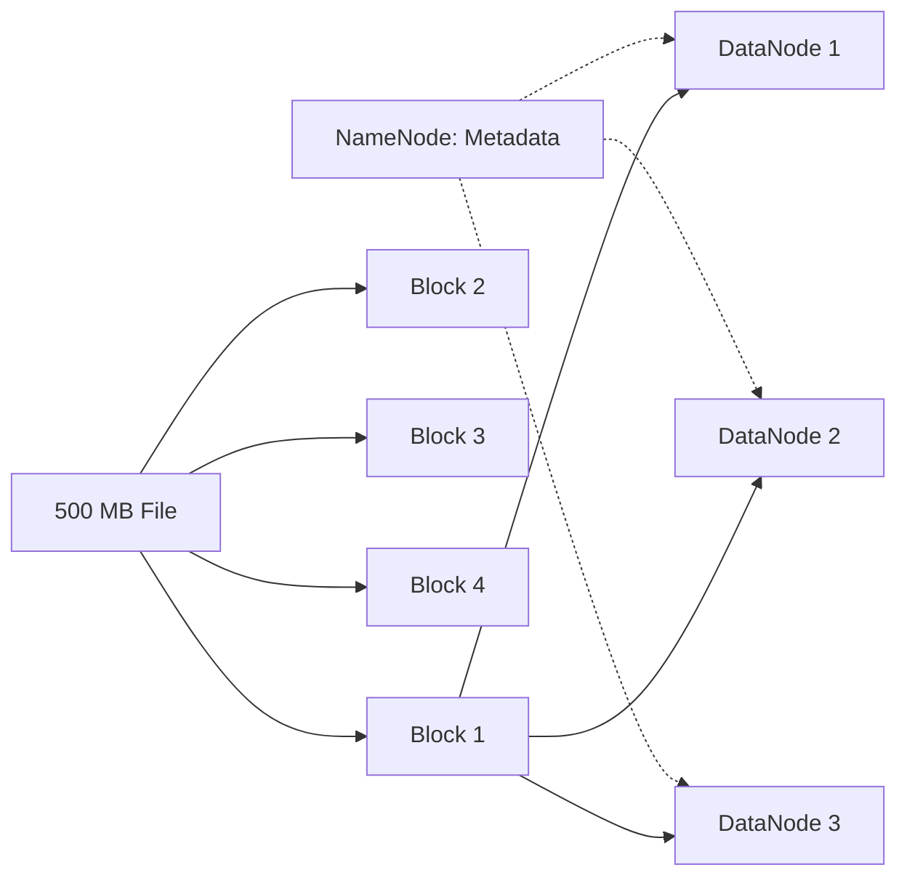
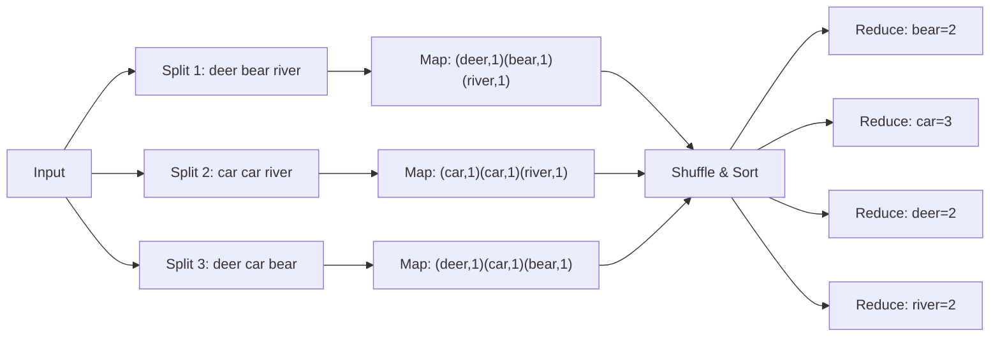
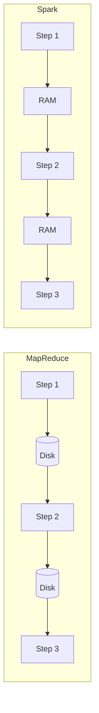
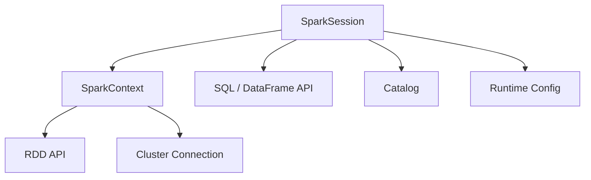

# Section 1: Spark Basics (પાયો)

> **આ section માં શું શીખીશું:** Big Data શું છે, Hadoop અને તેના ભાગો (HDFS, MapReduce), in-memory vs disk computing, distributed computing, અને Spark માં SparkSession vs SparkContext.
>
> **લક્ષ્ય:** Spark **કેમ** આવ્યું તે સમજવું. આ સમજ્યા વગર આગળના concepts ઉપર-ઉપરથી જ સમજાશે.

---

## 📑 Index

1. [Big Data](#1-big-data)
2. [Distributed Computing](#2-distributed-computing)
3. [Hadoop](#3-hadoop)
4. [HDFS](#4-hdfs-hadoop-distributed-file-system)
5. [MapReduce](#5-mapreduce)
6. [In-Memory vs Disk Computing](#6-in-memory-vs-disk-computing)
7. [Apache Spark નો પરિચય](#7-apache-spark-નો-પરિચય)
8. [Hadoop MapReduce vs Spark](#8-hadoop-mapreduce-vs-spark)
9. [SparkSession vs SparkContext](#9-sparksession-vs-sparkcontext)
10. [Quick Revision](#10-quick-revision)

---

## 1. Big Data

### 📖 Definition
**Big Data** એટલે એવો data જે એટલો **મોટો, ઝડપી અથવા વિવિધ** છે કે તેને એક સામાન્ય computer અથવા traditional database (જેમ કે MySQL) વડે store કે process કરવો મુશ્કેલ અથવા અશક્ય બને.

### 🧩 Big Data ના 5 V

| V | અર્થ | Example |
|---|------|---------|
| **Volume** | Data નું કદ (TB, PB) | Facebook રોજ petabytes data બનાવે છે |
| **Velocity** | Data કેટલી ઝડપથી આવે છે | Stock market ticks, UPI transactions દર second |
| **Variety** | Data ના પ્રકાર | Structured (tables), Semi-structured (JSON), Unstructured (images, videos) |
| **Veracity** | Data કેટલો સાચો / વિશ્વસનીય છે | Fake reviews, missing values |
| **Value** | Data માંથી મળતો business ફાયદો | Recommendation system થી વેચાણ વધે |

### 🏠 Real-life Analogy
કલ્પના કરો કે તમારા ઘરનું એક નાનું કબાટ છે (એક computer). જો તમારી પાસે 10 કપડાં હોય તો સરળતાથી સમાઈ જાય. પણ જો આખા શહેરના કપડાં રાખવાના હોય, તો એક કબાટ પૂરતો નથી. તમારે **મોટું ગોડાઉન અને ઘણા માણસો** જોઈએ. Big Data એ "આખા શહેરના કપડાં" જેવું છે.

### 💡 Why it matters
- Traditional tools (Excel, single DB) એક મશીનની મર્યાદા (RAM, disk, CPU) માં બંધાયેલા છે.
- કંપનીઓ data માંથી નિર્ણય લે છે: fraud detection, recommendations, forecasting.
- Big Data ને handle કરવા માટે **નવી રીત** જોઈએ, અને એ રીત છે **distributed computing**.

---

## 2. Distributed Computing

### 📖 Definition
**Distributed Computing** એટલે એક મોટા કામને **નાના ભાગોમાં વહેંચીને**, તેને **ઘણા computers (nodes)** પર **એકસાથે (parallel)** ચલાવવું, અને પછી પરિણામોને ભેગા કરવા.

મશીનોના આ સમૂહને **Cluster** કહેવાય છે, અને દરેક મશીનને **Node** કહેવાય છે.

### 🏠 Real-life Analogy
એક શિક્ષકને 1000 answer sheets ચકાસવાની છે.
- **એકલા ચકાસે** તો 10 દિવસ લાગે.
- **10 શિક્ષકોમાં વહેંચે** (દરેકને 100), તો 1 દિવસમાં કામ પૂરું થાય. અંતે મુખ્ય શિક્ષક બધાના marks ભેગા કરે.

આ જ distributed computing છે.



### 🔑 મુખ્ય ખ્યાલો

| Concept | અર્થ |
|---------|------|
| **Horizontal Scaling (Scale-out)** | વધુ મશીનો ઉમેરવા. Big Data માં આ જ વપરાય છે. |
| **Vertical Scaling (Scale-up)** | એક જ મશીનમાં RAM/CPU વધારવા. તેની મર્યાદા છે અને મોંઘું પડે છે. |
| **Parallelism** | ઘણા કામ એકસાથે ચાલવા |
| **Fault Tolerance** | એક મશીન બગડે તો પણ કામ ચાલુ રહે |
| **Data Locality** | Data ને computation પાસે લઈ જવાને બદલે computation ને data પાસે મોકલવું |

### 💡 Why it matters
- એક મશીનની મર્યાદા તૂટી જાય છે, અને **સસ્તા સામાન્ય મશીનો (commodity hardware)** થી મોટું કામ થઈ શકે છે.
- Spark અને Hadoop બંને **distributed computing frameworks** છે.
- **પડકાર:** મશીનો વચ્ચે network communication ધીમું છે અને મશીનો ફેલ થઈ શકે છે. આ જ પડકારોને framework handle કરે છે.

---

## 3. Hadoop

### 📖 Definition
**Apache Hadoop** એક open-source framework છે જે Big Data ને **ઘણા સામાન્ય computers ના cluster** પર **store** અને **process** કરવાની સુવિધા આપે છે. તે Google ના GFS અને MapReduce research papers પરથી પ્રેરિત છે.

### 🧩 Hadoop ના મુખ્ય ભાગો

| Component | કામ | સરળ સમજ |
|-----------|-----|----------|
| **HDFS** | Storage | Data ક્યાં રાખવો |
| **MapReduce** | Processing | Data પર ગણતરી કેવી રીતે કરવી |
| **YARN** | Resource Management | કયા કામને કેટલા resources (CPU/RAM) આપવા |
| **Hadoop Common** | Shared libraries | બધા ભાગો માટે જરૂરી utilities |



### 🏠 Real-life Analogy
Hadoop એક **મોટી courier company** જેવું છે:
- **HDFS** = ગોડાઉન, જ્યાં પાર્સલ રાખવામાં આવે છે.
- **MapReduce** = ડિલિવરી કર્મચારીઓ, જે કામ કરે છે.
- **YARN** = મેનેજર, જે નક્કી કરે છે કે કોને કયું કામ અને કેટલી ગાડીઓ મળશે.

### 💡 Why it matters
- Big Data નો **પહેલો લોકપ્રિય ઉકેલ** Hadoop હતું.
- Spark આજે પણ ઘણી જગ્યાએ **HDFS (storage)** અને **YARN (cluster manager)** સાથે ચાલે છે.
- Spark એ MapReduce ની ખામીઓ દૂર કરવા માટે બન્યું છે, એટલે MapReduce સમજવું જરૂરી છે.

---

## 4. HDFS (Hadoop Distributed File System)

### 📖 Definition
**HDFS** એક distributed file system છે, જે મોટી files ને **blocks** માં તોડીને ઘણા મશીનો પર store કરે છે, અને દરેક block ની **copies (replicas)** રાખે છે, જેથી data ખોવાય નહીં.

### 🧩 મુખ્ય ખ્યાલો

| Concept | અર્થ |
|---------|------|
| **Block** | File નો ટુકડો. Default size **128 MB** |
| **NameNode** (Master) | Metadata રાખે છે: કઈ file ના કયા blocks કયા મશીન પર છે |
| **DataNode** (Worker) | ખરેખર blocks store કરે છે |
| **Replication Factor** | દરેક block ની કેટલી copies. Default **3** |
| **Secondary / Standby NameNode** | NameNode ના backup અને high availability માટે |

### 🔢 Example
ધારો કે 500 MB ની file છે:
- Blocks = 128 + 128 + 128 + 116 MB = **4 blocks**
- Replication 3 હોય તો કુલ **12 block copies** cluster માં ફેલાયેલી હશે.



### 🏠 Real-life Analogy
એક મોટી **encyclopedia** ને પ્રકરણોમાં ફાડીને (blocks) અલગ-અલગ લાઇબ્રેરીઓમાં (DataNodes) રાખો. દરેક પ્રકરણની 3 photocopies અલગ લાઇબ્રેરીઓમાં રાખો. એક **index register** (NameNode) માં લખેલું હોય કે કયું પ્રકરણ ક્યાં છે. એક લાઇબ્રેરી બળી જાય તો પણ બીજી copy મળી જાય.

### ✅ ફાયદા અને ❌ મર્યાદા

| ફાયદા | મર્યાદા |
|-------|---------|
| ખૂબ મોટી files store થાય | ઘણી નાની files માટે ખરાબ (NameNode પર metadata નો બોજ) |
| Fault tolerant (replication) | Low-latency random access માટે નથી |
| Commodity hardware પર ચાલે | Files સામાન્ય રીતે write-once, read-many |

### 💡 Why it matters
- Spark ઘણીવાર HDFS માંથી data વાંચે છે, અને **HDFS block ≈ Spark partition** નો ખ્યાલ અહીંથી જ આવે છે.
- આજે ઘણી જગ્યાએ HDFS ની જગ્યાએ **Cloud Object Storage** (AWS S3, Azure ADLS, GCS) વપરાય છે, પણ ખ્યાલ એ જ છે.

---

## 5. MapReduce

### 📖 Definition
**MapReduce** એક programming model છે, જે મોટા data ને બે મુખ્ય તબક્કામાં process કરે છે:
1. **Map:** દરેક data ટુકડાને parallel માં process કરીને **(key, value)** pairs બનાવે છે.
2. **Reduce:** એક જ key ની બધી values ભેગી કરીને final result આપે છે.

વચ્ચે એક મહત્વનો તબક્કો છે: **Shuffle & Sort**, જે એક જ key ને એક જ reducer પાસે મોકલે છે.

### 🔢 Example: Word Count
Input:
```
deer bear river
car car river
deer car bear
```



**Output:** `bear 2, car 3, deer 2, river 2`

### 🏠 Real-life Analogy
**ચૂંટણીમાં મત ગણતરી:**
- **Map:** દરેક બૂથ પર કર્મચારીઓ પોતાના બૂથના મતો ગણે ("BJP: 1, Congress: 1...").
- **Shuffle:** બધા બૂથના પરિણામ party પ્રમાણે ભેગા કરાય.
- **Reduce:** દરેક party ના કુલ મત ગણાય.

### ❌ MapReduce ની મોટી ખામીઓ (Spark કેમ આવ્યું)
1. **દરેક step પછી disk પર write:** Map નું output disk પર લખાય, Reduce disk પરથી વાંચે. Disk I/O ખૂબ ધીમું છે.
2. **Iterative કામ માટે ખરાબ:** Machine Learning માં એક જ data પર 100 વાર loop થાય, અને દર વખતે disk read/write થાય.
3. **લખવામાં મુશ્કેલ:** સાદા word count માટે પણ Java નો લાંબો code લખવો પડે.
4. **ફક્ત Batch:** Real-time streaming નો સપોર્ટ નથી.
5. **ફક્ત બે operations:** Map અને Reduce. Joins કે filters જેવા complex કામ મુશ્કેલ.

### 💡 Why it matters
- Spark ના **transformations, shuffle, stages** જેવા ખ્યાલો MapReduce માંથી જ આવે છે.
- **Shuffle** આજે પણ Spark માં સૌથી મોંઘું operation છે. આ સમજ performance tuning માં બહુ કામ આવશે.

---

## 6. In-Memory vs Disk Computing

### 📖 Definition
- **Disk-based Computing:** દરેક step નું intermediate result **hard disk** પર લખાય અને પછીનો step ત્યાંથી વાંચે. (MapReduce)
- **In-Memory Computing:** Intermediate data **RAM (memory)** માં રાખવામાં આવે, અને disk પર ફક્ત જરૂર પડે ત્યારે જ લખાય. (Spark)

### 🏠 Real-life Analogy
તમે ગણિતનો દાખલો ગણો છો:
- **Disk way:** દરેક step પછી જવાબ નોટબુકમાં લખીને નોટ કબાટમાં મૂકો, પછી ફરી કાઢીને આગળનો step કરો. 🐢
- **In-memory way:** બધા steps મગજમાં / સામે રફ પેપર પર રાખીને સીધા ગણો. 🚀

### 📊 Comparison

| મુદ્દો | Disk Computing | In-Memory Computing |
|-------|---------------|---------------------|
| Speed | ધીમું | ઘણું ઝડપી |
| Access time | Milliseconds (disk) | Nanoseconds (RAM) |
| Cost | Disk સસ્તી છે | RAM મોંઘી છે |
| Capacity | ખૂબ વધારે | મર્યાદિત |
| Iterative workloads (ML) | ખૂબ ધીમું | આદર્શ |
| Data loss on failure | Data disk પર સુરક્ષિત | RAM નો data ખોવાય, પણ Spark lineage થી ફરી બનાવે છે |
| Example | Hadoop MapReduce | Apache Spark |



### ⚠️ મહત્વની ગેરસમજ
> **"Spark બધું RAM માં જ કરે છે"**, આ ખોટું છે.
> Data RAM માં ન સમાય તો Spark તેને **disk પર spill** કરે છે. Shuffle data પણ disk પર લખાય છે. Spark **memory-first** છે, **memory-only** નથી. આ interview નો લોકપ્રિય પ્રશ્ન છે.

### 💡 Why it matters
- Spark નો speed નો મુખ્ય ફાયદો અહીંથી આવે છે, ખાસ કરીને **iterative** (ML) અને **interactive** (SQL queries) કામમાં.
- આગળ `cache()`, `persist()`, memory tuning અને OOM errors સમજવા માટે આ પાયો છે.

---

## 7. Apache Spark નો પરિચય

### 📖 Definition
**Apache Spark** એક open-source, **distributed, in-memory data processing engine** છે, જે batch, streaming, SQL, machine learning અને graph processing, એમ બધું **એક જ platform** પર કરી શકે છે. તેની શરૂઆત UC Berkeley ના AMPLab માં 2009 માં થઈ હતી.

### 🧩 Spark ના મુખ્ય ભાગો (Unified Stack)

| Module | કામ |
|--------|-----|
| **Spark Core** | પાયો: task scheduling, memory, fault tolerance, RDD |
| **Spark SQL** | SQL queries અને DataFrames |
| **Structured Streaming** | Real-time data processing |
| **MLlib** | Machine Learning |
| **GraphX** | Graph processing |

### 🌍 Spark ક્યાં ચાલે છે
- **Languages:** Python (PySpark), Scala, Java, R, SQL
- **Cluster Managers:** Standalone, YARN, Kubernetes
- **Storage:** HDFS, S3, ADLS, GCS, Local files, Databases, Kafka

### 🏠 Real-life Analogy
Hadoop MapReduce એક **સાદી સાયકલ** જેવું છે: કામ થાય પણ ધીમું. Spark એક **સ્માર્ટ કાર** જેવી છે: ઝડપી, અને એક જ વાહનમાં ઘણી સુવિધાઓ (SQL, Streaming, ML).

---

## 8. Hadoop MapReduce vs Spark

### 📊 વિગતવાર સરખામણી

| મુદ્દો | Hadoop MapReduce | Apache Spark |
|-------|------------------|--------------|
| **Processing** | Disk-based | In-memory (જરૂર પડે disk) |
| **Speed** | ધીમું | ઘણું ઝડપી (memory workloads માં 10x–100x સુધી) |
| **Ease of use** | Java નો લાંબો code | Python/Scala/SQL માં ટૂંકો code |
| **Operations** | ફક્ત Map અને Reduce | 80+ high-level operations (join, filter, groupBy...) |
| **Processing types** | ફક્ત Batch | Batch, Streaming, SQL, ML, Graph |
| **Iterative jobs (ML)** | ખૂબ ધીમું | ઝડપી (data cache થાય) |
| **Interactive queries** | સપોર્ટ નથી | Spark shell, notebooks, SQL |
| **Fault tolerance** | Data replication (disk) | RDD lineage (ફરી ગણતરી) |
| **Execution model** | દરેક job ના fixed 2 stages | DAG-based optimized execution |
| **Optimization** | Manual | Catalyst Optimizer (automatic) |
| **Lazy evaluation** | ના | હા |
| **Hardware cost** | ઓછી RAM ચાલે | વધુ RAM જોઈએ |
| **Own storage** | હા (HDFS) | ના, બીજા storage વાપરે છે |

### 🔢 Code સરખામણી (Word Count)
**MapReduce (Java):** ~50–60 lines (Mapper class, Reducer class, Driver class).

**Spark (PySpark):** ફક્ત થોડી lines:
```python
spark.read.text("input.txt") \
    .selectExpr("explode(split(value, ' ')) as word") \
    .groupBy("word").count().show()
```

### 🤔 તો શું Hadoop મરી ગયું?
ના, સંપૂર્ણ નહીં:
- **MapReduce** ની જગ્યા મોટાભાગે Spark એ લઈ લીધી છે.
- **HDFS અને YARN** આજે પણ ઘણી on-premise કંપનીઓમાં Spark સાથે વપરાય છે.
- Cloud પર HDFS ની જગ્યા S3/ADLS/GCS અને YARN ની જગ્યા Kubernetes લઈ રહ્યા છે.

> **Interview Tip:** "Spark replaces Hadoop" કહેવું ખોટું છે. સાચો જવાબ: **"Spark replaces MapReduce, but can work with HDFS and YARN."**

---

## 9. SparkSession vs SparkContext

### 📖 Definition

**SparkContext**
- Spark 1.x નો **મુખ્ય entry point**.
- Cluster સાથે connection બનાવે છે, અને **RDDs**, broadcast variables, accumulators બનાવવા માટે વપરાય છે.
- એક JVM માં **ફક્ત એક જ** active SparkContext હોઈ શકે.

**SparkSession**
- Spark **2.0 થી** આવેલો **unified entry point**.
- તે SparkContext, SQLContext, HiveContext, બધાને **એક જ object** માં ભેગા કરે છે.
- DataFrames, SQL, streaming, catalog, બધું આનાથી જ થાય છે.
- અંદર SparkContext હોય જ છે: `spark.sparkContext`.

### 🏠 Real-life Analogy
- **SparkContext** = ઘરની **મુખ્ય વીજળી connection (meter)**. તેના વગર કંઈ ચાલે નહીં.
- **SparkSession** = **સ્માર્ટ સ્વિચ બોર્ડ**, જેમાં લાઇટ, પંખો, AC, TV, બધાના switch એક જ જગ્યાએ છે. અંદર તો એ જ meter ની વીજળી વપરાય છે.

### 📊 Comparison

| મુદ્દો | SparkContext | SparkSession |
|-------|--------------|--------------|
| ક્યારે આવ્યું | Spark 1.x | Spark 2.0+ |
| મુખ્ય ઉપયોગ | RDD API | DataFrame, Dataset, SQL, Streaming |
| SQL support | અલગ SQLContext જોઈએ | Built-in |
| Hive support | અલગ HiveContext જોઈએ | `.enableHiveSupport()` |
| સંબંધ | Low-level | SparkContext ને અંદર રાખે છે |
| આજે ભલામણ | ફક્ત RDD કામ માટે | **હંમેશા આનાથી શરૂઆત કરો** ✅ |



### 💻 Code: SparkSession બનાવવું

```python
from pyspark.sql import SparkSession

# SparkSession બનાવો (અથવા પહેલેથી હોય તો એ જ મેળવો)
spark = (
    SparkSession.builder
    .appName("MyFirstSparkApp")      # Spark UI માં દેખાતું નામ
    .master("local[*]")              # Local machine પર, બધા CPU cores વાપરીને
    .config("spark.sql.shuffle.partitions", "8")  # Optional config
    .getOrCreate()
)

print(spark.version)                  # Spark version

# SparkSession ની અંદરથી SparkContext મેળવો
sc = spark.sparkContext
print(sc.appName)

# નાનો DataFrame બનાવીને test કરો
df = spark.createDataFrame([(1, "Spark"), (2, "Hadoop")], ["id", "name"])
df.show()

spark.stop()                          # કામ પૂરું થાય એટલે બંધ કરો
```

### 🔍 Code Explanation

| Line | અર્થ |
|------|------|
| `SparkSession.builder` | Session બનાવવાની શરૂઆત |
| `.appName(...)` | Application નું નામ, જે Spark UI અને logs માં દેખાય |
| `.master("local[*]")` | ક્યાં ચલાવવું. `local[*]` = તમારા laptop પર બધા cores. Cluster પર સામાન્ય રીતે આ `spark-submit` થી અપાય છે. |
| `.config(k, v)` | Spark settings સેટ કરવા |
| `.getOrCreate()` | Session પહેલેથી હોય તો એ જ આપે, નહીં તો નવું બનાવે |
| `spark.sparkContext` | અંદરનો SparkContext |
| `spark.stop()` | Resources છોડે |

> **નોંધ:** `pyspark` shell અથવા Databricks notebook માં `spark` object **પહેલેથી બનેલો** હોય છે. ત્યાં ફરી બનાવવાની જરૂર નથી.

### 💡 Why it matters
- દરેક Spark program ની **પહેલી line** SparkSession જ હોય છે.
- Interview માં લગભગ હંમેશા પૂછાય છે: **"SparkSession અને SparkContext માં શું ફરક છે?"**

---

## 10. Quick Revision

### 🧠 એક લાઇનમાં યાદ રાખો

| Topic | એક લાઇન |
|-------|---------|
| Big Data | એક મશીનમાં ન સમાય એવો મોટો, ઝડપી, વિવિધ data (5 V) |
| Distributed Computing | કામ વહેંચીને ઘણા મશીનો પર parallel ચલાવવું |
| Hadoop | HDFS (storage) + MapReduce (processing) + YARN (resources) |
| HDFS | Files ને 128 MB blocks માં તોડી, 3 copies સાથે store કરે |
| MapReduce | Map → Shuffle & Sort → Reduce, દરેક step disk પર |
| In-Memory | Intermediate data RAM માં, એટલે ઘણું ઝડપી |
| Spark | Unified, in-memory, distributed engine |
| MapReduce vs Spark | Spark ઝડપી, સરળ, બહુ-ઉપયોગી; MapReduce disk-based અને ફક્ત batch |
| SparkSession | Spark 2.0+ નો એક જ entry point, જેમાં SparkContext અંદર છે |

### ❓ Self-Check Questions
1. Big Data ના 5 V કયા છે? દરેકનું એક example આપો.
2. Horizontal અને Vertical scaling માં શું ફરક છે?
3. 1 GB ની file HDFS માં કેટલા blocks માં તૂટશે? Replication 3 સાથે કેટલી copies થશે?
4. MapReduce માં Shuffle phase નું કામ શું છે?
5. MapReduce iterative ML jobs માટે ધીમું કેમ છે?
6. "Spark બધું memory માં જ કરે છે", આ વાક્ય સાચું છે કે ખોટું? કેમ?
7. Spark એ Hadoop ને replace કર્યું છે? સાચો જવાબ શું છે?
8. SparkSession અને SparkContext માં 3 ફરક જણાવો.
9. `getOrCreate()` શું કરે છે?
10. `local[*]` નો અર્થ શું છે?

<details>
<summary>✅ Answers (click to expand)</summary>

1. Volume, Velocity, Variety, Veracity, Value.
2. Horizontal = વધુ મશીનો ઉમેરવા; Vertical = એક મશીનને મોટું કરવું.
3. 1024 / 128 = **8 blocks**, replication 3 સાથે **24 block copies**.
4. એક જ key ની બધી values ને એક જ reducer પાસે ભેગી કરવી અને sort કરવી.
5. દરેક iteration માં data disk પરથી વાંચવો અને disk પર લખવો પડે છે.
6. ખોટું. Spark memory-first છે; data ન સમાય તો disk પર spill કરે છે, અને shuffle data પણ disk પર લખાય છે.
7. Spark એ **MapReduce** ને replace કર્યું છે, પણ તે HDFS અને YARN સાથે કામ કરી શકે છે.
8. Version (1.x vs 2.0+), API (RDD vs DataFrame/SQL), SparkSession unified છે અને SparkContext ને અંદર રાખે છે.
9. Active session હોય તો એ જ આપે, નહીં તો નવું બનાવે.
10. Local machine પર, ઉપલબ્ધ બધા CPU cores વાપરીને Spark ચલાવવું.

</details>

---

**➡️ આગળનો Section:** Section 2: Spark Architecture (Driver, Executor, DAG, Jobs/Stages/Tasks) 🚀
