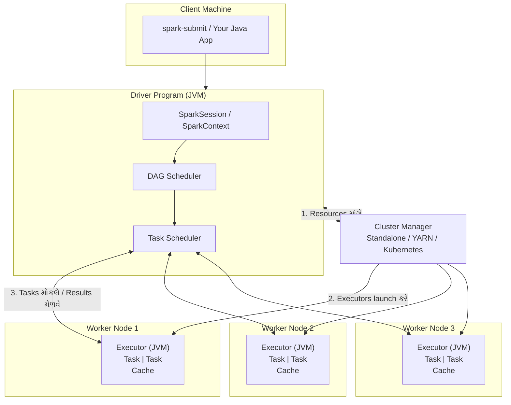
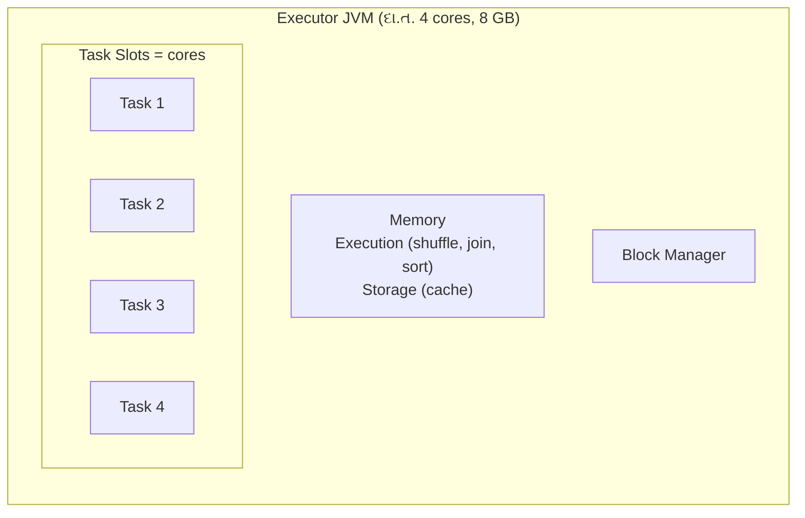
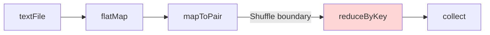
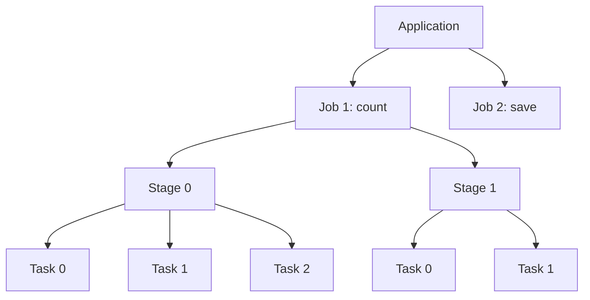
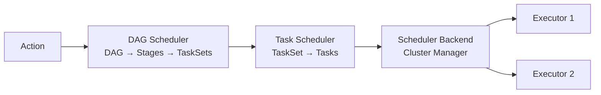
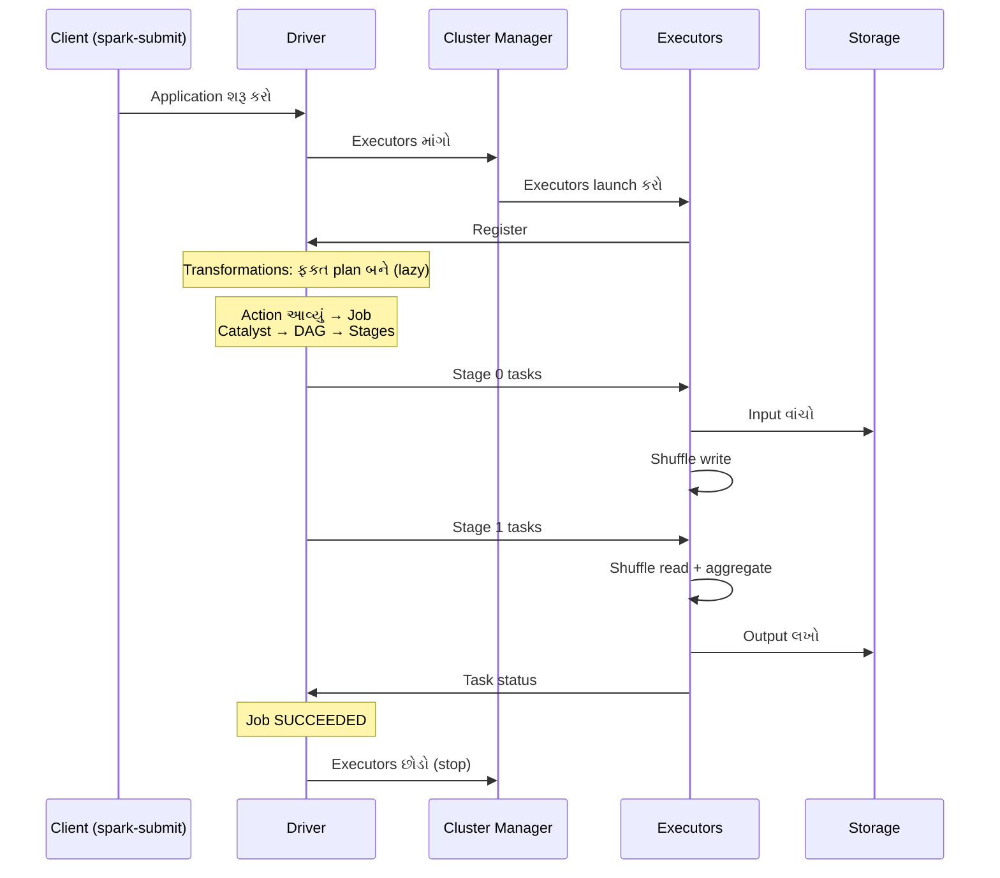
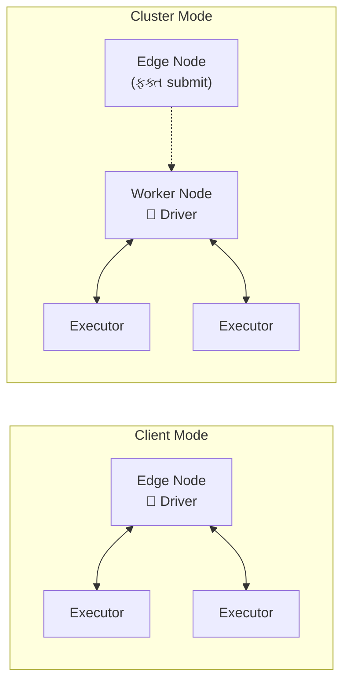
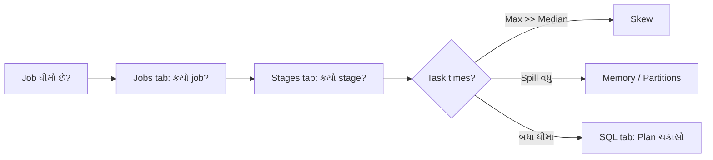

# Section 2: Spark Architecture

> **આ section માં શું શીખીશું:** Spark program ચલાવો ત્યારે અંદર **કોણ, શું, ક્યાં** કામ કરે છે: Driver, Executor, Cluster Manager, Job/Stage/Task, DAG, Schedulers, Deploy modes, spark-submit અને Spark UI.
>
> **Language:** બધા code examples **Java** માં છે.

---

## 📑 Index

1. [Big Picture: Spark Architecture](#1-big-picture-spark-architecture)
2. [Driver](#2-driver)
3. [Executor](#3-executor)
4. [Cluster Manager](#4-cluster-manager)
5. [DAG (Directed Acyclic Graph)](#5-dag-directed-acyclic-graph)
6. [Job, Stage, Task](#6-job-stage-task)
7. [DAG Scheduler અને Task Scheduler](#7-dag-scheduler-અને-task-scheduler)
8. [Action ચલાવો ત્યારે શું થાય છે (Step-by-Step)](#8-action-ચલાવો-ત્યારે-શું-થાય-છે-step-by-step)
9. [Deploy Modes: Client vs Cluster](#9-deploy-modes-client-vs-cluster)
10. [spark-submit](#10-spark-submit)
11. [Spark UI](#11-spark-ui)
12. [Quick Revision](#12-quick-revision)

---

## 0. Java Project Setup (એક વાર)

### Maven `pom.xml` dependency

```xml
<dependencies>
    <dependency>
        <groupId>org.apache.spark</groupId>
        <artifactId>spark-sql_2.13</artifactId>
        <version>4.0.0</version>
        <!-- Cluster પર Spark પહેલેથી હોય છે, એટલે jar માં ન નાખવું -->
        <scope>provided</scope>
    </dependency>
</dependencies>
```

> **નોંધ:**
> - `_2.13` = Scala version. Spark 4.x Scala 2.13 વાપરે છે.
> - Spark 4.x માટે **Java 17 અથવા 21** જોઈએ. Spark 3.x Java 8/11/17 પર ચાલે છે.
> - Local IDE (IntelliJ) માં run કરતી વખતે `provided` scope ના કારણે error આવે, તો IntelliJ માં "Include dependencies with Provided scope" option ચાલુ કરો.

---

## 1. Big Picture: Spark Architecture

### 📖 Definition
Spark એક **Master–Worker architecture** પર ચાલે છે:
- **Driver** = મગજ (Master process). Plan બનાવે છે અને કામ વહેંચે છે.
- **Executors** = હાથ (Worker processes). ખરેખર data પર કામ કરે છે.
- **Cluster Manager** = HR / resource manager. Driver ને executors માટે મશીનો (CPU, RAM) આપે છે.



### 🏠 Real-life Analogy: બાંધકામની સાઇટ
- **Driver** = **Site Engineer**: નકશો (plan) બનાવે, કામ નાના ભાગોમાં વહેંચે, કોણ શું કરશે તે નક્કી કરે.
- **Cluster Manager** = **Labour Contractor**: Engineer માંગે એટલા મજૂરો અને સાધનો આપે.
- **Executors** = **મજૂરોની ટીમો**: ઈંટ મૂકવાનું વાસ્તવિક કામ કરે.
- **Tasks** = દરેક મજૂરને આપેલું નાનું કામ ("આ દિવાલની 10 ઈંટો મૂકો").

### 💡 Why it matters
- Performance problem, OOM error, slow job, બધાનું debugging કરવા માટે **કયો ભાગ ક્યાં ચાલે છે** તે ખબર હોવી જોઈએ.
- Interview નો સૌથી સામાન્ય પ્રશ્ન: **"Explain Spark architecture."**

---

## 2. Driver

### 📖 Definition
**Driver** એ JVM process છે જે તમારી application નો **`main()` method** ચલાવે છે. તે `SparkSession` બનાવે છે, અને આખી application નું **સંચાલન (coordination)** કરે છે.

### 🧩 Driver ના કામ

| કામ | વિગત |
|-----|------|
| **main() ચલાવવું** | તમારો Java code અહીં ચાલે છે |
| **SparkSession / SparkContext બનાવવું** | Cluster સાથે connection |
| **Plan બનાવવો** | Code માંથી logical plan → DAG → stages |
| **Tasks schedule કરવા** | કયો task કયા executor પર ચાલશે |
| **Executors ને track કરવા** | કોણ જીવંત છે, કોણ fail થયું |
| **Results મેળવવા** | `collect()`, `count()` જેવા actions નું પરિણામ |
| **Spark UI ચલાવવું** | Default port **4040** |
| **Broadcast variables મોકલવા** | બધા executors ને |

### 🏠 Analogy
Driver = **ક્રિકેટ ટીમનો કેપ્ટન**. પોતે દરેક બોલ નથી નાખતો, પણ નક્કી કરે છે કે કોણ બોલિંગ કરશે, fielding ક્યાં ગોઠવવી, અને આખી મેચનો હિસાબ રાખે છે.

### ⚠️ Driver સંબંધિત સામાન્ય ભૂલો
```java
// ❌ ખતરનાક: આખો મોટો data driver પાસે આવે છે, જેનાથી Driver OOM થાય
List<Row> allRows = hugeDf.collectAsList();

// ✅ સારું: ફક્ત થોડી rows જુઓ
hugeDf.show(20);
List<Row> sample = hugeDf.limit(100).collectAsList();
```

> **યાદ રાખો:** Driver **single point of failure** છે. Driver મરી જાય તો આખી application મરી જાય.

---

## 3. Executor

### 📖 Definition
**Executor** એ worker node પર ચાલતો **JVM process** છે. તે Driver એ આપેલા **tasks ચલાવે** છે, **data cache** કરે છે, અને results Driver ને (અથવા storage માં) મોકલે છે.

### 🧩 Executor ની રચના



| ભાગ | કામ |
|-----|-----|
| **Cores (task slots)** | એક core = એક સમયે એક task. 4 cores હોય તો 4 tasks એકસાથે |
| **Memory** | Execution (shuffle/join/sort) અને Storage (cache) માટે |
| **Block Manager** | Cached data અને shuffle blocks સંભાળે |

### 🔢 Parallelism ની ગણતરી
```
કુલ એકસાથે ચાલતા tasks = Executors ની સંખ્યા × દરેક executor ના cores

દા.ત. 5 executors × 4 cores = 20 tasks એકસાથે
```

### 🏠 Analogy
Executor = **રસોડામાં એક રસોઈયો**, અને તેના cores = **તેની પાસેના ચૂલા**. 4 ચૂલા હોય તો 4 વાનગી એકસાથે બને.

### 💡 Why it matters
- Executor memory ઓછી હોય તો **spill** થાય અથવા **OOM** આવે.
- Executor ની સંખ્યા અને cores નક્કી કરે છે કે job કેટલો **parallel** ચાલશે. (Section 7 Performance Tuning માં ઊંડાણથી.)
- Executors application ના આખા જીવન દરમિયાન ચાલે છે, સિવાય કે **dynamic allocation** ચાલુ હોય.

---

## 4. Cluster Manager

### 📖 Definition
**Cluster Manager** એ બાહ્ય service છે જે cluster ના **resources (CPU, memory)** સંભાળે છે, અને Driver ની માંગ પ્રમાણે **executors launch** કરે છે. Spark પોતે resource manager નથી; તે cluster manager પર આધાર રાખે છે.

### 🧩 પ્રકારો

**1. Standalone**
- Spark સાથે જ આવતો સાદો cluster manager.
- **Master** અને **Worker** daemons હોય છે.
- Master URL: `spark://host:7077`

**2. YARN (Yet Another Resource Negotiator)**
- Hadoop નો resource manager.
- **ResourceManager**, **NodeManager**, અને દરેક app માટે **ApplicationMaster** હોય છે.
- Executors YARN **containers** માં ચાલે છે.
- Master URL: `yarn`

**3. Kubernetes (K8s)**
- Container orchestration platform.
- Driver અને દરેક executor **અલગ Pod** માં ચાલે છે.
- Master URL: `k8s://https://<api-server>:<port>`

**4. Local mode (development માટે)**
- Cluster નથી, બધું એક જ JVM માં ચાલે છે.
- Master URL: `local`, `local[4]`, `local[*]`

> **Mesos:** જૂનો cluster manager હતો. Spark 3.2 માં deprecated થયો અને Spark 4.0 માં દૂર કરાયો.

### 📊 Comparison Table

| મુદ્દો | Standalone | YARN | Kubernetes |
|-------|-----------|------|------------|
| **Setup** | સૌથી સરળ | Hadoop cluster જોઈએ | K8s cluster જોઈએ |
| **બીજા frameworks સાથે sharing** | ના (ફક્ત Spark) | હા (Hive, MapReduce, ...) | હા (કોઈપણ containerized app) |
| **Resource isolation** | નબળું | Containers / cgroups | Pods, namespaces, strong |
| **Security** | મર્યાદિત | Kerberos, mature | RBAC, secrets |
| **Dependency management** | Jars હાથે મોકલવા | Jars હાથે મોકલવા | Docker image માં બધું |
| **ક્યાં વપરાય** | નાની ટીમ, testing | On-premise Hadoop કંપનીઓ | Cloud-native, modern platforms |
| **Master URL** | `spark://host:7077` | `yarn` | `k8s://https://host:port` |
| **ભવિષ્ય** | સ્થિર | ધીમે ધીમે ઘટે છે | ઝડપથી વધે છે 📈 |

### 🏠 Analogy
- **Standalone** = પોતાની **નાની ખાનગી ટેક્સી સર્વિસ**: સરળ, પણ ફક્ત તમારા માટે.
- **YARN** = **સરકારી બસ ડેપો**: ઘણા લોકો (frameworks) વચ્ચે વહેંચાયેલી બસો, નિયમો કડક.
- **Kubernetes** = **Uber/Ola**: આધુનિક, માંગ પ્રમાણે વાહન, દરેક સવારી અલગ (pod).

---

## 5. DAG (Directed Acyclic Graph)

### 📖 Definition
**DAG** એટલે operations નો એવો graph, જેમાં:
- **Directed:** દરેક edge ની દિશા છે (એક step થી બીજા step તરફ).
- **Acyclic:** કોઈ loop નથી. પાછા એ જ step પર આવતું નથી.

Spark તમારા transformations (`filter`, `map`, `groupBy`...) ને તરત ચલાવતું નથી (**lazy evaluation**). તે આ બધાનો DAG બનાવે છે, અને **action** આવે ત્યારે જ આખો DAG optimize કરીને ચલાવે છે.

### 🔢 Example (Java RDD Word Count) RDD = Resilient Distributed Dataset

```java
JavaSparkContext jsc = new JavaSparkContext(spark.sparkContext());

JavaRDD<String> lines = jsc.textFile("input.txt");                // Step 1
JavaRDD<String> words = lines.flatMap(
        l -> Arrays.asList(l.split(" ")).iterator());              // Step 2
JavaPairRDD<String, Integer> pairs = words.mapToPair(
        w -> new Tuple2<>(w, 1));                                  // Step 3
JavaPairRDD<String, Integer> counts = pairs.reduceByKey(Integer::sum); // Step 4 (shuffle!)

List<Tuple2<String, Integer>> result = counts.collect();           // ACTION → હવે જ ચાલે છે
```



### 🏠 Analogy
DAG = **રસોઈની recipe**. Recipe વાંચવાથી રસોઈ બનતી નથી (lazy). જ્યારે મહેમાન આવે અને "પીરસો" કહે (action), ત્યારે રસોઈયો આખી recipe જોઈને **સૌથી સારી રીત** નક્કી કરે: કયું કામ સાથે થઈ શકે, કયું પહેલા કરવું.

### 💡 Why it matters
- **Optimization:** આખો plan પહેલેથી દેખાય છે, એટલે Spark steps ભેગા કરી શકે (pipelining) અને બિનજરૂરી કામ ટાળી શકે.
- **Fault tolerance:** કોઈ partition ખોવાય તો Spark DAG (lineage) જોઈને **ફક્ત એ partition** ફરી ગણી શકે છે.

---

## 6. Job, Stage, Task

### 📖 Definitions

| Unit | Definition | કેટલા બને? |
|------|-----------|-----------|
| **Job** | એક **action** (`count`, `collect`, `save`, `show`) થી શરૂ થતું આખું કામ | સામાન્ય રીતે દરેક action દીઠ 1 job |
| **Stage** | Job નો એવો ભાગ જે **shuffle વગર** ચાલી શકે. Shuffle આવે એટલે નવો stage | Shuffle boundaries + 1 |
| **Task** | એક stage નું **એક partition** પરનું કામ. Executor પર ચાલતો સૌથી નાનો unit | Stage ના partitions જેટલા |



### 🧩 Narrow vs Wide = Stage નો નિયમ
- **Narrow transformation** (`map`, `filter`, `flatMap`): દરેક output partition ફક્ત એક input partition પર આધાર રાખે. **Shuffle નથી**, એટલે એક જ stage માં pipeline થાય.
- **Wide transformation** (`reduceByKey`, `groupBy`, `join`, `repartition`, `distinct`): data network પર ફરીથી વહેંચાય (**shuffle**), એટલે **નવો stage** શરૂ થાય.

### 🔢 ઉપરના Word Count માં ગણતરી
ધારો કે `input.txt` ના **4 partitions** છે:

| Stage | Operations | Tasks | Stage નો પ્રકાર |
|-------|-----------|-------|-----------------|
| **Stage 0** | textFile → flatMap → mapToPair (+ shuffle write) | 4 | ShuffleMapStage |
| **Stage 1** | shuffle read → reduceByKey → collect | 4 (default, parent જેટલા) | ResultStage |

**કુલ: 1 Job, 2 Stages, 8 Tasks.**

### 🏠 Analogy: પરીક્ષાના પેપર ચકાસણી
- **Job** = "આખા વર્ગનું પરિણામ તૈયાર કરો" (એક મોટો આદેશ).
- **Stage 1** = દરેક શિક્ષક પોતાના પેપર ચકાસે (કોઈ વચ્ચે વાતચીત નહીં).
- **Shuffle** = બધા પેપર **વિષય પ્રમાણે** ફરીથી ગોઠવવા, જે માટે શિક્ષકો વચ્ચે પેપરની અદલાબદલી થાય.
- **Stage 2** = દરેક વિષયના કુલ marks ગણવા.
- **Task** = એક શિક્ષકનો એક બંડલ.

### ⚠️ ધ્યાન રાખો
DataFrame API માં ક્યારેક એક action થી **એક કરતાં વધુ jobs** દેખાય છે. દા.ત. CSV વાંચતી વખતે `inferSchema` માટે, અથવા sort માટે sampling. આ સામાન્ય છે.

### 💡 Why it matters
- **Shuffle = નવો stage = network + disk I/O = ધીમું.** Stages ઓછા કરવા એ optimization નું મૂળ છે.
- Partitions ઓછા હોય તો tasks ઓછા, એટલે cores ખાલી બેસે. વધારે હોય તો overhead વધે.

---

## 7. DAG Scheduler અને Task Scheduler

### 📖 DAG Scheduler (Driver માં, high-level)
- Action આવે ત્યારે RDD/plan નો DAG લે છે.
- **Shuffle boundaries** પર DAG ને **Stages** માં તોડે છે.
- Stages ને યોગ્ય ક્રમમાં (dependencies પ્રમાણે) submit કરે છે.
- દરેક stage માટે **TaskSet** (tasks નો સમૂહ) બનાવીને Task Scheduler ને આપે છે.
- **Preferred locations** નક્કી કરે છે (data ક્યાં પડ્યો છે).
- Shuffle output ખોવાય (દા.ત. executor મરી જાય), તો **આગળનો stage ફરી ચલાવે** છે.

### 📖 Task Scheduler (Driver માં, low-level)
- DAG Scheduler પાસેથી TaskSet મેળવે છે.
- Cluster manager / scheduler backend દ્વારા **ખાલી executor slots પર tasks launch** કરે છે.
- **Data locality** નું ધ્યાન રાખે છે.
- Fail થયેલા task ને **ફરી પ્રયત્ન** કરે છે (default `spark.task.maxFailures = 4`).
- ધીમા tasks માટે **speculative execution** (જો ચાલુ હોય): એ જ task ની બીજી copy બીજે ચલાવે.

### 📊 Comparison

| મુદ્દો | DAG Scheduler | Task Scheduler |
|-------|---------------|----------------|
| Level | Stage-level | Task-level |
| Input | Job નો DAG | TaskSet |
| Output | Stages / TaskSets | Executors પર ચાલતા tasks |
| Failure handling | Stage ફરી ચલાવે (shuffle data ખોવાય ત્યારે) | Task ફરી ચલાવે |
| Cluster નું જ્ઞાન | ના | હા (executors, slots) |

### 📍 Data Locality Levels (શ્રેષ્ઠ થી ખરાબ)

| Level | અર્થ |
|-------|------|
| `PROCESS_LOCAL` | Data એ જ executor JVM માં (cached) |
| `NODE_LOCAL` | Data એ જ મશીન પર (disk / બીજો executor) |
| `NO_PREF` | કોઈ પસંદગી નથી (દા.ત. database) |
| `RACK_LOCAL` | એ જ rack ના બીજા મશીન પર |
| `ANY` | ગમે ત્યાં, network પરથી |



### 🏠 Analogy
- **DAG Scheduler** = **Project Manager**: આખા project ને phases માં તોડે ("પહેલા પાયો, પછી દિવાલો, પછી છત").
- **Task Scheduler** = **Team Lead**: દરેક phase નું કામ ખાલી બેઠેલા લોકોને આપે, અને કોઈ ભૂલ કરે તો કામ ફરી કરાવે.

---

## 8. Action ચલાવો ત્યારે શું થાય છે (Step-by-Step)

### 💻 Java Application

```java
import org.apache.spark.sql.Dataset;
import org.apache.spark.sql.Row;
import org.apache.spark.sql.SparkSession;
import static org.apache.spark.sql.functions.*;

public class WordCountApp {
    public static void main(String[] args) {
        SparkSession spark = SparkSession.builder()
                .appName("WordCountApp")
                .getOrCreate();

        Dataset<Row> lines = spark.read().text(args[0]);         // Transformation (lazy)

        Dataset<Row> counts = lines
                .select(explode(split(col("value"), " ")).alias("word")) // Narrow
                .filter(col("word").notEqual(""))                // Narrow
                .groupBy("word")                                 // Wide → shuffle
                .count();

        counts.write().mode("overwrite").csv(args[1]);           // ACTION → Job શરૂ

        spark.stop();
    }
}
```

### 🔄 Step-by-Step Flow

| Step | શું થાય છે | ક્યાં |
|------|-----------|-------|
| **1** | તમે `spark-submit` ચલાવો છો | Client |
| **2** | Driver JVM શરૂ થાય છે અને `main()` ચાલે છે | Driver |
| **3** | `SparkSession` બને છે અને Cluster Manager સાથે જોડાય છે | Driver ↔ CM |
| **4** | Cluster Manager worker nodes પર **executors launch** કરે છે, અને executors Driver ને register થાય છે | CM → Workers |
| **5** | `read`, `select`, `filter`, `groupBy` ચાલે છે, પણ **કંઈ compute થતું નથી**. ફક્ત **logical plan** બને છે | Driver |
| **6** | `write()` (**action**) આવે છે, એટલે **Job** બને છે | Driver |
| **7** | **Catalyst Optimizer** plan ને optimize કરે છે: Logical → Optimized → Physical plan | Driver |
| **8** | **DAG Scheduler** shuffle (`groupBy`) પર plan ને **2 stages** માં તોડે છે | Driver |
| **9** | **Task Scheduler** Stage 0 ના tasks (દરેક input partition દીઠ એક) executors ને મોકલે છે | Driver → Executors |
| **10** | Executors data વાંચે, split/filter કરે, partial count કરે, અને **shuffle files disk પર લખે** | Executors |
| **11** | Stage 0 પૂરો થાય એટલે Stage 1 ના tasks શરૂ થાય. તે **shuffle data વાંચે** (network પરથી) અને final count કરે | Executors |
| **12** | Stage 1 ના tasks output files storage (HDFS/S3) માં લખે | Executors → Storage |
| **13** | Executors Driver ને status મોકલે, અને Job **SUCCEEDED** થાય | Executors → Driver |
| **14** | `spark.stop()` પછી executors બંધ થાય અને resources પાછા મળે | Driver ↔ CM |



> **Interview Tip:** "What happens when you call an action?" પ્રશ્નનો જવાબ આ 14 steps નો ટૂંકો સાર છે: **Lazy plan → Action → Catalyst → DAG Scheduler (stages) → Task Scheduler (tasks) → Executors → Results.**

---

## 9. Deploy Modes: Client vs Cluster

### 📖 Definition
**Deploy mode** નક્કી કરે છે કે **Driver ક્યાં ચાલશે**:
- **Client mode:** Driver એ જ મશીન પર ચાલે છે જ્યાંથી તમે `spark-submit` કર્યું (તમારું laptop / edge node / gateway).
- **Cluster mode:** Driver **cluster ની અંદર** એક worker node પર ચાલે છે.



### 📊 Comparison

| મુદ્દો | Client Mode | Cluster Mode |
|-------|-------------|--------------|
| **Driver ક્યાં** | Submit કરનાર મશીન પર | Cluster ની અંદર |
| **Logs / output** | સીધા terminal માં દેખાય | Cluster logs માં (YARN logs, K8s pod logs) |
| **Client મશીન બંધ થાય તો** | Application મરી જાય ❌ | Application ચાલુ રહે ✅ |
| **Network latency** | Driver અને executors દૂર હોઈ શકે | Driver executors ની નજીક |
| **Interactive use** | હા (spark-shell, notebooks) | ના |
| **ક્યારે વાપરવું** | Development, debugging, testing | **Production jobs** |
| **Default** | હા | ના, `--deploy-mode cluster` આપવું પડે |

### 🏠 Analogy
- **Client mode** = તમે **ઘરેથી phone પર** કારખાનું ચલાવો છો. Phone બંધ થાય તો કામ અટકી જાય.
- **Cluster mode** = તમે **કારખાનામાં જ manager બેસાડી** દો છો. તમે ઘરે જાઓ તો પણ કામ ચાલુ રહે.

---

## 10. spark-submit

### 📖 Definition
**`spark-submit`** એ Spark application (તમારી **jar**) ને cluster પર ચલાવવાનું command-line tool છે. તે બધા cluster managers માટે એક જ interface આપે છે.

### 🧩 Basic Syntax
```bash
spark-submit \
  --class <main-class> \
  --master <master-url> \
  --deploy-mode <client|cluster> \
  [options] \
  <application-jar> \
  [application-arguments]
```

### 📋 મહત્વના Options

| Option | અર્થ | Example |
|--------|------|---------|
| `--class` | `main()` વાળો Java class (package સાથે) | `com.example.WordCountApp` |
| `--master` | Cluster manager URL | `local[*]`, `yarn`, `spark://host:7077`, `k8s://...` |
| `--deploy-mode` | Driver ક્યાં ચાલશે | `client` / `cluster` |
| `--name` | Application નું નામ (UI માં) | `"Daily Sales Job"` |
| `--driver-memory` | Driver JVM heap memory | `2g` |
| `--driver-cores` | Driver cores (cluster mode) | `1` |
| `--executor-memory` | દરેક executor ની heap memory | `4g` |
| `--executor-cores` | દરેક executor ના cores | `4` |
| `--num-executors` | Executors ની સંખ્યા (YARN / K8s) | `10` |
| `--total-executor-cores` | કુલ cores (Standalone) | `40` |
| `--conf` | કોઈપણ Spark config | `spark.sql.shuffle.partitions=200` |
| `--jars` | વધારાની dependency jars (comma-separated) | `mysql-connector.jar` |
| `--packages` | Maven coordinates થી dependency download | `org.postgresql:postgresql:42.7.3` |
| `--files` | Config files બધા executors પર મોકલવી | `app.properties` |
| `--properties-file` | Configs ની file | `spark-defaults.conf` |
| `--verbose` | Debug માટે વધુ માહિતી | |

### 🔢 Examples

**1. Local machine પર (development)**
```bash
spark-submit \
  --class com.example.WordCountApp \
  --master "local[*]" \
  target/wordcount-1.0.jar \
  input.txt output/
```

**2. Standalone cluster**
```bash
spark-submit \
  --class com.example.WordCountApp \
  --master spark://master-host:7077 \
  --deploy-mode cluster \
  --executor-memory 4g \
  --total-executor-cores 20 \
  target/wordcount-1.0.jar \
  hdfs:///data/input.txt hdfs:///data/output/
```

**3. YARN (production)**
```bash
spark-submit \
  --class com.example.WordCountApp \
  --master yarn \
  --deploy-mode cluster \
  --name "WordCount-Daily" \
  --driver-memory 2g \
  --executor-memory 8g \
  --executor-cores 4 \
  --num-executors 10 \
  --conf spark.sql.shuffle.partitions=200 \
  --conf spark.dynamicAllocation.enabled=false \
  --packages org.postgresql:postgresql:42.7.3 \
  target/wordcount-1.0.jar \
  hdfs:///data/input hdfs:///data/output
```
**ગણતરી:** 10 executors × 4 cores = **40 tasks એકસાથે**, અને કુલ executor memory ≈ 10 × 8 GB = 80 GB (+ overhead).

**4. Kubernetes**
```bash
spark-submit \
  --class com.example.WordCountApp \
  --master k8s://https://k8s-api-server:6443 \
  --deploy-mode cluster \
  --name wordcount \
  --conf spark.kubernetes.container.image=myrepo/spark-app:1.0 \
  --conf spark.kubernetes.namespace=spark-jobs \
  --conf spark.executor.instances=5 \
  --executor-memory 4g \
  --executor-cores 2 \
  local:///opt/spark/jars/wordcount-1.0.jar \
  s3a://bucket/input s3a://bucket/output
```
> `local:///...` એટલે jar **Docker image ની અંદર** પહેલેથી છે.

### ⚖️ Config Priority (કોની કિંમત લાગશે?)
```
Code માં SparkSession.builder().config(...)   ← સૌથી વધુ priority
        ↓
spark-submit --conf / flags
        ↓
spark-defaults.conf                            ← સૌથી ઓછી priority
```

> **સારી પ્રથા:** Memory, cores અને master જેવી settings **code માં hard-code ન કરો**; `spark-submit` થી આપો, જેથી એ જ jar બધા environments માં ચાલે.

### 🛠️ Jar બનાવવી (Maven)
```bash
mvn clean package
# Dependencies સાથે fat jar જોઈએ તો maven-shade-plugin વાપરો
# (Spark ની પોતાની dependencies 'provided' રાખો)
```

---

## 11. Spark UI

### 📖 Definition
**Spark UI** એ web interface છે જે ચાલતી application ની **jobs, stages, tasks, memory, executors, SQL plans** બતાવે છે. Debugging અને tuning નું સૌથી મહત્વનું સાધન છે.

- **ચાલતી app:** `http://<driver-host>:4040` (બીજી app ચાલતી હોય તો 4041, 4042...)
- **પૂરી થયેલી apps:** **Spark History Server**, `http://<host>:18080`
  - આ માટે `spark.eventLog.enabled=true` અને `spark.eventLog.dir` સેટ કરવું પડે.
- **YARN પર:** YARN ResourceManager UI માં "ApplicationMaster" link પરથી.

### 🧩 Tabs અને તેમાં શું જોવું

| Tab | શું બતાવે | શું ચકાસવું |
|-----|-----------|-------------|
| **Jobs** | બધા jobs, status, સમય | કયો job સૌથી વધુ સમય લે છે |
| **Stages** | દરેક stage ના tasks, shuffle read/write, spill | **Shuffle size**, **Spill (memory/disk)**, task duration નું min/median/max |
| **Storage** | Cached / persisted data | Cache ખરેખર થયું? કેટલું memory માં, કેટલું disk પર? |
| **Environment** | બધી Spark configs, JVM, classpath | તમારું `--conf` ખરેખર લાગ્યું કે નહીં |
| **Executors** | દરેક executor ની memory, cores, tasks, GC time | **GC time વધુ?** Failed tasks? Driver memory? |
| **SQL / DataFrame** | DataFrame queries ના physical plans (graph) | Join type (Broadcast vs SortMerge), rows count, scan size |
| **Structured Streaming** | Streaming queries ના rates અને batch duration | Input rate vs processing rate |

### 🔍 સામાન્ય સમસ્યાઓ UI માં કેવી રીતે દેખાય

| સમસ્યા | UI માં લક્ષણ |
|--------|-------------|
| **Data Skew** | Stage માં **max task time >> median** (દા.ત. median 5s, max 10 min) |
| **Memory ઓછી** | Stages tab માં **Spill (Disk)** મોટું, Executors tab માં GC time વધુ |
| **ઓછા partitions** | ઓછા tasks, ઘણા cores ખાલી |
| **બહુ વધુ partitions** | હજારો નાના tasks, દરેક થોડા ms ના |
| **મોટો shuffle** | Shuffle Read/Write GBs માં |
| **ખોટો join** | SQL tab માં નાની table છતાં SortMergeJoin |



### 🏠 Analogy
Spark UI = ગાડીનું **dashboard + mechanic નું diagnostic machine**. Speed, fuel, engine temperature, બધું ત્યાં દેખાય. Problem હોય તો સૌથી પહેલા ત્યાં જ જોવાય.

> **Expert habit:** દરેક job ચલાવ્યા પછી Spark UI ખોલો, ભલે job સફળ થયો હોય. તમને ખબર પડશે કે અંદર **ખરેખર** શું થયું.

---

## 12. Quick Revision

### 🧠 એક લાઇનમાં યાદ રાખો

| Topic | એક લાઇન |
|-------|---------|
| Driver | `main()` ચલાવે, plan બનાવે, tasks schedule કરે. Single point of failure |
| Executor | Worker પર JVM, tasks ચલાવે અને data cache કરે |
| Cluster Manager | Resources આપે: Standalone / YARN / Kubernetes |
| DAG | Operations નો loop વગરનો graph, action આવે ત્યારે ચાલે |
| Job | એક action = (સામાન્ય રીતે) એક job |
| Stage | Shuffle boundary પર તૂટે |
| Task | એક partition પરનું કામ, એક core પર ચાલે |
| DAG Scheduler | DAG → Stages → TaskSets |
| Task Scheduler | TaskSet → Executors પર tasks, retries, locality |
| Client mode | Driver submit મશીન પર, development માટે |
| Cluster mode | Driver cluster માં, production માટે |
| spark-submit | Jar ને cluster પર ચલાવવાનું tool |
| Spark UI | Port 4040; history server 18080 |

### ❓ Self-Check Questions
1. Driver અને Executor ના ત્રણ-ત્રણ કામ જણાવો.
2. 6 executors × 5 cores હોય, તો કેટલા tasks એકસાથે ચાલી શકે?
3. Stage નવો ક્યારે બને છે?
4. એક stage માં કેટલા tasks હશે તે શેના પર આધાર રાખે છે?
5. DAG Scheduler અને Task Scheduler માં શું ફરક છે?
6. Production માં કયો deploy mode વાપરવો જોઈએ અને કેમ?
7. Standalone માં `--num-executors` કેમ કામ નથી કરતું? તેની જગ્યાએ શું વપરાય?
8. `collectAsList()` મોટા data પર કેમ ખતરનાક છે?
9. Spark UI માં data skew કેવી રીતે ઓળખશો?
10. Config code માં, `--conf` માં અને `spark-defaults.conf` માં ત્રણેય જગ્યાએ હોય, તો કઈ કિંમત લાગશે?

<details>
<summary>✅ Answers (click to expand)</summary>

1. **Driver:** main() ચલાવે, DAG/stages બનાવે, tasks schedule કરે. **Executor:** tasks ચલાવે, data cache કરે, results મોકલે.
2. 6 × 5 = **30 tasks**.
3. **Wide transformation (shuffle)** આવે ત્યારે.
4. એ stage ના **partitions ની સંખ્યા** પર.
5. DAG Scheduler = stage-level planning (DAG → stages). Task Scheduler = task-level launching (executors પર), retries અને locality.
6. **Cluster mode**, કારણ કે client મશીન બંધ થાય તો પણ job ચાલુ રહે અને Driver executors ની નજીક હોય.
7. તે YARN/K8s માટેનું option છે. Standalone માં `--total-executor-cores` (અને `--executor-cores`) વપરાય છે.
8. આખો data Driver ની memory માં આવે છે, જેનાથી **Driver OOM** થાય.
9. Stages tab માં task duration નું **max, median કરતાં ઘણું વધારે** હોય.
10. **Code માં** આપેલી કિંમત (સૌથી વધુ priority).

</details>

---

**➡️ આગળનો Section:** Section 3: RDD (Java API માં transformations અને actions) 🚀
