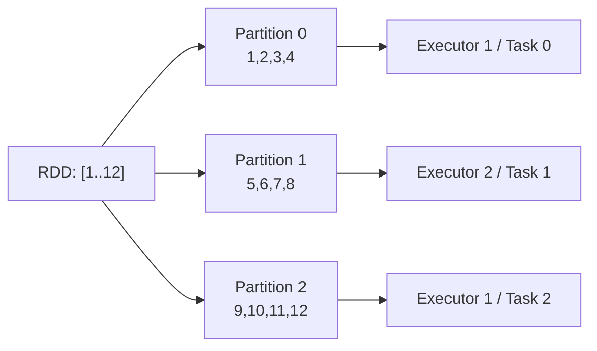
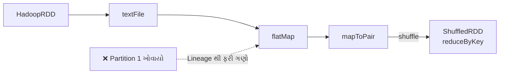
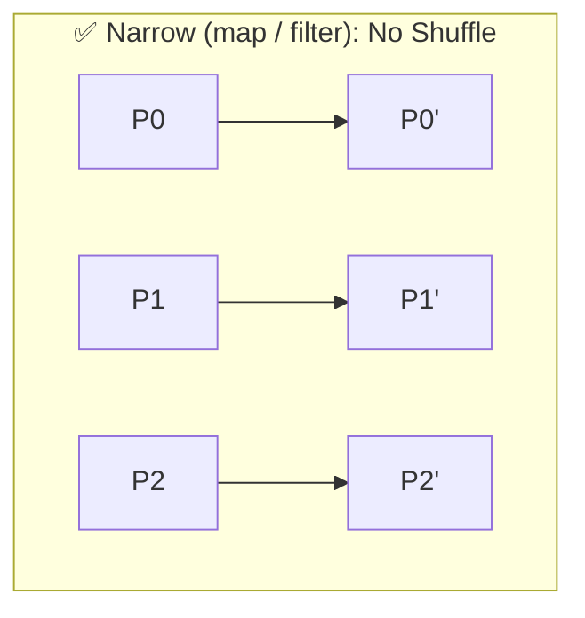
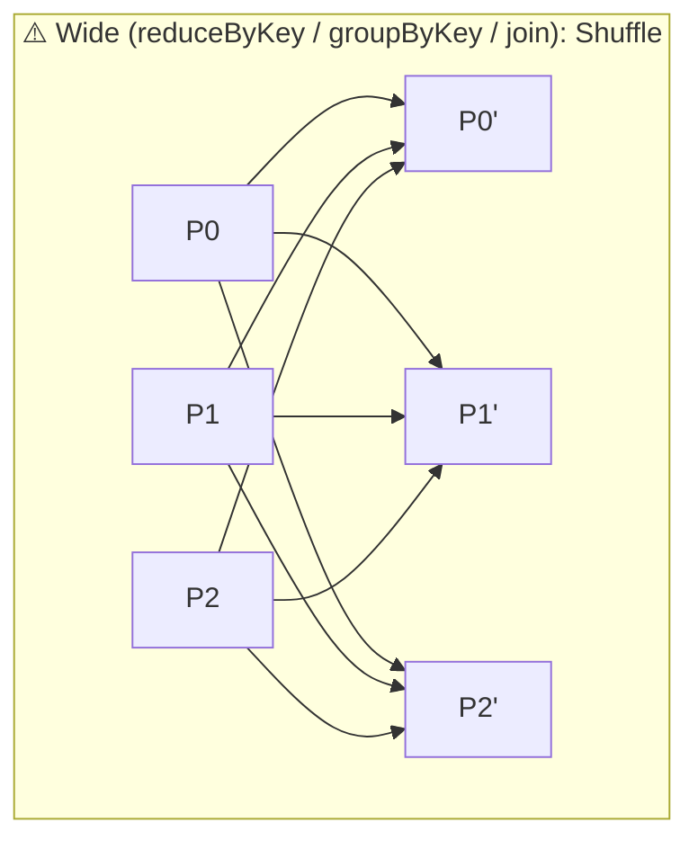
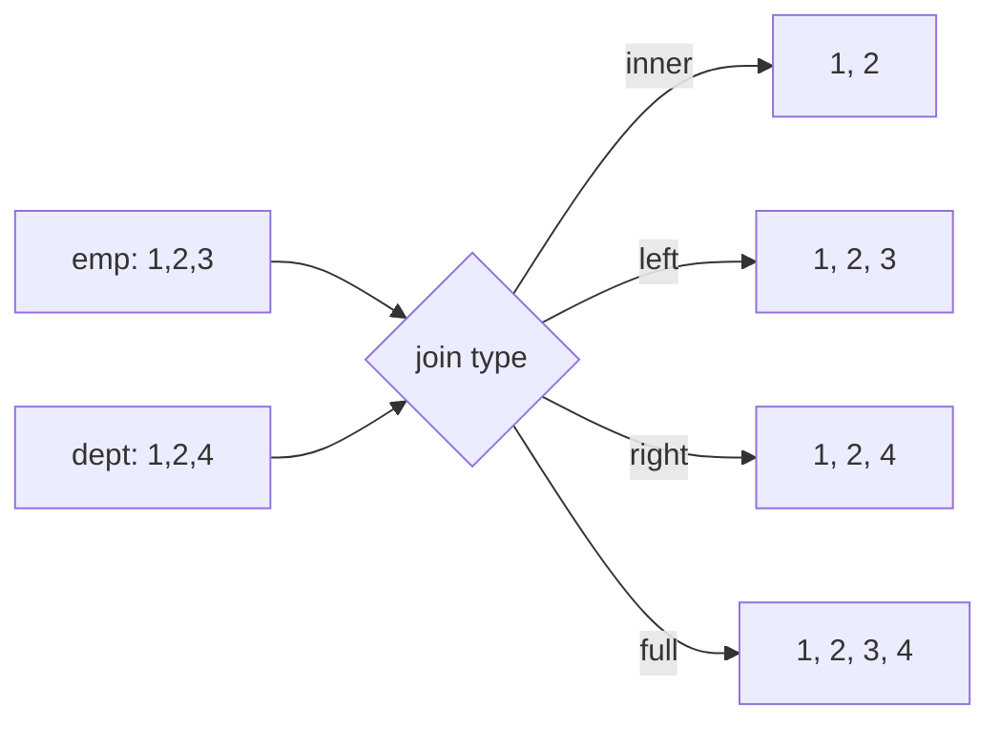
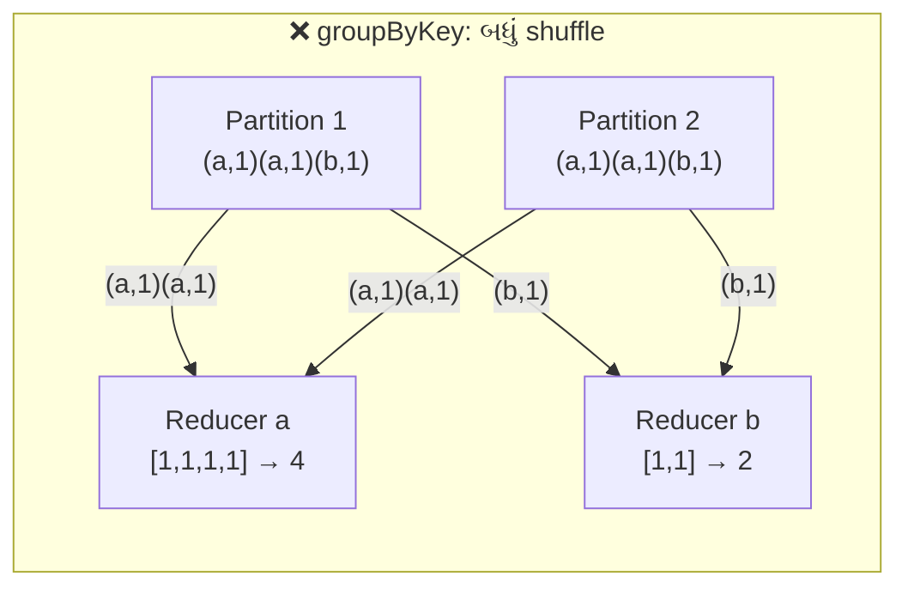
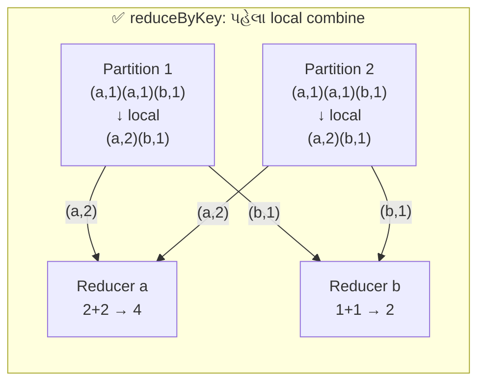
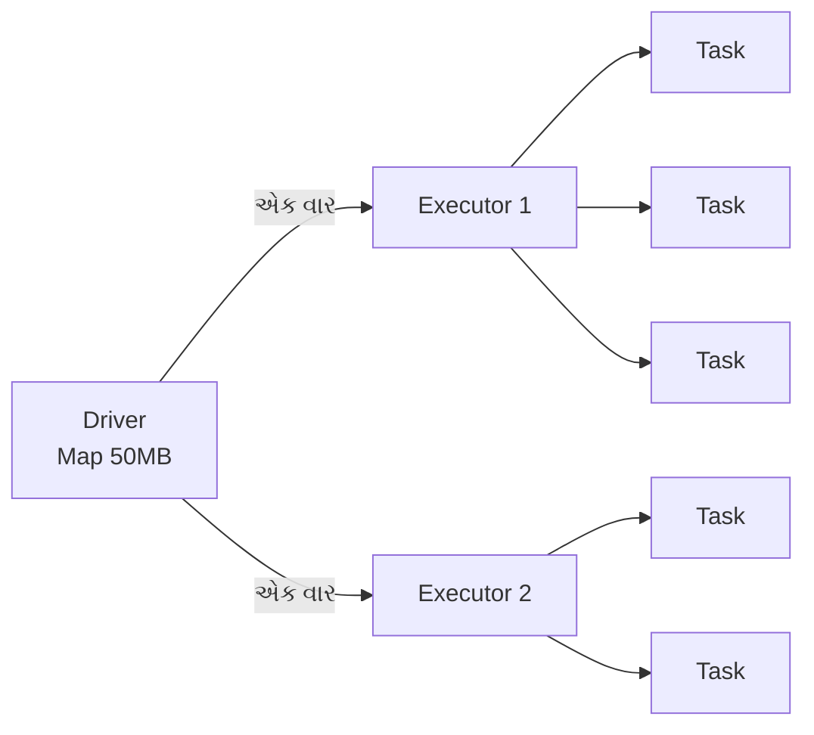

# Section 3: Spark RDD (Resilient Distributed Dataset)

> **આ section માં શું શીખીશું:** RDD, partitions, lineage, fault tolerance, lazy evaluation, narrow vs wide transformations, **બધા મહત્વના transformations અને actions** (Java syntax સાથે), Pair RDDs, persistence, broadcast variables અને accumulators.
>
> **Language:** બધા code examples **Java** માં છે.
>
> **Format:** દરેક method માટે **Definition → Syntax → Java Code → Input → Output**.

---

## 📑 Index

**Part A: Concepts**
1. [Setup (Java)](#1-setup-java)
2. [RDD શું છે?](#2-rdd-શું-છે)
3. [RDD બનાવવાની રીતો](#3-rdd-બનાવવાની-રીતો)
4. [Partitions](#4-partitions)
5. [Lazy Evaluation](#5-lazy-evaluation)
6. [Lineage અને Fault Tolerance](#6-lineage-અને-fault-tolerance)
7. [Narrow vs Wide Transformations](#7-narrow-vs-wide-transformations)

**Part B: Methods**

8. [Basic Transformations](#8-basic-transformations)
9. [Pair RDD Transformations](#9-pair-rdd-transformations)
10. [groupByKey vs reduceByKey](#10-groupbykey-vs-reducebykey)
11. [Actions](#11-actions)

**Part C: Advanced**

12. [Persistence (cache / persist / checkpoint)](#12-persistence-cache--persist--checkpoint)
13. [Broadcast Variables](#13-broadcast-variables)
14. [Accumulators](#14-accumulators)
15. [Java-specific Gotchas](#15-java-specific-gotchas)
16. [Mini Project: Log Analysis](#16-mini-project-log-analysis)
17. [Quick Revision](#17-quick-revision)

---

# Part A: Concepts

## 1. Setup (Java)

આ section ના બધા examples માં નીચેનો common setup માની લીધો છે:

```java
import org.apache.spark.api.java.JavaPairRDD;
import org.apache.spark.api.java.JavaRDD;
import org.apache.spark.api.java.JavaSparkContext;
import org.apache.spark.api.java.Optional;          // ⚠️ Spark નું Optional, java.util નું નહીં
import org.apache.spark.broadcast.Broadcast;
import org.apache.spark.sql.SparkSession;
import org.apache.spark.storage.StorageLevel;
import org.apache.spark.util.LongAccumulator;
import scala.Tuple2;

import java.io.Serializable;
import java.util.*;

public class RddExamples {
    public static void main(String[] args) {
        SparkSession spark = SparkSession.builder()
                .appName("RDD Examples")
                .master("local[*]")
                .getOrCreate();

        // RDD API માટે JavaSparkContext જોઈએ
        JavaSparkContext jsc = new JavaSparkContext(spark.sparkContext());
        jsc.setLogLevel("WARN");   // ઓછા logs

        // ... examples અહીં ...

        spark.stop();
    }
}
```

### 🧩 Java RDD API ના મુખ્ય classes

| Class | ઉપયોગ |
|-------|-------|
| `JavaSparkContext` | RDD બનાવવા માટેનો entry point |
| `JavaRDD<T>` | સામાન્ય RDD (એક type ના elements) |
| `JavaPairRDD<K, V>` | Key-value RDD (`Tuple2<K, V>` elements) |
| `JavaDoubleRDD` | Numbers માટે (`sum()`, `mean()`, `stats()`) |
| `scala.Tuple2<A, B>` | Pair: `t._1()` = key, `t._2()` = value |
| `org.apache.spark.api.java.function.*` | `Function`, `Function2`, `FlatMapFunction`, `PairFunction`, `VoidFunction`. બધા `Serializable` છે, એટલે Java lambdas સીધા વપરાય |

---

## 2. RDD શું છે?

### 📖 Definition
**RDD (Resilient Distributed Dataset)** એ Spark નું **મૂળભૂત data structure** છે. તે elements નો એક **immutable (બદલી ન શકાય તેવો)**, **distributed (ઘણા મશીનો પર વહેંચાયેલો)** collection છે, જેને parallel માં process કરી શકાય છે.

| શબ્દ | અર્થ |
|------|------|
| **Resilient** | Fault-tolerant. Partition ખોવાય તો **lineage** થી ફરી બને |
| **Distributed** | Data ઘણા nodes પર partitions માં વહેંચાયેલો |
| **Dataset** | Elements નો collection (Strings, Integers, Objects...) |

### 🧩 RDD ની 5 આંતરિક properties
દરેક RDD અંદરથી આ 5 વસ્તુઓથી ઓળખાય છે:
1. **Partitions ની યાદી:** data ના ટુકડા.
2. **Compute function:** દરેક partition કેવી રીતે ગણવો.
3. **Dependencies:** parent RDDs ની યાદી (lineage).
4. **Partitioner (optional):** key-value RDD માટે, કઈ key કયા partition માં જશે (દા.ત. HashPartitioner).
5. **Preferred locations (optional):** data ક્યાં પડ્યો છે (data locality માટે).

### ✨ RDD ની વિશેષતાઓ

| વિશેષતા | અર્થ |
|---------|------|
| **Immutable** | એક વાર બન્યા પછી બદલાય નહીં. દરેક transformation **નવું RDD** આપે |
| **Lazy** | Action આવે ત્યાં સુધી કંઈ compute ન થાય |
| **Partitioned** | Parallel processing નો આધાર |
| **Type-safe (Java/Scala)** | `JavaRDD<Integer>` માં compile-time type check |
| **In-memory (optional)** | `cache()` / `persist()` કરી શકાય |
| **Fault-tolerant** | Lineage દ્વારા |

### 🏠 Real-life Analogy
RDD = **એક મોટી ફોટો-આલ્બમ, જેના પાના અલગ-અલગ મિત્રોના ઘરે છે** (partitions). તમે કોઈ ફોટો **બદલતા નથી** (immutable); edit કરવો હોય તો **નવી copy** બનાવો છો. અને દરેક copy સાથે એક **નોંધ** રાખો છો કે "આ ફોટો મૂળ ફોટા પર ક્યા filters લગાવીને બન્યો" (lineage). કોઈ મિત્રનું પાનું ખોવાય, તો નોંધ પરથી ફરી બનાવી શકાય.

### 🤔 આજે RDD ક્યારે વાપરવું?
Modern Spark માં **DataFrame/Dataset API (Section 4) ભલામણપાત્ર** છે, કારણ કે તેમાં Catalyst optimizer મળે છે. RDD ત્યારે વાપરો જ્યારે:
- Unstructured data હોય (raw text, binary) અને schema ન હોય.
- Low-level control જોઈએ (partitions પર custom logic).
- જૂનો (legacy) code maintain કરવાનો હોય.

> **છતાં RDD શીખવું જરૂરી છે**, કારણ કે DataFrame પણ અંદરથી RDD પર જ ચાલે છે, અને partitions, shuffle, lineage જેવા ખ્યાલો અહીંથી જ સમજાય છે.

---

## 3. RDD બનાવવાની રીતો

### 3.1 `parallelize()`: Java collection માંથી

**Definition:** Driver ની memory માં રહેલા Java `List` ને distributed RDD માં ફેરવે છે. Testing અને નાના data માટે.

**Syntax:**
```java
<T> JavaRDD<T> parallelize(List<T> list)
<T> JavaRDD<T> parallelize(List<T> list, int numSlices)   // numSlices = partitions
```

```java
JavaRDD<Integer> nums = jsc.parallelize(Arrays.asList(1, 2, 3, 4, 5, 6), 3);
System.out.println(nums.getNumPartitions());   // 3
System.out.println(nums.collect());            // [1, 2, 3, 4, 5, 6]
```

**Pair RDD બનાવવું:**
```java
JavaPairRDD<String, Integer> pairs = jsc.parallelizePairs(Arrays.asList(
        new Tuple2<>("a", 1), new Tuple2<>("b", 2)));
```

### 3.2 `textFile()`: File માંથી

**Definition:** Text file(s) વાંચે છે. **દરેક line = એક element.** Local, HDFS, S3 બધા path ચાલે છે, અને wildcard (`*.log`) અથવા folder પણ આપી શકાય.

**Syntax:**
```java
JavaRDD<String> textFile(String path)
JavaRDD<String> textFile(String path, int minPartitions)
```

```java
JavaRDD<String> lines = jsc.textFile("data/input.txt");
JavaRDD<String> logs  = jsc.textFile("hdfs:///logs/2026/*.log", 10);
```

**Input (file):**
```
hello spark
hello java
```
**Output:** `["hello spark", "hello java"]`

### 3.3 `wholeTextFiles()`: આખી file = એક element

**Definition:** Folder ની દરેક file ને `(filePath, fileContent)` pair તરીકે વાંચે છે. **ઘણી નાની files** માટે ઉપયોગી.

```java
JavaPairRDD<String, String> files = jsc.wholeTextFiles("data/docs/");
// [("file:/data/docs/a.txt", "આખું content..."), ("file:/data/docs/b.txt", "...")]
```

### 3.4 બીજા RDD માંથી (transformation)
```java
JavaRDD<Integer> doubled = nums.map(x -> x * 2);   // નવું RDD
```

### 3.5 DataFrame / Dataset માંથી
```java
JavaRDD<Row> rowRdd = df.javaRDD();
```

### 3.6 ખાલી RDD
```java
JavaRDD<String> empty = jsc.emptyRDD();
```

---

## 4. Partitions

### 📖 Definition
**Partition** એ RDD નો એક **logical ટુકડો** છે, જે એક executor પર, **એક task** દ્વારા process થાય છે. Partitions = **parallelism નો એકમ**.

```
1 partition = 1 task = 1 core (એક સમયે)
```



### 🔢 Default partitions કેટલા?

| Source | Default |
|--------|---------|
| `parallelize()` | `spark.default.parallelism` (local માં = cores, cluster માં = કુલ executor cores) |
| `textFile()` | HDFS block દીઠ એક (128 MB), ઓછામાં ઓછા `minPartitions` |
| Shuffle પછી (`reduceByKey` વગેરે) | Parent RDD ના partitions જેટલા, અથવા `spark.default.parallelism` જો સેટ હોય |

### 💻 Partitions જોવા

```java
JavaRDD<Integer> rdd = jsc.parallelize(Arrays.asList(1,2,3,4,5,6,7,8,9,10,11,12), 3);

System.out.println(rdd.getNumPartitions());  // 3
System.out.println(rdd.glom().collect());    // [[1,2,3,4], [5,6,7,8], [9,10,11,12]]
```

### 📏 Thumb Rules
- Partitions ≈ **કુલ cores × 2 થી 4**.
- દરેક partition આશરે **100–200 MB**.
- **બહુ ઓછા:** cores ખાલી બેસે અને memory pressure વધે.
- **બહુ વધુ:** scheduling overhead વધે અને ઘણા નાના tasks બને.

### 🏠 Analogy
1000 લાડુ બનાવવાના છે. **Partitions** = લાડુના થાળ. 10 રસોઈયા (cores) હોય અને ફક્ત 2 થાળ (partitions) હોય, તો 8 રસોઈયા ખાલી બેસે. 10,000 થાળ હોય, તો થાળ ગોઠવવામાં જ સમય જાય.

---

## 5. Lazy Evaluation

### 📖 Definition
**Lazy Evaluation** એટલે Spark **transformations ને તરત ચલાવતું નથી**. તે ફક્ત "શું કરવાનું છે" તેનો plan (DAG) બનાવે છે. **Action** આવે ત્યારે જ આખો plan ચાલે છે.

### 💻 Code (સાબિતી)

```java
JavaRDD<Integer> nums = jsc.parallelize(Arrays.asList(1, 2, 3));

JavaRDD<Integer> mapped = nums.map(x -> {
    System.out.println("Processing: " + x);   // હજુ print નહીં થાય
    return x * 10;
});
System.out.println("Transformation define થયું");

long c = mapped.count();                       // ACTION → હવે print થશે
System.out.println("Count = " + c);
```

**Output (local mode):**
```
Transformation define થયું
Processing: 1
Processing: 2
Processing: 3
Count = 3
```

> **ધ્યાન:** Cluster mode માં `System.out.println` **executor ના logs** માં દેખાશે, Driver ના console માં નહીં.

### 💡 Lazy evaluation ના ફાયદા

| ફાયદો | સમજ |
|-------|------|
| **Optimization** | આખો plan જોઈને steps ભેગા કરી શકાય (pipelining: `map → filter` એક જ pass માં) |
| **બિનજરૂરી કામ ટાળવું** | `take(5)` હોય તો ફક્ત જરૂરી partitions જ વંચાય |
| **Fault tolerance** | Plan (lineage) હોવાથી ખોવાયેલો data ફરી બનાવી શકાય |
| **Memory બચત** | Intermediate RDDs memory માં ભરાતા નથી |

### ⚠️ Gotcha
દરેક action **આખો DAG શરૂઆતથી ફરી ચલાવે છે** (સિવાય કે `cache()` કર્યું હોય):
```java
JavaRDD<String> cleaned = jsc.textFile("big.log").filter(l -> !l.isEmpty());
cleaned.count();   // file વાંચશે
cleaned.first();   // file ફરી વાંચશે! → cache() વાપરો (Section 12)
```

### 🏠 Analogy
Online shopping cart: તમે વસ્તુઓ **cart માં ઉમેરો** (transformations), પણ પૈસા અને delivery **"Place Order"** (action) દબાવો ત્યારે જ થાય. અને order વખતે site નક્કી કરે કે કઈ વસ્તુ કયા warehouse માંથી સાથે મોકલવી (optimization).

---

## 6. Lineage અને Fault Tolerance

### 📖 Definition
**Lineage** એટલે RDD **કેવી રીતે બન્યું** તેનો ઇતિહાસ, એટલે parent RDDs અને લાગેલા transformations ની સાંકળ. તેને **RDD dependency graph** પણ કહેવાય છે.

**Fault Tolerance:** કોઈ executor મરી જાય અને partition ખોવાય, તો Spark lineage જોઈને **ફક્ત એ ખોવાયેલો partition** ફરી compute કરે છે. આખો data replicate કરવાની જરૂર નથી.

### 💻 Lineage જોવો: `toDebugString()`

```java
JavaRDD<String> lines = jsc.textFile("data/input.txt");
JavaPairRDD<String, Integer> counts = lines
        .flatMap(l -> Arrays.asList(l.split(" ")).iterator())
        .mapToPair(w -> new Tuple2<>(w, 1))
        .reduceByKey(Integer::sum);

System.out.println(counts.toDebugString());
```

**Output (આશરે):**
```
(2) ShuffledRDD[4] at reduceByKey
 +-(2) MapPartitionsRDD[3] at mapToPair
    |  MapPartitionsRDD[2] at flatMap
    |  data/input.txt MapPartitionsRDD[1] at textFile
    |  data/input.txt HadoopRDD[0] at textFile
```
- `(2)` = partitions ની સંખ્યા
- `+-` = **shuffle boundary** (નવો stage)



### 🛡️ Fault Tolerance કેવી રીતે કામ કરે

| પરિસ્થિતિ | Spark શું કરે |
|-----------|---------------|
| Task fail થાય | Task Scheduler એ task ફરી ચલાવે (default 4 વાર) |
| Executor મરી જાય (narrow ops) | ખોવાયેલા partitions lineage થી બીજા executor પર ફરી ગણે |
| Shuffle output ખોવાય | DAG Scheduler આગળનો stage (અથવા તેનો ભાગ) ફરી ચલાવે |
| Lineage બહુ લાંબો (iterative jobs) | **Checkpoint** થી lineage કાપો (Section 12) |

### 🏠 Analogy
**રસોઈની recipe:** દાળ ઢોળાઈ જાય, તો તમે આખું ઘર ફરી નથી બનાવતા. Recipe (lineage) જોઈને **ફક્ત દાળ** ફરી બનાવો છો.

### 💡 Why it matters
- Replication ની સરખામણીમાં **ઓછી memory/disk** વપરાય.
- **Interview:** "RDD fault-tolerant કેવી રીતે છે?" જવાબ: **Lineage + Immutability + Recomputation**.

---

## 7. Narrow vs Wide Transformations

### 📖 Definition
- **Narrow Transformation:** દરેક **output partition** ફક્ત **એક (અથવા નિશ્ચિત થોડા) input partition** પર આધાર રાખે. **Shuffle નથી**. એક જ stage માં pipeline થાય છે.
- **Wide Transformation:** એક output partition ને **ઘણા input partitions** ના data ની જરૂર પડે. **Shuffle થાય** (network પર data ફરી વહેંચાય). **નવો stage** શરૂ થાય.

### 📊 Diagram





### 📋 કયું operation કયા પ્રકારનું?

| Narrow (No Shuffle) ✅ | Wide (Shuffle) ⚠️ |
|------------------------|-------------------|
| `map`, `flatMap`, `filter` | `reduceByKey`, `groupByKey` |
| `mapPartitions`, `mapPartitionsWithIndex` | `aggregateByKey`, `foldByKey`, `combineByKey` |
| `mapToPair`, `mapValues`, `flatMapValues` | `distinct` |
| `union` | `intersection`, `subtract`, `subtractByKey` |
| `sample` | `sortBy`, `sortByKey` |
| `coalesce` (ઘટાડવા માટે, shuffle=false) | `repartition`, `partitionBy` |
| `zip`, `glom`, `keyBy` | `join`, `cogroup`, `groupBy` |
| `join` (જો બંને RDD એક જ partitioner થી પહેલેથી partitioned હોય) | `cartesian` |

### 📊 Comparison

| મુદ્દો | Narrow | Wide |
|-------|--------|------|
| Data movement | નથી (એ જ executor) | Network પર (shuffle) |
| Stage | એ જ stage | નવો stage |
| Speed | ઝડપી | ધીમું (disk + network I/O) |
| Failure recovery | ફક્ત એક parent partition ફરી ગણવો | ઘણા parent partitions ની જરૂર પડી શકે |
| Example | `map`, `filter` | `reduceByKey`, `join` |

### 🏠 Analogy
- **Narrow** = દરેક વિદ્યાર્થી **પોતાની નોટબુકમાં** જવાબ સુધારે. કોઈને કંઈ આપવાની જરૂર નથી.
- **Wide** = આખા વર્ગની નોટબુકો **વિષય પ્રમાણે ફરીથી ગોઠવવી**. બધાએ ઊભા થઈને બીજાને નોટ આપવી પડે, જેમાં સમય લાગે.

> **Golden Rule:** **Shuffle ઓછું = Job ઝડપી.** Wide transformations ઓછા વાપરો, અને વાપરો તો પહેલા data ઘટાડો (`filter` પહેલા, `join` પછી).

---

# Part B: Methods

> **Format:** દરેક method માટે 🏷️ Type (Narrow/Wide) → 📖 Definition → 🧾 Syntax → 💻 Java Code → ➡️ Input → Output
>
> **નોંધ:** Shuffle પછીના output નો **ક્રમ (order) બદલાઈ શકે** છે; examples માં સમજવા માટે ક્રમસર બતાવ્યો છે.

---

## 8. Basic Transformations

### 8.1 `map()`
🏷️ **Narrow**

📖 **Definition:** દરેક element પર function લગાવે અને **બરાબર એક** output element આપે (1 → 1).

🧾 **Syntax:** `<R> JavaRDD<R> map(Function<T, R> f)`

```java
JavaRDD<Integer> nums = jsc.parallelize(Arrays.asList(1, 2, 3, 4));
JavaRDD<Integer> squares = nums.map(x -> x * x);
System.out.println(squares.collect());
```
➡️ `[1, 2, 3, 4]` → `[1, 4, 9, 16]`

**Type બદલવો (String → Integer):**
```java
JavaRDD<Integer> lengths = jsc.parallelize(Arrays.asList("spark", "java"))
                              .map(String::length);
```
➡️ `["spark", "java"]` → `[5, 4]`

---

### 8.2 `flatMap()`
🏷️ **Narrow**

📖 **Definition:** દરેક element પરથી **0, 1 કે વધુ** elements બનાવે, અને બધાને એક જ સપાટ (flat) RDD માં મૂકે (1 → N). Java માં function એ **`Iterator`** પાછો આપવો પડે.

🧾 **Syntax:** `<U> JavaRDD<U> flatMap(FlatMapFunction<T, U> f)` જ્યાં function `Iterator<U>` return કરે

```java
JavaRDD<String> lines = jsc.parallelize(Arrays.asList("hello spark", "hello java"));
JavaRDD<String> words = lines.flatMap(line -> Arrays.asList(line.split(" ")).iterator());
System.out.println(words.collect());
```
➡️ `["hello spark", "hello java"]` → `["hello", "spark", "hello", "java"]`

**map vs flatMap:**
```java
lines.map(l -> Arrays.asList(l.split(" "))).collect();
// [[hello, spark], [hello, java]]   ← List ની List

lines.flatMap(l -> Arrays.asList(l.split(" ")).iterator()).collect();
// [hello, spark, hello, java]       ← સપાટ
```

---

### 8.3 `filter()`
🏷️ **Narrow**

📖 **Definition:** ફક્ત એવા elements રાખે જેના માટે condition **`true`** હોય.

🧾 **Syntax:** `JavaRDD<T> filter(Function<T, Boolean> f)`

```java
JavaRDD<Integer> evens = jsc.parallelize(Arrays.asList(1, 2, 3, 4, 5, 6))
                            .filter(x -> x % 2 == 0);
```
➡️ `[1, 2, 3, 4, 5, 6]` → `[2, 4, 6]`

```java
JavaRDD<String> errors = jsc.textFile("app.log").filter(l -> l.contains("ERROR"));
```

---

### 8.4 `mapPartitions()`
🏷️ **Narrow**

📖 **Definition:** Function ને **દરેક element** પર નહીં, પણ **દરેક partition પર એક વાર** ચલાવે. Input = partition નો `Iterator`. **મોંઘા setup** (DB connection, parser object) માટે ઉત્તમ, કારણ કે setup partition દીઠ એક જ વાર થાય છે.

🧾 **Syntax:** `<U> JavaRDD<U> mapPartitions(FlatMapFunction<Iterator<T>, U> f)`

```java
JavaRDD<Integer> nums = jsc.parallelize(Arrays.asList(1, 2, 3, 4, 5, 6), 2);

JavaRDD<Integer> partitionSums = nums.mapPartitions(iter -> {
    int sum = 0;
    while (iter.hasNext()) sum += iter.next();
    return Collections.singletonList(sum).iterator();
});
System.out.println(partitionSums.collect());
```
➡️ Partitions `[1,2,3] [4,5,6]` → `[6, 15]`

**Real-world pattern (connection દીઠ partition):**
```java
JavaRDD<String> enriched = ids.mapPartitions(iter -> {
    MyDbClient client = new MyDbClient();          // ✅ partition દીઠ એક વાર
    List<String> out = new ArrayList<>();
    while (iter.hasNext()) out.add(client.lookup(iter.next()));
    client.close();
    return out.iterator();
});
```

| `map` | `mapPartitions` |
|-------|-----------------|
| Function element દીઠ ચાલે | Function partition દીઠ ચાલે |
| 1M elements = 1M function calls | 10 partitions = 10 function calls |
| Setup cost વારંવાર | Setup cost એક વાર ✅ |

> ⚠️ આખો partition `List` માં ભેગો કરવાથી મોટા partitions પર OOM આવી શકે. મોટા data માટે lazy iterator પાછો આપો.

---

### 8.5 `mapPartitionsWithIndex()`
🏷️ **Narrow**

📖 **Definition:** `mapPartitions` જેવું જ, પણ સાથે **partition નો index** પણ મળે. Debugging અને partition-specific logic માટે.

🧾 **Syntax:** `<R> JavaRDD<R> mapPartitionsWithIndex(Function2<Integer, Iterator<T>, Iterator<R>> f, boolean preservesPartitioning)`

```java
JavaRDD<String> tagged = jsc.parallelize(Arrays.asList("a", "b", "c", "d"), 2)
    .mapPartitionsWithIndex((idx, iter) -> {
        List<String> out = new ArrayList<>();
        while (iter.hasNext()) out.add("P" + idx + ":" + iter.next());
        return out.iterator();
    }, false);
```
➡️ `["a","b","c","d"]` → `["P0:a", "P0:b", "P1:c", "P1:d"]`

---

### 8.6 `distinct()`
🏷️ **Wide**

📖 **Definition:** Duplicate elements દૂર કરે. અંદરથી shuffle થાય છે.

🧾 **Syntax:** `JavaRDD<T> distinct()` / `distinct(int numPartitions)`

```java
JavaRDD<Integer> unique = jsc.parallelize(Arrays.asList(1, 2, 2, 3, 3, 3)).distinct();
```
➡️ `[1, 2, 2, 3, 3, 3]` → `[1, 2, 3]`

---

### 8.7 `union()`
🏷️ **Narrow**

📖 **Definition:** બે RDDs ને **જોડે** (append). **Duplicates દૂર થતા નથી.** Output partitions = બંનેના partitions નો સરવાળો.

🧾 **Syntax:** `JavaRDD<T> union(JavaRDD<T> other)`

```java
JavaRDD<Integer> a = jsc.parallelize(Arrays.asList(1, 2, 3));
JavaRDD<Integer> b = jsc.parallelize(Arrays.asList(3, 4));
System.out.println(a.union(b).collect());
```
➡️ `[1,2,3]` + `[3,4]` → `[1, 2, 3, 3, 4]`

---

### 8.8 `intersection()`
🏷️ **Wide**

📖 **Definition:** બંને RDDs માં **સામાન્ય** elements આપે (duplicates વગર).

🧾 **Syntax:** `JavaRDD<T> intersection(JavaRDD<T> other)`

```java
a.intersection(b).collect();
```
➡️ `[1,2,3]` ∩ `[3,4]` → `[3]`

---

### 8.9 `subtract()`
🏷️ **Wide**

📖 **Definition:** પહેલા RDD ના એવા elements જે બીજામાં **નથી**.

🧾 **Syntax:** `JavaRDD<T> subtract(JavaRDD<T> other)`

```java
a.subtract(b).collect();
```
➡️ `[1,2,3]` − `[3,4]` → `[1, 2]`

---

### 8.10 `cartesian()`
🏷️ **Wide** (⚠️ ખૂબ મોંઘું)

📖 **Definition:** બંને RDDs ના **દરેક જોડાણ (pair)** આપે. Output size = m × n.

🧾 **Syntax:** `<U> JavaPairRDD<T, U> cartesian(JavaRDDLike<U, ?> other)`

```java
JavaRDD<String> colors = jsc.parallelize(Arrays.asList("Red", "Blue"));
JavaRDD<String> sizes  = jsc.parallelize(Arrays.asList("S", "M"));
colors.cartesian(sizes).collect();
```
➡️ `[(Red,S), (Red,M), (Blue,S), (Blue,M)]`

> ⚠️ 1 લાખ × 1 લાખ = 10 અબજ rows. મોટા data પર ટાળો.

---

### 8.11 `sample()`
🏷️ **Narrow**

📖 **Definition:** RDD નો **random નમૂનો** લે. Testing અને data exploration માટે.

🧾 **Syntax:** `JavaRDD<T> sample(boolean withReplacement, double fraction, long seed)`

```java
JavaRDD<Integer> nums = jsc.parallelize(Arrays.asList(1,2,3,4,5,6,7,8,9,10));
JavaRDD<Integer> s = nums.sample(false, 0.3, 42L);
```
➡️ `[1..10]` → આશરે 30%, દા.ત. `[2, 7, 9]`

> `fraction` **ચોક્કસ** count નથી આપતું; અંદાજિત છે. ચોક્કસ સંખ્યા જોઈએ તો action `takeSample()` વાપરો.

---

### 8.12 `randomSplit()`
🏷️ **Narrow**

📖 **Definition:** RDD ને આપેલા વજન પ્રમાણે **ઘણા RDDs માં વહેંચે**. ML માં train/test split માટે.

🧾 **Syntax:** `JavaRDD<T>[] randomSplit(double[] weights, long seed)`

```java
JavaRDD<Integer>[] splits = nums.randomSplit(new double[]{0.8, 0.2}, 42L);
JavaRDD<Integer> train = splits[0];   // ~80%
JavaRDD<Integer> test  = splits[1];   // ~20%
```

---

### 8.13 `sortBy()`
🏷️ **Wide**

📖 **Definition:** આપેલા key function પ્રમાણે elements ને **sort** કરે.

🧾 **Syntax:** `<S> JavaRDD<T> sortBy(Function<T, S> f, boolean ascending, int numPartitions)`

```java
JavaRDD<String> words = jsc.parallelize(Arrays.asList("banana", "kiwi", "apple"));
words.sortBy(w -> w.length(), true, 1).collect();
```
➡️ `["banana","kiwi","apple"]` → `["kiwi", "apple", "banana"]`

---

### 8.14 `groupBy()`
🏷️ **Wide**

📖 **Definition:** Function ના પરિણામને **key** બનાવીને elements ને group કરે. Output = `JavaPairRDD<Key, Iterable<T>>`.

🧾 **Syntax:** `<U> JavaPairRDD<U, Iterable<T>> groupBy(Function<T, U> f)`

```java
JavaPairRDD<String, Iterable<Integer>> grouped =
    jsc.parallelize(Arrays.asList(1, 2, 3, 4, 5, 6))
       .groupBy(x -> x % 2 == 0 ? "even" : "odd");
```
➡️ `[1..6]` → `[("odd", [1,3,5]), ("even", [2,4,6])]`

> ⚠️ `groupByKey` જેવી જ સમસ્યા: બધો data shuffle થાય છે. Aggregation કરવું હોય તો `reduceByKey` વાપરો.

---

### 8.15 `keyBy()`
🏷️ **Narrow**

📖 **Definition:** દરેક element માંથી **key બનાવીને** `(key, element)` pair બનાવે.

🧾 **Syntax:** `<U> JavaPairRDD<U, T> keyBy(Function<T, U> f)`

```java
jsc.parallelize(Arrays.asList("apple", "banana")).keyBy(s -> s.charAt(0)).collect();
```
➡️ `["apple","banana"]` → `[('a', "apple"), ('b', "banana")]`

---

### 8.16 `zip()` અને `zipWithIndex()`
🏷️ **Narrow**

📖 **Definition:**
- `zip`: બે RDDs ના elements ને **ક્રમ પ્રમાણે જોડી** બનાવે. ⚠️ બંનેમાં **partitions સરખા** અને **દરેક partition માં elements સરખા** હોવા જરૂરી.
- `zipWithIndex`: દરેક element ને તેનો **index (0, 1, 2...)** આપે.

🧾 **Syntax:**
```java
<U> JavaPairRDD<T, U> zip(JavaRDDLike<U, ?> other)
JavaPairRDD<T, Long> zipWithIndex()
```

```java
JavaRDD<String> names = jsc.parallelize(Arrays.asList("Amit", "Riya"), 1);
JavaRDD<Integer> ages = jsc.parallelize(Arrays.asList(25, 30), 1);
names.zip(ages).collect();          // [(Amit,25), (Riya,30)]
names.zipWithIndex().collect();     // [(Amit,0), (Riya,1)]
```

---

### 8.17 `glom()`
🏷️ **Narrow**

📖 **Definition:** દરેક partition ને **એક `List`** માં ફેરવે. Partitioning debug કરવા માટે ઉત્તમ.

🧾 **Syntax:** `JavaRDD<List<T>> glom()`

```java
jsc.parallelize(Arrays.asList(1, 2, 3, 4, 5), 2).glom().collect();
```
➡️ `[[1, 2], [3, 4, 5]]`

---

### 8.18 `repartition()`
🏷️ **Wide** (હંમેશા full shuffle)

📖 **Definition:** Partitions ની સંખ્યા **વધારે કે ઘટાડે**, અને data ને **સરખી રીતે ફરી વહેંચે**.

🧾 **Syntax:** `JavaRDD<T> repartition(int numPartitions)`

```java
JavaRDD<Integer> rdd = jsc.parallelize(Arrays.asList(1,2,3,4,5,6), 2);
JavaRDD<Integer> more = rdd.repartition(4);
System.out.println(more.getNumPartitions());   // 4
```

---

### 8.19 `coalesce()`
🏷️ **Narrow** (default, shuffle વગર)

📖 **Definition:** Partitions **ઘટાડે**, અને **shuffle ટાળીને** નજીકના partitions ને ભેગા કરે. `repartition` કરતાં સસ્તું, પણ data અસમાન રીતે વહેંચાઈ શકે.

🧾 **Syntax:** `JavaRDD<T> coalesce(int numPartitions)` / `coalesce(int n, boolean shuffle)`

```java
JavaRDD<Integer> fewer = jsc.parallelize(Arrays.asList(1,2,3,4,5,6), 6).coalesce(2);
fewer.glom().collect();   // [[1,2,3], [4,5,6]]
```

| `repartition(n)` | `coalesce(n)` |
|------------------|---------------|
| વધારો અને ઘટાડો બંને | સામાન્ય રીતે ફક્ત ઘટાડો |
| હંમેશા full shuffle | Shuffle નહીં (default) |
| Data સરખો વહેંચાય | અસમાન હોઈ શકે |
| ધીમું | ઝડપી |
| `= coalesce(n, true)` | |
| ક્યારે: skew દૂર કરવા, parallelism વધારવા | ક્યારે: output પહેલા files ઓછી કરવા |

---

## 9. Pair RDD Transformations

### 📖 Pair RDD શું છે?
**Pair RDD** = એવું RDD જેના દરેક element **(key, value)** pair હોય. Java માં `JavaPairRDD<K, V>`, અને દરેક element `Tuple2<K, V>` છે.
Aggregations, joins, grouping, બધું key પર થાય છે, એટલે Pair RDDs સૌથી વધુ વપરાય છે.

### 9.1 `mapToPair()`: Pair RDD બનાવવું
🏷️ **Narrow**

📖 **Definition:** દરેક element ને `Tuple2<K, V>` માં ફેરવીને Pair RDD બનાવે.

🧾 **Syntax:** `<K, V> JavaPairRDD<K, V> mapToPair(PairFunction<T, K, V> f)`

```java
JavaRDD<String> words = jsc.parallelize(Arrays.asList("spark", "java", "spark"));
JavaPairRDD<String, Integer> pairs = words.mapToPair(w -> new Tuple2<>(w, 1));
```
➡️ `["spark","java","spark"]` → `[(spark,1), (java,1), (spark,1)]`

---

### 9.2 `flatMapToPair()`
🏷️ **Narrow**

📖 **Definition:** એક element માંથી **ઘણા pairs** બનાવે.

🧾 **Syntax:** `<K, V> JavaPairRDD<K, V> flatMapToPair(PairFlatMapFunction<T, K, V> f)`

```java
JavaPairRDD<String, Integer> wordPairs = jsc.parallelize(Arrays.asList("a b", "b c"))
    .flatMapToPair(line -> {
        List<Tuple2<String, Integer>> out = new ArrayList<>();
        for (String w : line.split(" ")) out.add(new Tuple2<>(w, 1));
        return out.iterator();
    });
```
➡️ `["a b","b c"]` → `[(a,1), (b,1), (b,1), (c,1)]`

---

### 9.3 `reduceByKey()` ⭐
🏷️ **Wide**

📖 **Definition:** એક જ key ની બધી values ને આપેલા function થી **ભેગી (reduce)** કરે. Shuffle **પહેલા** દરેક partition માં **local combine (map-side combine)** થાય છે, એટલે ખૂબ efficient છે. Function **associative અને commutative** હોવું જોઈએ (જેમ કે sum, max).

🧾 **Syntax:** `JavaPairRDD<K, V> reduceByKey(Function2<V, V, V> f)` / `reduceByKey(f, int numPartitions)`

```java
JavaPairRDD<String, Integer> pairs = jsc.parallelizePairs(Arrays.asList(
    new Tuple2<>("a", 1), new Tuple2<>("b", 1), new Tuple2<>("a", 1), new Tuple2<>("a", 1)));

JavaPairRDD<String, Integer> counts = pairs.reduceByKey(Integer::sum);
```
➡️ `[(a,1),(b,1),(a,1),(a,1)]` → `[(a,3), (b,1)]`

**Max per key:**
```java
sales.reduceByKey(Math::max);   // [(shop1,500), (shop2,300)]
```

---

### 9.4 `groupByKey()`
🏷️ **Wide**

📖 **Definition:** એક જ key ની **બધી values ને `Iterable`** માં ભેગી કરે. **Map-side combine થતું નથી**, એટલે **બધો data shuffle થાય**.

🧾 **Syntax:** `JavaPairRDD<K, Iterable<V>> groupByKey()`

```java
JavaPairRDD<String, Iterable<Integer>> grouped = pairs.groupByKey();
```
➡️ `[(a,1),(b,1),(a,1),(a,1)]` → `[(a,[1,1,1]), (b,[1])]`

> ✅ જ્યારે ખરેખર **બધી values** જોઈએ (દા.ત. median, બધી values ની list) ત્યારે જ વાપરો. Sum/count/max માટે `reduceByKey` વાપરો. (વિગત: [Section 10](#10-groupbykey-vs-reducebykey))

---

### 9.5 `aggregateByKey()`
🏷️ **Wide**

📖 **Definition:** `reduceByKey` નું વધુ શક્તિશાળી રૂપ. **Output type, input value type થી અલગ** હોઈ શકે. તેમાં 3 વસ્તુ જોઈએ:
1. **zeroValue:** શરૂઆતની કિંમત
2. **seqFunc:** partition ની **અંદર** value ઉમેરવાનું function
3. **combFunc:** **partitions વચ્ચે** results ભેગા કરવાનું function

🧾 **Syntax:** `<U> JavaPairRDD<K, U> aggregateByKey(U zeroValue, Function2<U, V, U> seqFunc, Function2<U, U, U> combFunc)`

**Example: દરેક key ની Average (sum, count)**
```java
JavaPairRDD<String, Integer> marks = jsc.parallelizePairs(Arrays.asList(
    new Tuple2<>("math", 80), new Tuple2<>("math", 90), new Tuple2<>("sci", 70)));

JavaPairRDD<String, Tuple2<Integer, Integer>> sumCount = marks.aggregateByKey(
    new Tuple2<>(0, 0),                                              // zero: (sum, count)
    (acc, v) -> new Tuple2<>(acc._1() + v, acc._2() + 1),            // seqFunc
    (a, b) -> new Tuple2<>(a._1() + b._1(), a._2() + b._2())         // combFunc
);

JavaPairRDD<String, Double> avg = sumCount.mapValues(t -> (double) t._1() / t._2());
```
➡️ `[(math,80),(math,90),(sci,70)]` → `[(math,85.0), (sci,70.0)]`

---

### 9.6 `foldByKey()`
🏷️ **Wide**

📖 **Definition:** `reduceByKey` જેવું જ, પણ **zeroValue** સાથે. Output type = input type.

🧾 **Syntax:** `JavaPairRDD<K, V> foldByKey(V zeroValue, Function2<V, V, V> func)`

```java
pairs.foldByKey(0, Integer::sum).collect();
```
➡️ `[(a,1),(b,1),(a,1),(a,1)]` → `[(a,3), (b,1)]`

> ⚠️ zeroValue **દરેક partition માં** key દીઠ એક વાર લાગે છે, એટલે તે "neutral" હોવું જોઈએ (sum માટે 0, product માટે 1).

---

### 9.7 `combineByKey()`
🏷️ **Wide**

📖 **Definition:** બધા by-key aggregations નો **મૂળ (most generic)** method. `reduceByKey` અને `aggregateByKey` અંદરથી આના પર જ બનેલા છે. 3 functions:
1. **createCombiner:** key ની **પહેલી value** જોઈને combiner બનાવે
2. **mergeValue:** partition માં નવી value combiner માં ઉમેરે
3. **mergeCombiners:** partitions ના combiners ભેગા કરે

🧾 **Syntax:** `<C> JavaPairRDD<K, C> combineByKey(Function<V, C> createCombiner, Function2<C, V, C> mergeValue, Function2<C, C, C> mergeCombiners)`

```java
JavaPairRDD<String, Tuple2<Integer, Integer>> sc = marks.combineByKey(
    v -> new Tuple2<>(v, 1),                                         // createCombiner
    (c, v) -> new Tuple2<>(c._1() + v, c._2() + 1),                  // mergeValue
    (c1, c2) -> new Tuple2<>(c1._1() + c2._1(), c1._2() + c2._2())   // mergeCombiners
);
```
➡️ `[(math,80),(math,90),(sci,70)]` → `[(math,(170,2)), (sci,(70,1))]`

### 📊 By-Key Aggregations ની સરખામણી

| Method | Zero value? | Output type અલગ? | ક્યારે |
|--------|-------------|-------------------|--------|
| `reduceByKey` | ના | ના | Sum, count, max, min |
| `foldByKey` | હા | ના | Reduce + શરૂઆતની કિંમત |
| `aggregateByKey` | હા | **હા** | Average, (sum,count), set બનાવવો |
| `combineByKey` | ના (function થી) | **હા** | સૌથી વધુ control |
| `groupByKey` | ના | `Iterable<V>` | બધી values જોઈએ ત્યારે જ |

---

### 9.8 `mapValues()`
🏷️ **Narrow** (partitioner સાચવે છે ✅)

📖 **Definition:** **ફક્ત value** પર function લગાવે, key એ જ રહે. `mapToPair` કરતાં સારું, કારણ કે **partitioner સચવાય છે**, એટલે પછીના join/reduce માં shuffle ટળી શકે.

🧾 **Syntax:** `<U> JavaPairRDD<K, U> mapValues(Function<V, U> f)`

```java
JavaPairRDD<String, Integer> prices = jsc.parallelizePairs(Arrays.asList(
    new Tuple2<>("pen", 10), new Tuple2<>("book", 100)));
prices.mapValues(p -> p * 1.18).collect();      // GST ઉમેરો
```
➡️ `[(pen,10),(book,100)]` → `[(pen,11.8), (book,118.0)]`

---

### 9.9 `flatMapValues()`
🏷️ **Narrow**

📖 **Definition:** દરેક value માંથી **ઘણી values** બનાવે, અને key દરેક સાથે એ જ રહે.

🧾 **Syntax:** `<U> JavaPairRDD<K, U> flatMapValues(FlatMapFunction<V, U> f)` (Spark 3+)

```java
JavaPairRDD<String, String> tags = jsc.parallelizePairs(Arrays.asList(
    new Tuple2<>("post1", "java,spark")));
tags.flatMapValues(v -> Arrays.asList(v.split(",")).iterator()).collect();
```
➡️ `[(post1,"java,spark")]` → `[(post1,java), (post1,spark)]`

---

### 9.10 `keys()` અને `values()`
🏷️ **Narrow**

📖 **Definition:** ફક્ત keys અથવા ફક્ત values નું RDD આપે.

```java
JavaRDD<String> k = prices.keys();      // [pen, book]
JavaRDD<Integer> v = prices.values();   // [10, 100]
```

---

### 9.11 `sortByKey()`
🏷️ **Wide**

📖 **Definition:** Key પ્રમાણે sort કરે.

🧾 **Syntax:** `JavaPairRDD<K, V> sortByKey(boolean ascending)` / `sortByKey(Comparator<K> comp, boolean ascending)`

```java
jsc.parallelizePairs(Arrays.asList(new Tuple2<>(3, "c"), new Tuple2<>(1, "a"), new Tuple2<>(2, "b")))
   .sortByKey(true).collect();
```
➡️ `[(3,c),(1,a),(2,b)]` → `[(1,a), (2,b), (3,c)]`

**Value પ્રમાણે sort (trick):** key-value ઉલટાવો, sort કરો, ફરી ઉલટાવો:
```java
counts.mapToPair(Tuple2::swap).sortByKey(false).mapToPair(Tuple2::swap);
```

---

### 9.12 Joins: `join()`, `leftOuterJoin()`, `rightOuterJoin()`, `fullOuterJoin()`
🏷️ **Wide** (જો બંને પહેલેથી એક જ partitioner થી partitioned હોય તો Narrow)

📖 **Definition:** બે Pair RDDs ને **key પર જોડે**. Outer joins માં ખૂટતી બાજુ **`org.apache.spark.api.java.Optional`** તરીકે આવે છે.

**Sample data:**
```java
JavaPairRDD<Integer, String> emp = jsc.parallelizePairs(Arrays.asList(
    new Tuple2<>(1, "Amit"), new Tuple2<>(2, "Riya"), new Tuple2<>(3, "Karan")));
JavaPairRDD<Integer, String> dept = jsc.parallelizePairs(Arrays.asList(
    new Tuple2<>(1, "IT"), new Tuple2<>(2, "HR"), new Tuple2<>(4, "Sales")));
```

| Method | Syntax (Return type) | Output |
|--------|---------------------|--------|
| `join` (inner) | `JavaPairRDD<K, Tuple2<V, W>>` | `[(1,(Amit,IT)), (2,(Riya,HR))]` |
| `leftOuterJoin` | `JavaPairRDD<K, Tuple2<V, Optional<W>>>` | `[(1,(Amit,Optional[IT])), (2,(Riya,Optional[HR])), (3,(Karan,Optional.empty))]` |
| `rightOuterJoin` | `JavaPairRDD<K, Tuple2<Optional<V>, W>>` | `[(1,(Optional[Amit],IT)), (2,(Optional[Riya],HR)), (4,(Optional.empty,Sales))]` |
| `fullOuterJoin` | `JavaPairRDD<K, Tuple2<Optional<V>, Optional<W>>>` | 1, 2, 3, 4 બધી keys |

```java
JavaPairRDD<Integer, Tuple2<String, Optional<String>>> left = emp.leftOuterJoin(dept);

left.map(t -> t._2()._1() + " → " + t._2()._2().orElse("No Dept"))
    .collect().forEach(System.out::println);
// Amit → IT
// Riya → HR
// Karan → No Dept
```



> 💡 **નાની table સાથે join:** shuffle ટાળવા માટે નાની table ને **Broadcast** કરો (map-side join, [Section 13](#13-broadcast-variables)).

---

### 9.13 `cogroup()`
🏷️ **Wide**

📖 **Definition:** બે (અથવા વધુ) Pair RDDs માં, **દરેક key માટે** બંને બાજુની **બધી values ના Iterables** આપે. Joins અંદરથી cogroup પર બનેલા છે.

🧾 **Syntax:** `<W> JavaPairRDD<K, Tuple2<Iterable<V>, Iterable<W>>> cogroup(JavaPairRDD<K, W> other)`

```java
emp.cogroup(dept).collect();
```
➡️ `[(1,([Amit],[IT])), (2,([Riya],[HR])), (3,([Karan],[])), (4,([],[Sales]))]`

---

### 9.14 `subtractByKey()`
🏷️ **Wide**

📖 **Definition:** પહેલા RDD ની એવી pairs જેની **key બીજા RDD માં નથી**.

```java
emp.subtractByKey(dept).collect();
```
➡️ `[(3, Karan)]`

---

### 9.15 `partitionBy()`
🏷️ **Wide**

📖 **Definition:** Pair RDD ને આપેલા **Partitioner** પ્રમાણે ફરી વહેંચે, જેથી **એક જ key હંમેશા એક જ partition માં** રહે. વારંવાર થતા joins પહેલા આ કરીને **cache** કરો, તો પછીના joins માં shuffle ટળે.

🧾 **Syntax:** `JavaPairRDD<K, V> partitionBy(Partitioner p)`

```java
import org.apache.spark.HashPartitioner;

JavaPairRDD<Integer, String> partitioned = emp
        .partitionBy(new HashPartitioner(4))
        .persist(StorageLevel.MEMORY_ONLY());   // ⚠️ persist ન કરો તો ફાયદો નહીં
```

---

## 10. groupByKey vs reduceByKey

### 📊 Diagram





### 📊 Comparison Table

| મુદ્દો | `groupByKey` | `reduceByKey` |
|-------|--------------|---------------|
| **Map-side combine** | ❌ ના | ✅ હા (shuffle પહેલા local aggregation) |
| **Shuffle data** | બધી values | દરેક partition માંથી key દીઠ એક જ value |
| **Network I/O** | ખૂબ વધુ | ઘણું ઓછું |
| **Memory risk** | એક key ની બધી values એક executor ની memory માં, એટલે **OOM**નો ખતરો (ખાસ કરીને skewed key) | ઓછું |
| **Output** | `JavaPairRDD<K, Iterable<V>>` | `JavaPairRDD<K, V>` |
| **Function** | જરૂર નથી | Associative + commutative function જોઈએ |
| **Speed** | ધીમું 🐢 | ઝડપી 🚀 |
| **ક્યારે વાપરવું** | બધી values ખરેખર જોઈએ: median, list, sorting within key | Sum, count, max, min, કોઈપણ reduce |

### 💻 એક જ પરિણામ, બે રીતે

```java
// ❌ ખરાબ
JavaPairRDD<String, Integer> c1 = pairs.groupByKey()
        .mapValues(vals -> { int s = 0; for (int v : vals) s += v; return s; });

// ✅ સારું
JavaPairRDD<String, Integer> c2 = pairs.reduceByKey(Integer::sum);
```

### 🏠 Analogy
**ચૂંટણી મત ગણતરી:**
- **groupByKey** = દરેક બૂથ પરથી **બધા મતપત્રો** ટ્રકમાં ભરીને મુખ્ય કચેરીએ મોકલો, અને ત્યાં ગણો. 🚛🚛🚛
- **reduceByKey** = દરેક બૂથ પર **ત્યાં જ ગણી લો**, અને મુખ્ય કચેરીએ ફક્ત **એક કાગળ** ("BJP: 450, Congress: 320") મોકલો. 📄

> **Interview ⭐:** "groupByKey vs reduceByKey" Spark નો સૌથી લોકપ્રિય interview પ્રશ્ન છે. મુખ્ય શબ્દ: **map-side combine**.

---

## 11. Actions

### 📖 Action શું છે?
**Action** એવું operation છે જે:
1. **Job શરૂ કરે** (lazy plan ને ખરેખર ચલાવે), અને
2. **RDD નહીં** પણ **પરિણામ** આપે: Driver ને value (`count`, `collect`), અથવા external storage માં output (`saveAsTextFile`).

| Transformation | Action |
|----------------|--------|
| નવું RDD આપે | Value / output આપે |
| Lazy | તરત ચાલે (Job બને) |
| `map`, `filter`, `reduceByKey` | `collect`, `count`, `save...` |

**Sample data (નીચેના બધા examples માટે):**
```java
JavaRDD<Integer> nums = jsc.parallelize(Arrays.asList(5, 3, 8, 1, 9, 3), 2);
```

---

### 11.1 `collect()`
📖 **Definition:** RDD ના **બધા elements** Driver પર `List` તરીકે લાવે.

🧾 **Syntax:** `List<T> collect()`

```java
List<Integer> all = nums.collect();
```
➡️ `[5, 3, 8, 1, 9, 3]`

> ⚠️ **ખતરો:** મોટા RDD પર **Driver OOM**. ફક્ત નાના results (filter/aggregate પછી) માટે વાપરો.

---

### 11.2 `count()`
📖 **Definition:** Elements ની **કુલ સંખ્યા** આપે.

🧾 **Syntax:** `long count()`

```java
long n = nums.count();
```
➡️ `6`

---

### 11.3 `first()`
📖 **Definition:** **પહેલો element** આપે. (`take(1)` જેવું.)

🧾 **Syntax:** `T first()`

```java
Integer f = nums.first();
```
➡️ `5`

---

### 11.4 `take(n)`
📖 **Definition:** **પહેલા n elements** આપે. જરૂર જેટલા જ partitions scan કરે, એટલે `collect` કરતાં ઘણું સસ્તું.

🧾 **Syntax:** `List<T> take(int num)`

```java
nums.take(3);
```
➡️ `[5, 3, 8]`

---

### 11.5 `takeOrdered(n)` અને `top(n)`
📖 **Definition:**
- `takeOrdered(n)`: **સૌથી નાના n** elements (ascending), અથવા custom comparator મુજબ.
- `top(n)`: **સૌથી મોટા n** elements (descending).

🧾 **Syntax:**
```java
List<T> takeOrdered(int num)
List<T> takeOrdered(int num, Comparator<T> comp)
List<T> top(int num)
List<T> top(int num, Comparator<T> comp)
```

```java
nums.takeOrdered(3);   // [1, 3, 3]
nums.top(3);           // [9, 8, 5]
```

**Custom comparator (⚠️ Serializable હોવો જોઈએ):**
```java
Comparator<Integer> desc = (Comparator<Integer> & Serializable) (a, b) -> Integer.compare(b, a);
nums.takeOrdered(2, desc);   // [9, 8]
```

---

### 11.6 `takeSample()`
📖 **Definition:** **ચોક્કસ સંખ્યા** માં random elements Driver પર લાવે.

🧾 **Syntax:** `List<T> takeSample(boolean withReplacement, int num, long seed)`

```java
nums.takeSample(false, 2, 42L);
```
➡️ દા.ત. `[8, 1]`

---

### 11.7 `reduce()`
📖 **Definition:** બધા elements ને એક function થી **એક જ value** માં ઘટાડે. Function **associative + commutative** હોવું જોઈએ.

🧾 **Syntax:** `T reduce(Function2<T, T, T> f)`

```java
int sum = nums.reduce(Integer::sum);   // 29
int max = nums.reduce(Math::max);      // 9
```
➡️ `[5,3,8,1,9,3]` → `29`

> ⚠️ ખાલી RDD પર `reduce()` **exception** આપે છે. ત્યાં `fold()` વાપરો.

---

### 11.8 `fold()`
📖 **Definition:** `reduce` જેવું, પણ **zeroValue** સાથે. ખાલી RDD પર zeroValue પાછું આપે.

🧾 **Syntax:** `T fold(T zeroValue, Function2<T, T, T> f)`

```java
nums.fold(0, Integer::sum);   // 29
```

> ⚠️ zeroValue **દરેક partition માં** અને **અંતિમ merge માં** પણ લાગે છે. `fold(10, sum)` 2 partitions પર = 29 + 10×3 = **59**. એટલે zeroValue હંમેશા neutral રાખો.

---

### 11.9 `aggregate()`
📖 **Definition:** `fold` નું શક્તિશાળી રૂપ, જેમાં **output type અલગ** હોઈ શકે. `aggregateByKey` નું non-key version.

🧾 **Syntax:** `<U> U aggregate(U zeroValue, Function2<U, T, U> seqOp, Function2<U, U, U> combOp)`

**Example: Average**
```java
Tuple2<Integer, Integer> sc = nums.aggregate(
    new Tuple2<>(0, 0),
    (acc, v) -> new Tuple2<>(acc._1() + v, acc._2() + 1),
    (a, b)   -> new Tuple2<>(a._1() + b._1(), a._2() + b._2())
);
double avg = (double) sc._1() / sc._2();
```
➡️ `(29, 6)` → `4.83`

---

### 11.10 `countByValue()`
📖 **Definition:** દરેક **અલગ value કેટલી વાર** આવે છે તે `Map` તરીકે Driver ને આપે.

🧾 **Syntax:** `Map<T, Long> countByValue()`

```java
nums.countByValue();
```
➡️ `{5=1, 3=2, 8=1, 1=1, 9=1}`

> ⚠️ Unique values ઘણી હોય તો Driver OOM. મોટા data માટે `mapToPair + reduceByKey` વાપરો.

---

### 11.11 `countByKey()` (Pair RDD)
📖 **Definition:** દરેક **key કેટલી વાર** આવે છે તે `Map` તરીકે આપે.

🧾 **Syntax:** `Map<K, Long> countByKey()`

```java
jsc.parallelizePairs(Arrays.asList(new Tuple2<>("a", 10), new Tuple2<>("b", 20), new Tuple2<>("a", 30)))
   .countByKey();
```
➡️ `{a=2, b=1}`

---

### 11.12 `collectAsMap()` (Pair RDD)
📖 **Definition:** Pair RDD ને Driver પર Java `Map` તરીકે લાવે. ⚠️ **Duplicate keys** માં ફક્ત એક જ value રહે છે.

🧾 **Syntax:** `Map<K, V> collectAsMap()`

```java
Map<String, Integer> m = prices.collectAsMap();
```
➡️ `{pen=10, book=100}`

---

### 11.13 `lookup(key)` (Pair RDD)
📖 **Definition:** આપેલી **key ની બધી values** `List` તરીકે આપે. RDD partitioned હોય તો ફક્ત એક જ partition scan થાય છે.

🧾 **Syntax:** `List<V> lookup(K key)`

```java
emp.lookup(1);
```
➡️ `["Amit"]`

---

### 11.14 `max()` / `min()`
📖 **Definition:** Comparator પ્રમાણે સૌથી મોટો / નાનો element.

🧾 **Syntax:** `T max(Comparator<T> comp)` / `T min(Comparator<T> comp)`

```java
nums.max(Comparator.naturalOrder());   // 9
nums.min(Comparator.naturalOrder());   // 1
```
> `Comparator.naturalOrder()` serializable છે, એટલે સીધો ચાલે.

**Numbers માટે `JavaDoubleRDD`:**
```java
JavaDoubleRDD d = nums.mapToDouble(Integer::doubleValue);
d.sum();     // 29.0
d.mean();    // 4.83
d.stats();   // (count: 6, mean: 4.83, stdev: ..., max: 9.0, min: 1.0)
```

---

### 11.15 `isEmpty()`
📖 **Definition:** RDD ખાલી છે કે નહીં તે ચકાસે. `count() == 0` કરતાં **ઘણું ઝડપી**, કારણ કે પહેલો element મળતાં જ અટકી જાય છે.

```java
if (!errors.isEmpty()) { /* alert મોકલો */ }
```

---

### 11.16 `foreach()`
📖 **Definition:** દરેક element પર function ચલાવે (**executors પર**). કંઈ return ન કરે. External system માં લખવા જેવી side-effects માટે.

🧾 **Syntax:** `void foreach(VoidFunction<T> f)`

```java
nums.foreach(x -> System.out.println(x));   // Executor logs માં print થશે
```

> ⚠️ **સામાન્ય ભૂલ:**
> ```java
> List<Integer> list = new ArrayList<>();
> nums.foreach(x -> list.add(x));   // ❌ Driver ની list ખાલી જ રહેશે!
> ```
> Function **executor પર list ની copy** પર ચાલે છે. Driver પર data જોઈએ તો `collect()`, counter જોઈએ તો **Accumulator** વાપરો.

---

### 11.17 `foreachPartition()`
📖 **Definition:** Function ને **દરેક partition પર એક વાર** ચલાવે. DB માં લખવા માટે **ભલામણપાત્ર**, કારણ કે connection partition દીઠ એક જ બને છે.

🧾 **Syntax:** `void foreachPartition(VoidFunction<Iterator<T>> f)`

```java
nums.foreachPartition(iter -> {
    try (Connection conn = DriverManager.getConnection(jdbcUrl, user, pass);
         PreparedStatement ps = conn.prepareStatement("INSERT INTO t(v) VALUES (?)")) {
        while (iter.hasNext()) {
            ps.setInt(1, iter.next());
            ps.addBatch();
        }
        ps.executeBatch();
    }
});
```

---

### 11.18 `saveAsTextFile()`
📖 **Definition:** RDD ને **text files** તરીકે folder માં લખે. **દરેક partition = એક `part-XXXXX` file**. દરેક element નું `toString()` એક line બને છે.

🧾 **Syntax:**
```java
void saveAsTextFile(String path)
void saveAsTextFile(String path, Class<? extends CompressionCodec> codec)
```

```java
counts.saveAsTextFile("output/wordcount");
```

**Output folder:**
```
output/wordcount/
├── _SUCCESS
├── part-00000      → (spark,2)
└── part-00001      → (java,1)
```

**Compression સાથે:**
```java
counts.saveAsTextFile("output/wc_gz", org.apache.hadoop.io.compress.GzipCodec.class);
```

> ⚠️ Folder **પહેલેથી હોય તો error** (`FileAlreadyExistsException`). Single file જોઈએ તો પહેલા `coalesce(1)` (ફક્ત નાના data માટે).

---

### 11.19 `saveAsObjectFile()` અને `objectFile()`
📖 **Definition:** RDD ને **Java serialization** થી binary તરીકે save કરે, અને `jsc.objectFile()` થી પાછું વાંચી શકાય. Spark-to-Spark intermediate storage માટે.

```java
nums.saveAsObjectFile("output/nums_obj");
JavaRDD<Integer> back = jsc.objectFile("output/nums_obj");
```

---

### 📋 Actions Quick Table

| Action | Return | Driver પર data? | ખતરો |
|--------|--------|------------------|------|
| `collect` | `List<T>` | બધો | ⚠️ OOM |
| `count` | `long` | ના | |
| `first` / `take(n)` | `T` / `List<T>` | થોડો | |
| `top` / `takeOrdered` | `List<T>` | n | |
| `reduce` / `fold` / `aggregate` | Value | એક value | |
| `countByValue` / `countByKey` | `Map` | Unique keys | ⚠️ ઘણી keys હોય તો OOM |
| `collectAsMap` | `Map` | બધો | ⚠️ OOM |
| `lookup` | `List<V>` | એક key | |
| `foreach` / `foreachPartition` | `void` | ના (executor પર) | |
| `saveAsTextFile` | `void` | ના (storage માં) | |

---

# Part C: Advanced

## 12. Persistence (cache / persist / checkpoint)

### 📖 Definition
દરેક action આખો DAG શરૂઆતથી ફરી ચલાવે છે. જે RDD **વારંવાર વપરાય** છે, તેને **memory/disk માં સાચવી** રાખવાથી ફરી compute કરવું પડતું નથી.

| Method | અર્થ |
|--------|------|
| `cache()` | `persist(StorageLevel.MEMORY_ONLY())` નું shortcut (RDD માટે) |
| `persist(level)` | પસંદ કરેલા storage level માં સાચવે |
| `unpersist()` | Memory માંથી દૂર કરે |
| `checkpoint()` | Reliable storage (HDFS) માં લખે અને **lineage કાપે** |

> `cache()` / `persist()` પણ **lazy** છે. પહેલું action ચાલે ત્યારે જ data સાચવાય છે.

### 💻 Code
```java
JavaRDD<String> logs = jsc.textFile("app.log")
        .filter(l -> l.contains("ERROR"))
        .persist(StorageLevel.MEMORY_AND_DISK());

long total = logs.count();                                          // file વંચાય + cache થાય
long dbErrors = logs.filter(l -> l.contains("DB")).count();         // cache માંથી ⚡
List<String> sample = logs.take(5);                                 // cache માંથી ⚡

logs.unpersist();   // કામ પૂરું થાય એટલે memory છોડો
```

### 📊 Storage Levels

| Level | Memory | Disk | Serialized | Replicas | ક્યારે |
|-------|--------|------|-----------|----------|--------|
| `MEMORY_ONLY` | ✅ | ❌ | ❌ | 1 | Default (`cache`). ન સમાય તે partition ફરી compute થાય |
| `MEMORY_AND_DISK` | ✅ | ✅ | ❌ | 1 | ન સમાય તે disk પર. **સૌથી સુરક્ષિત પસંદગી** |
| `MEMORY_ONLY_SER` | ✅ | ❌ | ✅ | 1 | Memory બચાવે, CPU વધુ વાપરે |
| `MEMORY_AND_DISK_SER` | ✅ | ✅ | ✅ | 1 | મોટો data, મર્યાદિત memory |
| `DISK_ONLY` | ❌ | ✅ | ✅ | 1 | Compute ખૂબ મોંઘું, memory નથી |
| `MEMORY_ONLY_2`, `MEMORY_AND_DISK_2` | | | | **2** | Fault tolerance વધુ |
| `OFF_HEAP` | Off-heap | ❌ | ✅ | 1 | GC pressure ઘટાડવા |

### 📖 Checkpoint
```java
jsc.setCheckpointDir("hdfs:///checkpoints/myapp");

JavaRDD<Integer> rdd = /* ઘણા iterations પછીનું RDD */;
rdd.persist(StorageLevel.MEMORY_AND_DISK());  // ભલામણ: નહીં તો બે વાર compute થશે
rdd.checkpoint();
rdd.count();                                  // action પછી checkpoint લખાય
```

| `persist` | `checkpoint` |
|-----------|--------------|
| Lineage સચવાય | Lineage **કપાય** |
| Executor memory/disk માં | Reliable storage (HDFS/S3) માં |
| App પૂરી થાય એટલે જાય | App પછી પણ રહે (હાથે delete કરવું પડે) |
| ઝડપી | ધીમું (લખવામાં) |
| ક્યારે: વારંવાર reuse | ક્યારે: બહુ લાંબો lineage (iterative ML, graph), streaming |

### 🏠 Analogy
- **cache** = વારંવાર જોઈતું પુસ્તક **ટેબલ પર જ** રાખો, દર વખતે લાઇબ્રેરીમાં ન જાઓ.
- **checkpoint** = પુસ્તકના જરૂરી પાનાની **photocopy કરીને તિજોરીમાં** મૂકો. હવે મૂળ પુસ્તક (lineage) ની જરૂર નથી.

> ⚠️ **ફક્ત reuse થતું હોય તે જ cache કરો.** એક વાર વપરાતું RDD cache કરવાથી memory બગડે છે.

---

## 13. Broadcast Variables

### 📖 Definition
**Broadcast variable** એ **read-only** variable છે, જે Driver પરથી **દરેક executor ને ફક્ત એક જ વાર** મોકલાય છે (દરેક task ને નહીં). નાની lookup tables, config maps, ML models માટે ઉપયોગી.

### ❌ Broadcast વગરની સમસ્યા
Lambda માં વપરાતું Driver નું variable **દરેક task સાથે** serialize થઈને મોકલાય છે. 1000 tasks × 50 MB map = **50 GB network traffic** 😱

### 💻 Code: Map-side Join (Shuffle વગર)

```java
// નાની lookup table (Driver પર)
Map<String, String> countryNames = new HashMap<>();
countryNames.put("IN", "India");
countryNames.put("US", "United States");
countryNames.put("JP", "Japan");

// 1. Broadcast કરો
Broadcast<Map<String, String>> bcCountries = jsc.broadcast(countryNames);

// 2. મોટો data
JavaRDD<String> orders = jsc.parallelize(Arrays.asList("O1,IN", "O2,US", "O3,XX"));

// 3. Executor પર .value() થી વાપરો
JavaRDD<String> enriched = orders.map(line -> {
    String[] p = line.split(",");
    String name = bcCountries.value().getOrDefault(p[1], "Unknown");
    return p[0] + " → " + name;
});

System.out.println(enriched.collect());

// 4. કામ પૂરું થાય એટલે છોડો
bcCountries.unpersist();   // executors પરથી દૂર કરે (જરૂર પડે તો ફરી મોકલાશે)
// bcCountries.destroy();  // સંપૂર્ણ નાશ, પછી વાપરી ન શકાય
```
➡️ `["O1,IN","O2,US","O3,XX"]` → `["O1 → India", "O2 → United States", "O3 → Unknown"]`



### ✅ Rules
- Broadcast data **નાનો** હોવો જોઈએ (MBs માં, executor memory માં સમાય તેટલો).
- **Read-only:** executor પર `value()` માં ફેરફાર કરવાથી બીજા executors ને ખબર નહીં પડે. ફેરફાર ન કરો.
- Object **Serializable** હોવો જોઈએ.

### 🏠 Analogy
દરેક વિદ્યાર્થીને (task) **શબ્દકોશ** જોઈએ છે. દરેક વિદ્યાર્થીને નવો શબ્દકોશ છાપીને આપવાને બદલે, **દરેક વર્ગખંડમાં (executor) એક** શબ્દકોશ મૂકી દો. બધા ત્યાંથી વાંચે.

---

## 14. Accumulators

### 📖 Definition
**Accumulator** એ એવો **shared variable** છે, જેમાં **executors ફક્ત ઉમેરી (add) શકે** છે, અને **ફક્ત Driver જ value વાંચી** શકે છે. Counters અને sums (દા.ત. ખરાબ records ની ગણતરી) માટે.

### 🧩 પ્રકારો

| Type | ઉપયોગ |
|------|-------|
| `LongAccumulator` | Integer counts / sums |
| `DoubleAccumulator` | Decimal sums |
| `CollectionAccumulator<T>` | Elements ની list ભેગી કરવી (નાના data માટે) |
| Custom `AccumulatorV2<IN, OUT>` | પોતાનું logic |

### 💻 Code
```java
LongAccumulator badRecords = jsc.sc().longAccumulator("Bad Records");
LongAccumulator goodRecords = jsc.sc().longAccumulator("Good Records");

JavaRDD<String> raw = jsc.parallelize(Arrays.asList("10", "20", "abc", "30", "", "xyz"));

JavaRDD<Integer> parsed = raw.flatMap(s -> {
    try {
        int v = Integer.parseInt(s.trim());
        goodRecords.add(1);
        return Collections.singletonList(v).iterator();
    } catch (NumberFormatException e) {
        badRecords.add(1);
        return Collections.<Integer>emptyIterator();
    }
});

parsed.count();   // ACTION: આ પછી જ accumulator માં value આવે

System.out.println("Good: " + goodRecords.value());   // 3
System.out.println("Bad: "  + badRecords.value());    // 3
```
➡️ `["10","20","abc","30","","xyz"]` → Good = **3**, Bad = **3**

> નામ આપેલા accumulators **Spark UI** ના Stages tab માં પણ દેખાય છે.

### ⚠️ સૌથી મહત્વની ચેતવણી (Interview ⭐)

| જ્યાં update કરો | Guarantee |
|-----------------|-----------|
| **Action** માં (`foreach`, `foreachPartition`) | ✅ દરેક task નો update **ફક્ત એક જ વાર** ગણાય |
| **Transformation** માં (`map`, `filter`, `flatMap`) | ⚠️ Task retry, speculative execution, અથવા **RDD ફરી compute થાય** (cache નથી) ત્યારે **ઘણી વાર ગણાઈ શકે** |

```java
// ⚠️ Double counting નું ઉદાહરણ
JavaRDD<Integer> mapped = raw.map(s -> { counter.add(1); return s.length(); });
mapped.count();   // counter = 6
mapped.count();   // counter = 12 ❗ (cache નથી, એટલે map ફરી ચાલ્યું)
```

**ઉપાય:** ચોક્કસ counts જોઈએ તો update **action** માં કરો, અથવા RDD **cache** કરો.

### 🏠 Analogy
Accumulator = મંદિરની **દાનપેટી**. બધા ભક્તો (executors) **ફક્ત પૈસા નાખી** શકે છે, અંદર જોઈ કે કાઢી શકતા નથી. ફક્ત **પૂજારી (Driver)** જ ખોલીને ગણી શકે છે.

### 📊 Broadcast vs Accumulator

| મુદ્દો | Broadcast | Accumulator |
|-------|-----------|-------------|
| દિશા | Driver → Executors | Executors → Driver |
| Executors | ફક્ત **વાંચે** | ફક્ત **ઉમેરે** |
| Driver | લખે | **વાંચે** |
| ઉપયોગ | Lookup tables, config | Counters, metrics, debugging |

---

## 15. Java-specific Gotchas

### 15.1 `Task not serializable` ⭐ (સૌથી સામાન્ય error)
Lambda જે object ને **capture** કરે છે, તે બધા executors ને મોકલવો પડે, એટલે તે **Serializable** હોવો જોઈએ.

```java
public class MyJob {                       // ❌ Serializable નથી
    private String prefix = "LOG:";

    public void run(JavaRDD<String> rdd) {
        rdd.map(s -> prefix + s).collect(); // ❌ 'prefix' એટલે 'this.prefix', આખો MyJob capture થાય
    }
}
```

**ઉપાયો:**
```java
// ✅ ઉપાય 1: Local variable માં copy કરો
String p = this.prefix;
rdd.map(s -> p + s).collect();

// ✅ ઉપાય 2: Class ને Serializable બનાવો
public class MyJob implements Serializable { ... }

// ✅ ઉપાય 3: Non-serializable fields ને transient રાખો, અને partition માં બનાવો
private transient DbClient client;
```

### 15.2 Tuple2 વાપરવું
```java
Tuple2<String, Integer> t = new Tuple2<>("a", 1);
t._1();      // "a"   (key)
t._2();      // 1     (value)
t.swap();    // (1, "a")
```

### 15.3 Optional (outer joins માં)
```java
import org.apache.spark.api.java.Optional;   // ✅ java.util.Optional નહીં!
opt.isPresent();
opt.get();
opt.orElse("default");
```

### 15.4 Comparators serializable હોવા જોઈએ
```java
// ✅ Intersection cast
Comparator<String> byLen = (Comparator<String> & Serializable) (a, b) -> a.length() - b.length();

// ✅ અથવા અલગ class
class ByLength implements Comparator<String>, Serializable {
    public int compare(String a, String b) { return Integer.compare(a.length(), b.length()); }
}
```

### 15.5 Lambda માંનું variable effectively final હોવું જોઈએ
```java
int threshold = 10;
// threshold = 20;   ❌ પછી ફેરફાર કરો તો compile error
rdd.filter(x -> x > threshold);
```

### 15.6 `flatMap` માં `Iterator` પાછો આપવો
```java
rdd.flatMap(s -> Arrays.asList(s.split(" ")).iterator());  // ✅ .iterator() ભૂલશો નહીં
```

---

## 16. Mini Project: Log Analysis

### 🎯 Goal
Web server logs માંથી:
1. કુલ requests અને ખરાબ (malformed) lines ની ગણતરી
2. Status code પ્રમાણે count
3. Top 3 સૌથી વધુ hit થયેલા URLs
4. Country code ને નામમાં ફેરવવા (broadcast)

**Input `access.log`:**
```
192.168.1.1,IN,/home,200
192.168.1.2,US,/login,200
192.168.1.3,IN,/home,404
bad line here
192.168.1.4,JP,/cart,500
192.168.1.5,IN,/home,200
192.168.1.6,US,/login,200
```

### 💻 Full Java Code
```java
import org.apache.spark.api.java.*;
import org.apache.spark.broadcast.Broadcast;
import org.apache.spark.sql.SparkSession;
import org.apache.spark.storage.StorageLevel;
import org.apache.spark.util.LongAccumulator;
import scala.Tuple2;
import java.util.*;

public class LogAnalysis {
    public static void main(String[] args) {
        SparkSession spark = SparkSession.builder()
                .appName("LogAnalysis").master("local[*]").getOrCreate();
        JavaSparkContext jsc = new JavaSparkContext(spark.sparkContext());
        jsc.setLogLevel("WARN");

        // Accumulator: ખરાબ lines ગણવા
        LongAccumulator badLines = jsc.sc().longAccumulator("BadLines");

        // Broadcast: country lookup
        Map<String, String> countries = new HashMap<>();
        countries.put("IN", "India");
        countries.put("US", "USA");
        countries.put("JP", "Japan");
        Broadcast<Map<String, String>> bc = jsc.broadcast(countries);

        // 1. Read + parse (flatMap વડે ખરાબ lines કાઢો)
        JavaRDD<String[]> records = jsc.textFile("access.log")
            .flatMap(line -> {
                String[] p = line.split(",");
                if (p.length != 4) {
                    badLines.add(1);
                    return Collections.<String[]>emptyIterator();
                }
                return Collections.singletonList(p).iterator();
            })
            .persist(StorageLevel.MEMORY_AND_DISK());   // ઘણી વાર વપરાશે

        // 2. કુલ requests
        System.out.println("Total valid requests: " + records.count());
        System.out.println("Bad lines: " + badLines.value());

        // 3. Status code પ્રમાણે count (reduceByKey ✅)
        JavaPairRDD<String, Integer> statusCounts = records
            .mapToPair(r -> new Tuple2<>(r[3], 1))
            .reduceByKey(Integer::sum);
        System.out.println("Status counts: " + statusCounts.collectAsMap());

        // 4. Top 3 URLs (count પ્રમાણે descending)
        List<Tuple2<Integer, String>> topUrls = records
            .mapToPair(r -> new Tuple2<>(r[2], 1))
            .reduceByKey(Integer::sum)
            .mapToPair(Tuple2::swap)          // (count, url)
            .sortByKey(false)
            .take(3);
        System.out.println("Top URLs: " + topUrls);

        // 5. Country-wise requests, broadcast થી નામ સાથે
        Map<String, Long> byCountry = records
            .map(r -> bc.value().getOrDefault(r[1], "Unknown"))
            .countByValue();
        System.out.println("By country: " + byCountry);

        records.unpersist();
        bc.unpersist();
        spark.stop();
    }
}
```

### ➡️ Output
```
Total valid requests: 6
Bad lines: 1
Status counts: {200=4, 404=1, 500=1}
Top URLs: [(3,/home), (2,/login), (1,/cart)]
By country: {India=3, USA=2, Japan=1}
```

### 🧠 આ project માં વપરાયેલા concepts

| Concept | ક્યાં |
|---------|------|
| `textFile`, `flatMap`, `map` | Reading અને parsing |
| Accumulator | Bad lines ગણવા (update transformation માં છે, પણ RDD persist કરેલું છે અને retry ન થાય તો ગણતરી સાચી રહે) |
| `persist` | `records` 4 વાર વપરાય છે |
| `mapToPair` + `reduceByKey` | Status અને URL counts |
| `swap` + `sortByKey` + `take` | Top-N pattern |
| Broadcast | Country lookup (shuffle વગરનો join) |
| `countByValue`, `collectAsMap` | નાના results Driver પર |

---

## 17. Quick Revision

### 🧠 એક લાઇનમાં યાદ રાખો

| Topic | એક લાઇન |
|-------|---------|
| RDD | Immutable, distributed, fault-tolerant collection |
| Partition | Parallelism નો એકમ: 1 partition = 1 task |
| Lazy evaluation | Action સુધી કંઈ ન ચાલે, ફક્ત DAG બને |
| Lineage | RDD કેવી રીતે બન્યું તેનો ઇતિહાસ, fault tolerance નો આધાર |
| Narrow | No shuffle, એ જ stage (`map`, `filter`) |
| Wide | Shuffle, નવો stage (`reduceByKey`, `join`) |
| `map` vs `flatMap` | 1→1 vs 1→N |
| `map` vs `mapPartitions` | Element દીઠ vs partition દીઠ |
| `repartition` vs `coalesce` | Shuffle સાથે vs shuffle વગર |
| `reduceByKey` vs `groupByKey` | Map-side combine છે vs નથી |
| `aggregateByKey` | Output type અલગ જોઈએ ત્યારે |
| `mapValues` | Partitioner સાચવે |
| `collect` | ⚠️ Driver OOM |
| `cache` | `MEMORY_ONLY` persist |
| `checkpoint` | Lineage કાપે |
| Broadcast | Driver → executors, read-only, એક વાર |
| Accumulator | Executors → Driver, add-only. Action માં જ ભરોસાપાત્ર |

### ❓ Self-Check Questions
1. RDD ની 5 આંતરિક properties કઈ છે?
2. `map` અને `flatMap` નો ફરક Java code સાથે સમજાવો.
3. `mapPartitions` ક્યારે `map` કરતાં સારું છે?
4. આ RDD માં કેટલા stages બનશે? `textFile → map → filter → reduceByKey → mapValues → sortByKey → collect`
5. `groupByKey` ની જગ્યાએ `reduceByKey` કેમ વાપરવું જોઈએ?
6. દરેક key ની average કાઢવા કયો method વાપરશો?
7. 2 partitions પર `fold(5, Integer::sum)` થી `[1,2,3]` નો જવાબ શું આવશે?
8. `foreach` માં Driver ના `ArrayList` માં add કરીએ તો શું થાય?
9. Accumulator ની value ક્યારે ખોટી (વધુ) આવી શકે?
10. `Task not serializable` error ના 2 ઉપાય જણાવો.
11. `cache()` અને `checkpoint()` માં ફરક શું છે?
12. 200 MB ની lookup table ને 1 TB data સાથે join કરવી છે. શું કરશો?

<details>
<summary>✅ Answers (click to expand)</summary>

1. Partitions ની list, compute function, dependencies, partitioner (optional), preferred locations (optional).
2. `map` 1→1 (`List` ની `List` બને), `flatMap` 1→N સપાટ (Java માં `Iterator` return કરવો પડે).
3. જ્યારે partition દીઠ મોંઘો setup હોય (DB connection, parser), અથવા partition-level aggregation કરવું હોય.
4. **3 stages:** (textFile→map→filter) | shuffle | (reduceByKey→mapValues) | shuffle | (sortByKey→collect). નોંધ: `sortByKey` range partitioning માટે sampling નો એક અલગ job પણ ચલાવે છે.
5. Map-side combine થી shuffle data, network I/O અને OOM નો ખતરો ઘટે છે.
6. `aggregateByKey` (અથવા `combineByKey`) વડે (sum, count), પછી `mapValues`. અથવા `mapValues(v → (v,1))` + `reduceByKey`.
7. 6 + 5×2 (partitions) + 5 (final merge) = **21**.
8. Driver ની list **ખાલી રહે**, કારણ કે executors list ની copy પર કામ કરે છે.
9. Transformation માં update થાય અને task retry / speculative execution / RDD recompute (cache નથી) થાય ત્યારે.
10. Field ને local variable માં copy કરો, class ને `Serializable` બનાવો, અથવા field ને `transient` બનાવીને partition માં initialize કરો.
11. `cache` lineage રાખે અને executor memory માં સાચવે; `checkpoint` reliable storage માં લખે અને lineage કાપે.
12. 200 MB ને **broadcast** કરો અને `map` માં lookup કરો (map-side join), જેથી 1 TB data shuffle ન થાય. (Broadcast કરતાં પહેલા executor memory ચકાસો.)

</details>

---

**➡️ આગળનો Section:** Section 4: DataFrame & Spark SQL (Java `Dataset<Row>` API) 🚀
