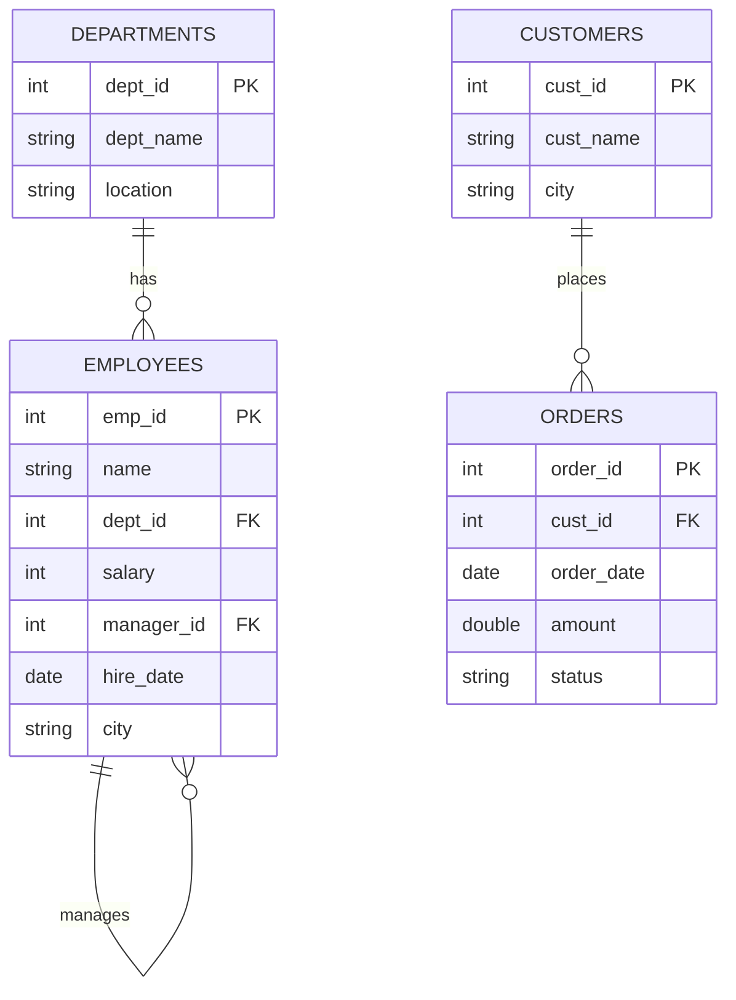
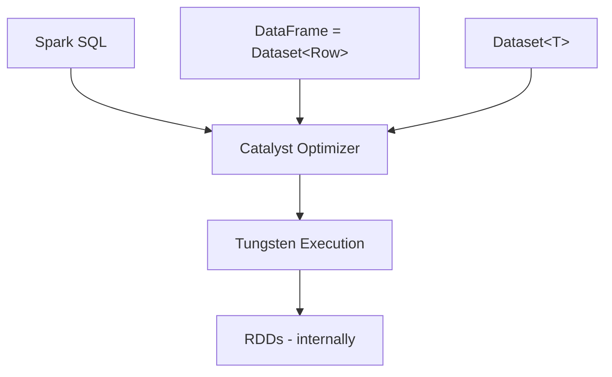
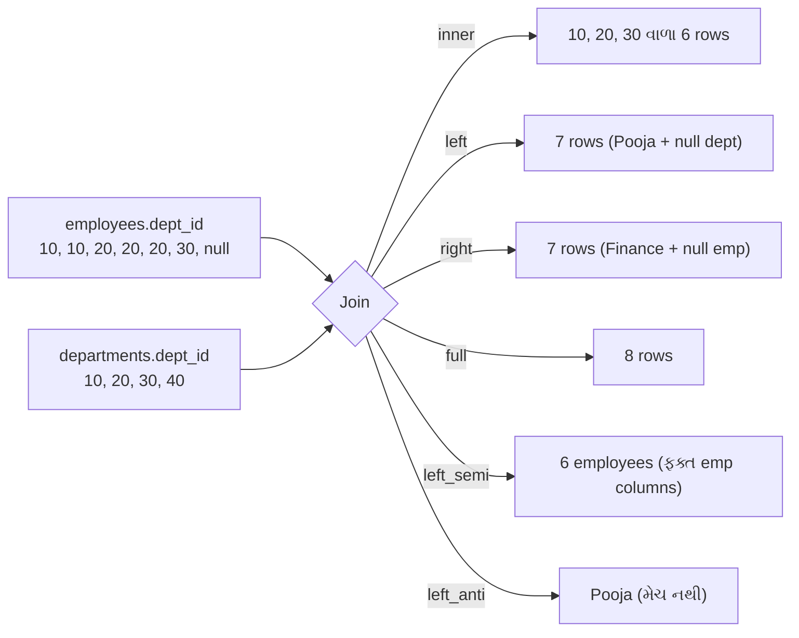
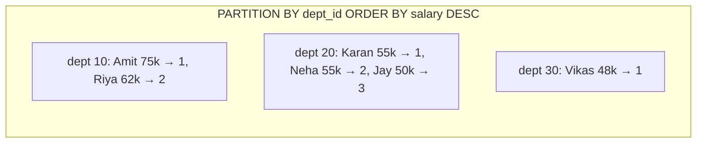

# Section 4: DataFrame & Spark SQL

> **આ section માં શું શીખીશું:** Schemas, select/filter/withColumn/groupBy/agg/orderBy, બધા join types, window functions, complex types (array, map, struct, explode), null handling, temp views, UDFs, અને Dataset vs DataFrame.
>
> **Language:** બધો code **Java** (`Dataset<Row>` API) માં છે, અને દરેક query **DataFrame API + SQL** બંને રીતે બતાવી છે.
>
> **Data:** આખા section માં એક **real company database** (employees, departments, customers, orders) વાપર્યો છે, જેથી દરેક example real project જેવું લાગે.

---

## 📑 Index

**Part A: Foundation**
1. [Setup (Java)](#1-setup-java)
2. [Sample Company Database](#2-sample-company-database)
3. [DataFrame શું છે? RDD vs DataFrame vs Dataset](#3-dataframe-શું-છે-rdd-vs-dataframe-vs-dataset)
4. [Schemas](#4-schemas)

**Part B: Core Operations**

5. [select / selectExpr](#5-select--selectexpr)
6. [filter / where](#6-filter--where)
7. [withColumn, when/otherwise, rename, drop](#7-withcolumn-whenotherwise-rename-drop)
8. [distinct, orderBy, limit](#8-distinct-orderby-limit)
9. [groupBy + agg + having](#9-groupby--agg--having)
10. [Built-in Functions (String, Date, Math)](#10-built-in-functions-string-date-math)

**Part C: Joins & Windows**

11. [All Join Types](#11-all-join-types)
12. [Window Functions](#12-window-functions)

**Part D: Advanced**

13. [Complex Types: Array, Map, Struct, Explode](#13-complex-types-array-map-struct-explode)
14. [Null Handling](#14-null-handling)
15. [Temp Views & Spark SQL](#15-temp-views--spark-sql)
16. [UDF vs Pandas UDF vs Built-in Functions](#16-udf-vs-pandas-udf-vs-built-in-functions)
17. [Dataset vs DataFrame (Java Beans)](#17-dataset-vs-dataframe-java-beans)
18. [explain(): Query Plan જોવો](#18-explain-query-plan-જોવો)
19. [Mini Project: E-commerce Sales Report](#19-mini-project-e-commerce-sales-report)
20. [Quick Revision](#20-quick-revision)

---

# Part A: Foundation

## 1. Setup (Java)

### Maven dependency
```xml
<dependency>
    <groupId>org.apache.spark</groupId>
    <artifactId>spark-sql_2.13</artifactId>
    <version>4.0.0</version>
    <scope>provided</scope>
</dependency>
<!-- Real DB માંથી વાંચવા માટે (દા.ત. PostgreSQL) -->
<dependency>
    <groupId>org.postgresql</groupId>
    <artifactId>postgresql</artifactId>
    <version>42.7.3</version>
</dependency>
```

### Common imports (આખા section માં)
```java
import org.apache.spark.sql.*;                       // Dataset, Row, SparkSession, Column, RowFactory, Encoders, SaveMode
import org.apache.spark.sql.types.*;                 // StructType, DataTypes
import org.apache.spark.sql.expressions.Window;
import org.apache.spark.sql.expressions.WindowSpec;
import org.apache.spark.sql.api.java.UDF1;
import org.apache.spark.api.java.function.FilterFunction;
import org.apache.spark.api.java.function.MapFunction;
import static org.apache.spark.sql.functions.*;      // col, lit, when, sum, avg, count, explode ...

import java.sql.Date;
import java.util.*;
```

```java
SparkSession spark = SparkSession.builder()
        .appName("DataFrame & SQL")
        .master("local[*]")
        .config("spark.sql.shuffle.partitions", "4")   // નાના data માટે
        .getOrCreate();
spark.sparkContext().setLogLevel("WARN");
```

> 💡 **Java tip:** `import static org.apache.spark.sql.functions.*;` થી `col("x")`, `sum("x")` જેવા functions સીધા લખી શકાય છે. Code ટૂંકો અને વાંચવામાં સરળ બને છે.

---

## 2. Sample Company Database

### 🏢 Database Design



### 📋 Tables (આખા section માં આ જ data)

**`employees`**

| emp_id | name | dept_id | salary | manager_id | hire_date | city |
|--------|------|---------|--------|------------|-----------|------|
| 1 | Amit | 10 | 75000 | null | 2019-03-15 | Ahmedabad |
| 2 | Riya | 10 | 62000 | 1 | 2020-07-01 | Surat |
| 3 | Karan | 20 | 55000 | 1 | 2021-01-10 | Ahmedabad |
| 4 | Neha | 20 | 55000 | 3 | 2022-05-20 | Vadodara |
| 5 | Vikas | 30 | 48000 | 3 | 2023-02-11 | null |
| 6 | Pooja | null | 40000 | 1 | 2024-08-01 | Surat |
| 7 | Jay | 20 | 50000 | 3 | 2025-01-05 | Ahmedabad |

**`departments`**

| dept_id | dept_name | location |
|---------|-----------|----------|
| 10 | Engineering | Ahmedabad |
| 20 | Sales | Mumbai |
| 30 | HR | Surat |
| 40 | Finance | Pune |

**`customers`**

| cust_id | cust_name | city |
|---------|-----------|------|
| 101 | Ramesh | Ahmedabad |
| 102 | Suresh | Surat |
| 103 | Mahesh | Rajkot |

**`orders`**

| order_id | cust_id | order_date | amount | status |
|----------|---------|------------|--------|--------|
| 1001 | 101 | 2026-01-05 | 2500.0 | DELIVERED |
| 1002 | 102 | 2026-01-07 | 1200.0 | DELIVERED |
| 1003 | 101 | 2026-02-10 | 3200.0 | CANCELLED |
| 1004 | 101 | 2026-02-15 | 800.0 | DELIVERED |
| 1005 | 104 | 2026-03-01 | 1500.0 | PENDING |
| 1006 | 102 | 2026-03-03 | 2000.0 | DELIVERED |

> **જાણીજોઈને રાખેલી ખામીઓ (real data જેવી):** Pooja નો `dept_id` null છે, Vikas નું `city` null છે, Finance department માં કોઈ employee નથી, order 1005 નો customer (104) અસ્તિત્વમાં નથી, અને Mahesh એ કોઈ order કર્યો નથી. આ બધું joins અને null handling સમજવામાં કામ આવશે.

### 🗄️ Option A: Real Database (PostgreSQL / MySQL) માં બનાવો

```sql
CREATE TABLE departments (dept_id INT PRIMARY KEY, dept_name VARCHAR(50), location VARCHAR(50));
CREATE TABLE employees (
    emp_id INT PRIMARY KEY, name VARCHAR(50), dept_id INT, salary INT,
    manager_id INT, hire_date DATE, city VARCHAR(50));
CREATE TABLE customers (cust_id INT PRIMARY KEY, cust_name VARCHAR(50), city VARCHAR(50));
CREATE TABLE orders (
    order_id INT PRIMARY KEY, cust_id INT, order_date DATE,
    amount NUMERIC(10,2), status VARCHAR(20));

INSERT INTO departments VALUES (10,'Engineering','Ahmedabad'),(20,'Sales','Mumbai'),(30,'HR','Surat'),(40,'Finance','Pune');
INSERT INTO employees VALUES
 (1,'Amit',10,75000,NULL,'2019-03-15','Ahmedabad'), (2,'Riya',10,62000,1,'2020-07-01','Surat'),
 (3,'Karan',20,55000,1,'2021-01-10','Ahmedabad'),  (4,'Neha',20,55000,3,'2022-05-20','Vadodara'),
 (5,'Vikas',30,48000,3,'2023-02-11',NULL),         (6,'Pooja',NULL,40000,1,'2024-08-01','Surat'),
 (7,'Jay',20,50000,3,'2025-01-05','Ahmedabad');
INSERT INTO customers VALUES (101,'Ramesh','Ahmedabad'),(102,'Suresh','Surat'),(103,'Mahesh','Rajkot');
INSERT INTO orders VALUES
 (1001,101,'2026-01-05',2500,'DELIVERED'), (1002,102,'2026-01-07',1200,'DELIVERED'),
 (1003,101,'2026-02-10',3200,'CANCELLED'), (1004,101,'2026-02-15',800,'DELIVERED'),
 (1005,104,'2026-03-01',1500,'PENDING'),   (1006,102,'2026-03-03',2000,'DELIVERED');
```

**Spark માં JDBC થી વાંચો:**
```java
String url = "jdbc:postgresql://localhost:5432/companydb";
Properties props = new Properties();
props.setProperty("user", "postgres");
props.setProperty("password", "secret");
props.setProperty("driver", "org.postgresql.Driver");

Dataset<Row> employees   = spark.read().jdbc(url, "employees", props);
Dataset<Row> departments = spark.read().jdbc(url, "departments", props);
Dataset<Row> customers   = spark.read().jdbc(url, "customers", props);
Dataset<Row> orders      = spark.read().jdbc(url, "orders", props);
```

> **નોંધ:** Postgres નો `NUMERIC(10,2)` Spark માં `DecimalType(10,2)` તરીકે આવશે. JDBC ના વધુ options (parallel read, pushdown) Section 5 માં છે.

### 💻 Option B: DB વગર, Java code માં બનાવો

```java
// ---------- employees ----------
StructType empSchema = new StructType()
        .add("emp_id",     DataTypes.IntegerType, false)
        .add("name",       DataTypes.StringType,  false)
        .add("dept_id",    DataTypes.IntegerType, true)
        .add("salary",     DataTypes.IntegerType, false)
        .add("manager_id", DataTypes.IntegerType, true)
        .add("hire_date",  DataTypes.DateType,    true)
        .add("city",       DataTypes.StringType,  true);

List<Row> empRows = Arrays.asList(
    RowFactory.create(1, "Amit",  10,   75000, null, Date.valueOf("2019-03-15"), "Ahmedabad"),
    RowFactory.create(2, "Riya",  10,   62000, 1,    Date.valueOf("2020-07-01"), "Surat"),
    RowFactory.create(3, "Karan", 20,   55000, 1,    Date.valueOf("2021-01-10"), "Ahmedabad"),
    RowFactory.create(4, "Neha",  20,   55000, 3,    Date.valueOf("2022-05-20"), "Vadodara"),
    RowFactory.create(5, "Vikas", 30,   48000, 3,    Date.valueOf("2023-02-11"), null),
    RowFactory.create(6, "Pooja", null, 40000, 1,    Date.valueOf("2024-08-01"), "Surat"),
    RowFactory.create(7, "Jay",   20,   50000, 3,    Date.valueOf("2025-01-05"), "Ahmedabad"));
Dataset<Row> employees = spark.createDataFrame(empRows, empSchema);

// ---------- departments (DDL string schema, ટૂંકી રીત) ----------
Dataset<Row> departments = spark.createDataFrame(Arrays.asList(
        RowFactory.create(10, "Engineering", "Ahmedabad"),
        RowFactory.create(20, "Sales",       "Mumbai"),
        RowFactory.create(30, "HR",          "Surat"),
        RowFactory.create(40, "Finance",     "Pune")),
    StructType.fromDDL("dept_id INT, dept_name STRING, location STRING"));

// ---------- customers ----------
Dataset<Row> customers = spark.createDataFrame(Arrays.asList(
        RowFactory.create(101, "Ramesh", "Ahmedabad"),
        RowFactory.create(102, "Suresh", "Surat"),
        RowFactory.create(103, "Mahesh", "Rajkot")),
    StructType.fromDDL("cust_id INT, cust_name STRING, city STRING"));

// ---------- orders ----------
Dataset<Row> orders = spark.createDataFrame(Arrays.asList(
        RowFactory.create(1001, 101, Date.valueOf("2026-01-05"), 2500.0, "DELIVERED"),
        RowFactory.create(1002, 102, Date.valueOf("2026-01-07"), 1200.0, "DELIVERED"),
        RowFactory.create(1003, 101, Date.valueOf("2026-02-10"), 3200.0, "CANCELLED"),
        RowFactory.create(1004, 101, Date.valueOf("2026-02-15"),  800.0, "DELIVERED"),
        RowFactory.create(1005, 104, Date.valueOf("2026-03-01"), 1500.0, "PENDING"),
        RowFactory.create(1006, 102, Date.valueOf("2026-03-03"), 2000.0, "DELIVERED")),
    StructType.fromDDL("order_id INT, cust_id INT, order_date DATE, amount DOUBLE, status STRING"));

// SQL queries માટે views બનાવો
employees.createOrReplaceTempView("employees");
departments.createOrReplaceTempView("departments");
customers.createOrReplaceTempView("customers");
orders.createOrReplaceTempView("orders");
```

> ⚠️ **Real projects માં પૈસા માટે `DOUBLE` નહીં, `DECIMAL(10,2)` વાપરો** (Java `BigDecimal`), નહીં તો rounding errors આવે. અહીં સરળતા માટે `DOUBLE` રાખ્યું છે.

---

## 3. DataFrame શું છે? RDD vs DataFrame vs Dataset

### 📖 Definition
**DataFrame** એ **named columns** માં ગોઠવાયેલો distributed data collection છે, જે database **table** અથવા Excel sheet જેવો દેખાય છે. તેમાં **schema** (column names + data types) હોય છે.

Java માં **DataFrame = `Dataset<Row>`**. અલગ class નથી.

**Dataset<T>** = typed version, જેમાં દરેક row તમારો **Java object** (દા.ત. `Employee` bean) હોય છે.

### 🏠 Analogy
- **RDD** = **કાગળોનો ઢગલો**: દરેક કાગળ પર શું લખ્યું છે તે Spark ને ખબર નથી. તમારે બધું હાથે સમજાવવું પડે.
- **DataFrame** = **Excel sheet**: columns ના નામ અને types ખબર છે, એટલે Spark સ્માર્ટ રીતે કામ કરી શકે (ફક્ત જરૂરી columns વાંચવા, filters વહેલા લગાવવા).
- **Dataset** = **Excel sheet + દરેક row એક Java object**: compile-time પર જ ભૂલ પકડાય.

### 📊 RDD vs DataFrame vs Dataset

| મુદ્દો | RDD | DataFrame (`Dataset<Row>`) | Dataset<T> |
|-------|-----|----------------------------|------------|
| **Introduced** | Spark 1.0 | Spark 1.3 | Spark 1.6 (2.0 માં unified) |
| **Data structure** | Java objects નો collection | Rows + named columns (schema) | Typed Java objects + schema |
| **Schema** | ❌ નથી | ✅ છે | ✅ છે |
| **Type safety** | ✅ Compile-time | ❌ Runtime (`col("salry")` runtime પર error) | ✅ Compile-time |
| **Optimization** | ❌ Catalyst નથી | ✅ Catalyst + Tungsten | ✅ Catalyst (typed lambdas માં આંશિક) |
| **Performance** | સૌથી ધીમું | ⚡ સૌથી ઝડપી | ઝડપી (lambdas માં serialization cost) |
| **Memory** | Java objects, GC વધુ | Tungsten binary format, compact | Encoders થી compact |
| **API style** | Functional (`map`, `filter`) | Declarative (SQL-like) | બંને |
| **SQL support** | ❌ | ✅ | ✅ |
| **Languages** | Java, Scala, Python | Java, Scala, Python, R | **ફક્ત Java અને Scala** |
| **ક્યારે** | Unstructured data, low-level control | **મોટાભાગના કામ (default)** ✅ | Domain objects, compile-time safety જોઈએ ત્યારે |



> **Interview ⭐:** "DataFrame RDD કરતાં ઝડપી કેમ છે?" જવાબ: **Schema હોવાથી Catalyst optimizer** (predicate pushdown, column pruning) અને **Tungsten** (binary memory format, code generation) મળે છે.

---

## 4. Schemas

### 📖 Definition
**Schema** = DataFrame નું માળખું: **column names, data types, અને nullable** (null આવી શકે કે નહીં). Java માં `StructType` (columns નો સમૂહ) અને `StructField` (એક column).

### 4.1 `printSchema()`
```java
employees.printSchema();
```
**Output:**
```
root
 |-- emp_id: integer (nullable = false)
 |-- name: string (nullable = false)
 |-- dept_id: integer (nullable = true)
 |-- salary: integer (nullable = false)
 |-- manager_id: integer (nullable = true)
 |-- hire_date: date (nullable = true)
 |-- city: string (nullable = true)
```

**SQL માં:**
```sql
DESCRIBE employees;
```

### 4.2 Schema બનાવવાની 3 રીતો

```java
// 1. StructType builder
StructType s1 = new StructType()
        .add("id", DataTypes.IntegerType, false)
        .add("name", DataTypes.StringType, true);

// 2. StructField array
StructType s2 = DataTypes.createStructType(new StructField[]{
        DataTypes.createStructField("id", DataTypes.IntegerType, false),
        DataTypes.createStructField("name", DataTypes.StringType, true)});

// 3. DDL string (સૌથી ટૂંકું) ✅
StructType s3 = StructType.fromDDL("id INT, name STRING");
```

### 4.3 Inferred vs Explicit Schema

```java
// ❌ inferSchema: Spark આખી file એક વાર વધારે વાંચીને types અનુમાન કરે છે
Dataset<Row> df1 = spark.read().option("header", "true")
        .option("inferSchema", "true").csv("employees.csv");

// ✅ Explicit schema: ઝડપી અને ભરોસાપાત્ર (production માં આ જ)
Dataset<Row> df2 = spark.read().option("header", "true")
        .schema(empSchema).csv("employees.csv");
```

| મુદ્દો | inferSchema | Explicit Schema |
|-------|-------------|-----------------|
| Speed | ધીમું (વધારાનો pass) | ઝડપી ✅ |
| Accuracy | ભૂલ થઈ શકે (`"001"` → 1) | તમે નક્કી કરો તેમ ✅ |
| Production | ❌ | ✅ |
| Exploration | ✅ | |

### 4.4 Data Types: Spark ↔ Java ↔ SQL

| Spark Type | Java Type | SQL / DB Type |
|------------|-----------|---------------|
| `IntegerType` | `Integer` / `int` | `INT` |
| `LongType` | `Long` | `BIGINT` |
| `DoubleType` | `Double` | `DOUBLE` |
| `DecimalType(p, s)` | `java.math.BigDecimal` | `DECIMAL(p,s)` / `NUMERIC` (💰 પૈસા માટે) |
| `StringType` | `String` | `VARCHAR` / `STRING` |
| `BooleanType` | `Boolean` | `BOOLEAN` |
| `DateType` | `java.sql.Date` / `LocalDate` | `DATE` |
| `TimestampType` | `java.sql.Timestamp` / `Instant` | `TIMESTAMP` |
| `ArrayType(T)` | `java.util.List<T>` | `ARRAY<T>` |
| `MapType(K, V)` | `java.util.Map<K, V>` | `MAP<K,V>` |
| `StructType` | `Row` | `STRUCT<...>` |

### 4.5 `cast()`: Type બદલવો

```java
employees.select(col("emp_id"), col("salary").cast("double").alias("salary_d"),
                 col("hire_date").cast("string").alias("hire_str"));
```
```sql
SELECT emp_id, CAST(salary AS DOUBLE) AS salary_d, CAST(hire_date AS STRING) AS hire_str FROM employees;
```

> ⚠️ Invalid cast (`"abc"` → INT) ANSI mode બંધ હોય તો **null** આપે, અને ANSI mode ચાલુ હોય તો **error** આપે. Spark 4.0 થી `spark.sql.ansi.enabled` **default `true`** છે, એટલે ખરાબ data પર error આવશે. Error ટાળવા `try_cast` વાપરો: `expr("try_cast(x AS INT)")`.

### 4.6 `columns()` અને `dtypes()`
```java
String[] cols = employees.columns();         // [emp_id, name, dept_id, ...]
Tuple2<String, String>[] types = employees.dtypes();   // [(emp_id,IntegerType), ...]
```

---

# Part B: Core Operations

> **Format:** 📖 Definition → 🧾 Syntax → 💻 Java (DataFrame API) → 🗄️ SQL → 📥 Input → 📤 Output
>
> Input tables માટે [Section 2](#2-sample-company-database) જુઓ. Output માં ફક્ત સંબંધિત columns બતાવ્યા છે.

---

## 5. select / selectExpr

### 5.1 `select()`
📖 **Definition:** જોઈતા **columns પસંદ** કરે, અથવા નવા computed columns બનાવે. SQL ના `SELECT` જેવું.

🧾 **Syntax:**
```java
Dataset<Row> select(String col, String... cols)
Dataset<Row> select(Column... cols)
```

💻 **Java:**
```java
// String names (સાદું)
employees.select("name", "salary").show();

// Column objects (expressions માટે) ✅
employees.select(
        col("name"),
        col("salary"),
        col("salary").multiply(12).alias("annual_salary")
).show();
```

🗄️ **SQL:**
```sql
SELECT name, salary, salary * 12 AS annual_salary FROM employees;
```

📤 **Output:**

| name | salary | annual_salary |
|------|--------|---------------|
| Amit | 75000 | 900000 |
| Riya | 62000 | 744000 |
| Karan | 55000 | 660000 |
| Neha | 55000 | 660000 |
| Vikas | 48000 | 576000 |
| Pooja | 40000 | 480000 |
| Jay | 50000 | 600000 |

### 🧩 Column reference કરવાની રીતો (Java)

| રીત | Example | ક્યારે |
|-----|---------|--------|
| `col("x")` | `col("salary")` | સૌથી સામાન્ય ✅ |
| `df.col("x")` | `employees.col("dept_id")` | Join પછી ambiguity ટાળવા |
| `expr("...")` | `expr("salary * 12")` | SQL expression લખવો હોય ત્યારે |
| `lit(value)` | `lit("INR")` | Constant value |

### 🧮 Column operators (Java માં `+ - * /` ચાલતા નથી!)

| SQL | Java Column method |
|-----|-------------------|
| `a + b` | `col("a").plus(col("b"))` |
| `a - b` | `col("a").minus(...)` |
| `a * b` | `col("a").multiply(...)` |
| `a / b` | `col("a").divide(...)` |
| `a % b` | `col("a").mod(...)` |
| `a = b` | `col("a").equalTo(...)` |
| `a != b` | `col("a").notEqual(...)` |
| `a > b`, `>=` | `.gt(...)`, `.geq(...)` |
| `a < b`, `<=` | `.lt(...)`, `.leq(...)` |
| `AND`, `OR`, `NOT` | `.and(...)`, `.or(...)`, `not(...)` |

---

### 5.2 `selectExpr()`
📖 **Definition:** **SQL expressions ને strings** તરીકે લખીને select કરે. Java માં `.multiply()` લખવા કરતાં ઘણું ટૂંકું.

🧾 **Syntax:** `Dataset<Row> selectExpr(String... exprs)`

💻 **Java:**
```java
employees.selectExpr(
        "name",
        "salary * 12 AS annual_salary",
        "upper(city) AS city_upper",
        "salary > 60000 AS is_senior"
).show();
```

🗄️ **SQL:**
```sql
SELECT name, salary * 12 AS annual_salary, upper(city) AS city_upper, salary > 60000 AS is_senior
FROM employees;
```

📤 **Output (પહેલી 3 rows):**

| name | annual_salary | city_upper | is_senior |
|------|---------------|-----------|-----------|
| Amit | 900000 | AHMEDABAD | true |
| Riya | 744000 | SURAT | true |
| Karan | 660000 | AHMEDABAD | false |

---

## 6. filter / where

📖 **Definition:** Condition પ્રમાણે **rows ગાળે**. `filter()` અને `where()` **બરાબર એક જ** છે.

🧾 **Syntax:**
```java
Dataset<Row> filter(Column condition)
Dataset<Row> filter(String sqlCondition)
Dataset<Row> where(Column condition)
```

### 6.1 Simple condition

💻 **Java:**
```java
employees.filter(col("salary").gt(50000)).select("name", "salary").show();

// SQL string તરીકે પણ ચાલે
employees.where("salary > 50000").select("name", "salary").show();
```

🗄️ **SQL:**
```sql
SELECT name, salary FROM employees WHERE salary > 50000;
```

📤 **Output:**

| name | salary |
|------|--------|
| Amit | 75000 |
| Riya | 62000 |
| Karan | 55000 |
| Neha | 55000 |

### 6.2 Multiple conditions (AND / OR)

💻 **Java:**
```java
employees.filter(
        col("dept_id").equalTo(20).and(col("city").equalTo("Ahmedabad"))
).select("name", "dept_id", "city").show();
```

🗄️ **SQL:**
```sql
SELECT name, dept_id, city FROM employees WHERE dept_id = 20 AND city = 'Ahmedabad';
```

📤 **Output:**

| name | dept_id | city |
|------|---------|------|
| Karan | 20 | Ahmedabad |
| Jay | 20 | Ahmedabad |

### 6.3 `isin`, `like`, `between`, `startsWith`

💻 **Java:**
```java
employees.filter(col("city").isin("Surat", "Vadodara")).select("name", "city").show();
employees.filter(col("name").like("A%")).select("name").show();
employees.filter(col("salary").between(50000, 60000)).select("name", "salary").show();
employees.filter(col("name").startsWith("P")).select("name").show();
```

🗄️ **SQL:**
```sql
SELECT name, city   FROM employees WHERE city IN ('Surat', 'Vadodara');
SELECT name         FROM employees WHERE name LIKE 'A%';
SELECT name, salary FROM employees WHERE salary BETWEEN 50000 AND 60000;
SELECT name         FROM employees WHERE name LIKE 'P%';
```

📤 **Output:**

| Query | Result |
|-------|--------|
| `isin("Surat","Vadodara")` | Riya (Surat), Neha (Vadodara), Pooja (Surat) |
| `like("A%")` | Amit |
| `between(50000, 60000)` | Karan 55000, Neha 55000, Jay 50000 |
| `startsWith("P")` | Pooja |

> ⚠️ **Null ધ્યાન:** `col("city").notEqual("Surat")` એ Vikas (city = null) ને **બતાવશે નહીં**, કારણ કે `null != 'Surat'` નું પરિણામ `null` છે, `true` નહીં. ([Section 14](#14-null-handling))

---

## 7. withColumn, when/otherwise, rename, drop

### 7.1 `withColumn()`
📖 **Definition:** **નવો column ઉમેરે**, અથવા એ જ નામનો column હોય તો **તેને બદલે (replace)**.

🧾 **Syntax:** `Dataset<Row> withColumn(String colName, Column col)`

💻 **Java:**
```java
Dataset<Row> withBonus = employees
        .withColumn("bonus", col("salary").multiply(0.10))
        .withColumn("salary", col("salary").plus(5000))        // હાલનો column બદલો
        .select("name", "salary", "bonus");
withBonus.show();
```

🗄️ **SQL:**
```sql
SELECT name, salary + 5000 AS salary, salary * 0.10 AS bonus FROM employees;
```

📤 **Output (પહેલી 3 rows):**

| name | salary | bonus |
|------|--------|-------|
| Amit | 80000 | 7500.0 |
| Riya | 67000 | 6200.0 |
| Karan | 60000 | 5500.0 |

> ⚠️ **ધ્યાન:** ઉપરના code માં `bonus` **જૂના** salary (75000) પરથી ગણાયો છે, કારણ કે તે salary બદલતા **પહેલા** ઉમેર્યો છે. Order મહત્વનો છે.
>
> ⚠️ **Performance:** Loop માં 50 વાર `withColumn` ન કરો, કારણ કે plan બહુ મોટો બને છે. તેના બદલે એક `select()` અથવા Spark 3.3+ નો `withColumns(Map<String, Column>)` વાપરો.

---

### 7.2 `when().otherwise()` (CASE WHEN)
📖 **Definition:** **If-else logic** column પર લગાવે. SQL ના `CASE WHEN` જેવું. `otherwise` ન આપો તો બાકીના માટે `null` આવે.

🧾 **Syntax:** `when(Column condition, Object value).when(...).otherwise(Object value)`

💻 **Java:**
```java
employees.withColumn("grade",
        when(col("salary").geq(60000), "High")
        .when(col("salary").geq(50000), "Medium")
        .otherwise("Low")
).select("name", "salary", "grade").show();
```

🗄️ **SQL:**
```sql
SELECT name, salary,
       CASE WHEN salary >= 60000 THEN 'High'
            WHEN salary >= 50000 THEN 'Medium'
            ELSE 'Low' END AS grade
FROM employees;
```

📤 **Output:**

| name | salary | grade |
|------|--------|-------|
| Amit | 75000 | High |
| Riya | 62000 | High |
| Karan | 55000 | Medium |
| Neha | 55000 | Medium |
| Vikas | 48000 | Low |
| Pooja | 40000 | Low |
| Jay | 50000 | Medium |

---

### 7.3 `withColumnRenamed()` અને `drop()`
📖 **Definition:** Column નું **નામ બદલે** / column **કાઢી નાખે**. (Column ન મળે તો બંને ભૂલ વગર ચુપચાપ આગળ વધે છે.)

💻 **Java:**
```java
employees
        .withColumnRenamed("name", "emp_name")
        .drop("manager_id", "hire_date")
        .show();
```

🗄️ **SQL:**
```sql
SELECT emp_id, name AS emp_name, dept_id, salary, city FROM employees;
```

📤 **Output columns:** `emp_id | emp_name | dept_id | salary | city`

---

## 8. distinct, orderBy, limit

### 8.1 `distinct()` અને `dropDuplicates()`
📖 **Definition:**
- `distinct()`: **બધા columns** પ્રમાણે duplicate rows દૂર કરે.
- `dropDuplicates(cols)`: **આપેલા columns** પ્રમાણે duplicates દૂર કરે, પણ **બધા columns રાખે**.

💻 **Java:**
```java
employees.select("city").distinct().show();
employees.dropDuplicates("dept_id").select("dept_id", "name").show();
```

🗄️ **SQL:**
```sql
SELECT DISTINCT city FROM employees;

-- dropDuplicates નું SQL સમકક્ષ (window function વડે)
SELECT dept_id, name FROM (
    SELECT *, ROW_NUMBER() OVER (PARTITION BY dept_id ORDER BY emp_id) AS rn FROM employees
) t WHERE rn = 1;
```

📤 **Output:**

| city (distinct) |
|-----------------|
| Ahmedabad |
| Surat |
| Vadodara |
| null |

| dept_id | name (dropDuplicates) |
|---------|-----------------------|
| 10 | Amit |
| 20 | Karan |
| 30 | Vikas |
| null | Pooja |

> ⚠️ `dropDuplicates` **કઈ row રાખશે તે નિશ્ચિત નથી**. ચોક્કસ row (દા.ત. latest) જોઈએ તો `row_number()` window વાપરો.

---

### 8.2 `orderBy()` / `sort()`
📖 **Definition:** Rows ને **sort** કરે. Default ascending. (Wide transformation, એટલે shuffle થાય.)

🧾 **Syntax:** `Dataset<Row> orderBy(Column... cols)` / `orderBy(String col, String... cols)`

💻 **Java:**
```java
employees.orderBy(
        col("dept_id").asc_nulls_last(),
        col("salary").desc()
).select("name", "dept_id", "salary").show();
```

🗄️ **SQL:**
```sql
SELECT name, dept_id, salary FROM employees
ORDER BY dept_id ASC NULLS LAST, salary DESC;
```

📤 **Output:**

| name | dept_id | salary |
|------|---------|--------|
| Amit | 10 | 75000 |
| Riya | 10 | 62000 |
| Karan | 20 | 55000 |
| Neha | 20 | 55000 |
| Jay | 20 | 50000 |
| Vikas | 30 | 48000 |
| Pooja | null | 40000 |

| Method | Nulls ક્યાં |
|--------|-------------|
| `.asc()` | પહેલા (default) |
| `.asc_nulls_last()` | છેલ્લે |
| `.desc()` | છેલ્લે (default) |
| `.desc_nulls_first()` | પહેલા |

> 💡 `sortWithinPartitions()` ફક્ત દરેક partition ની અંદર sort કરે, global shuffle વગર. Files લખતા પહેલા ઉપયોગી.

---

### 8.3 `limit()`, `show()`, `head()`, `take()`
💻 **Java:**
```java
employees.orderBy(col("salary").desc()).limit(3).show();   // Top 3 salary
employees.show(5, false);   // 5 rows, truncate=false (લાંબા text પૂરા દેખાય)
List<Row> top = employees.takeAsList(2);
Row first = employees.first();
long total = employees.count();
```

🗄️ **SQL:**
```sql
SELECT * FROM employees ORDER BY salary DESC LIMIT 3;
```

📤 **Output:** Amit 75000, Riya 62000, Karan 55000 (અથવા Neha, બંનેનો પગાર સરખો છે).

---

## 9. groupBy + agg + having

### 9.1 `groupBy().agg()`
📖 **Definition:** Rows ને એક (કે વધુ) column પ્રમાણે **group** કરીને દરેક group પર **aggregate functions** (count, sum, avg, max, min) લગાવે.

🧾 **Syntax:**
```java
RelationalGroupedDataset groupBy(String col, String... cols)
Dataset<Row> agg(Column expr, Column... exprs)
```

💻 **Java:**
```java
Dataset<Row> deptStats = employees.groupBy("dept_id").agg(
        count("*").alias("emp_count"),
        sum("salary").alias("total_salary"),
        round(avg("salary"), 2).alias("avg_salary"),
        max("salary").alias("max_salary"),
        min("salary").alias("min_salary")
).orderBy(col("dept_id").asc_nulls_last());
deptStats.show();
```

🗄️ **SQL:**
```sql
SELECT dept_id,
       COUNT(*)              AS emp_count,
       SUM(salary)           AS total_salary,
       ROUND(AVG(salary), 2) AS avg_salary,
       MAX(salary)           AS max_salary,
       MIN(salary)           AS min_salary
FROM employees
GROUP BY dept_id
ORDER BY dept_id NULLS LAST;
```

📤 **Output:**

| dept_id | emp_count | total_salary | avg_salary | max_salary | min_salary |
|---------|-----------|--------------|------------|------------|------------|
| 10 | 2 | 137000 | 68500.0 | 75000 | 62000 |
| 20 | 3 | 160000 | 53333.33 | 55000 | 50000 |
| 30 | 1 | 48000 | 48000.0 | 48000 | 48000 |
| null | 1 | 40000 | 40000.0 | 40000 | 40000 |

> 💡 **Null પણ એક group બને છે** (Pooja).

### 🧩 Shortcut methods
```java
employees.groupBy("dept_id").count();                 // ફક્ત count
employees.groupBy("dept_id").sum("salary");           // column: sum(salary)
employees.groupBy("dept_id").avg("salary");
employees.groupBy("dept_id", "city").count();         // ઘણા columns પર group
```

### 🧩 Aggregate Functions

| Function | અર્થ |
|----------|------|
| `count("*")` | બધી rows (null સહિત) |
| `count("col")` | Null **સિવાયની** values |
| `countDistinct("col")` | Unique values |
| `approx_count_distinct("col")` | ઝડપી અંદાજિત unique count (મોટા data માટે) |
| `sum`, `avg`, `min`, `max` | Nulls ignore કરે |
| `first`, `last` | Group ની પહેલી / છેલ્લી value (order નિશ્ચિત નથી) |
| `collect_list`, `collect_set` | Values ની array ([Section 13](#13-complex-types-array-map-struct-explode)) |
| `stddev`, `variance` | આંકડાકીય |

---

### 9.2 HAVING (Group પછી filter)
📖 **Definition:** **Aggregate પછી** groups ને filter કરે. DataFrame API માં અલગ `having()` method નથી; `agg()` પછી `filter()` જ HAVING છે.

💻 **Java:**
```java
employees.groupBy("dept_id")
        .agg(count("*").alias("emp_count"), sum("salary").alias("total_salary"))
        .filter(col("emp_count").geq(2))
        .show();
```

🗄️ **SQL:**
```sql
SELECT dept_id, COUNT(*) AS emp_count, SUM(salary) AS total_salary
FROM employees
GROUP BY dept_id
HAVING COUNT(*) >= 2;
```

📤 **Output:**

| dept_id | emp_count | total_salary |
|---------|-----------|--------------|
| 10 | 2 | 137000 |
| 20 | 3 | 160000 |

| WHERE | HAVING |
|-------|--------|
| Group **પહેલા** rows filter | Group **પછી** groups filter |
| Aggregate functions ન વાપરી શકાય | Aggregate functions વાપરી શકાય |
| `filter()` groupBy પહેલા | `filter()` agg પછી |

---

### 9.3 Pivot
📖 **Definition:** Row values ને **columns માં ફેરવે** (Excel pivot table જેવું).

💻 **Java:**
```java
employees.groupBy("dept_id")
        .pivot("city", Arrays.<Object>asList("Ahmedabad", "Surat", "Vadodara"))  // values આપવાથી ઝડપી
        .agg(count("*"))
        .na().fill(0)
        .show();
```

🗄️ **SQL:**
```sql
SELECT * FROM (SELECT dept_id, city FROM employees)
PIVOT (COUNT(*) FOR city IN ('Ahmedabad', 'Surat', 'Vadodara'));
```

📤 **Output:**

| dept_id | Ahmedabad | Surat | Vadodara |
|---------|-----------|-------|----------|
| 10 | 1 | 1 | 0 |
| 20 | 2 | 0 | 1 |
| 30 | 0 | 0 | 0 |
| null | 0 | 1 | 0 |

---

## 10. Built-in Functions (String, Date, Math)

> **Rule #1:** કંઈ પણ custom કરતાં પહેલા `functions` class માં built-in function શોધો. Spark માં **400+ built-in functions** છે, અને તે UDF કરતાં ઘણા ઝડપી છે.

### 10.1 String Functions
💻 **Java:**
```java
employees.select(
        col("name"),
        upper(col("name")).alias("upper"),
        length(col("name")).alias("len"),
        substring(col("name"), 1, 3).alias("sub"),
        concat_ws("-", col("name"), col("city")).alias("name_city"),
        lpad(col("emp_id").cast("string"), 5, "0").alias("emp_code"),
        regexp_replace(col("city"), "a", "@").alias("regex")
).filter(col("emp_id").equalTo(1)).show();
```

🗄️ **SQL:**
```sql
SELECT name, upper(name), length(name), substring(name, 1, 3),
       concat_ws('-', name, city), lpad(CAST(emp_id AS STRING), 5, '0'),
       regexp_replace(city, 'a', '@')
FROM employees WHERE emp_id = 1;
```

📤 **Output (Amit):**

| name | upper | len | sub | name_city | emp_code | regex |
|------|-------|-----|-----|-----------|----------|-------|
| Amit | AMIT | 4 | Ami | Amit-Ahmedabad | 00001 | Ahmed@b@d |

| બીજા ઉપયોગી | અર્થ |
|-------------|------|
| `lower`, `initcap` | નાના અક્ષર / પહેલો અક્ષર મોટો |
| `trim`, `ltrim`, `rtrim` | Spaces કાઢો |
| `concat` | જોડો (એક પણ null હોય તો પરિણામ null) |
| `concat_ws` | Separator સાથે જોડો (nulls skip કરે) ✅ |
| `split` | String → array |
| `regexp_extract` | Regex થી ભાગ કાઢો |
| `instr`, `locate` | Position શોધો |
| `format_string` | printf જેવું |

### 10.2 Date Functions
💻 **Java:**
```java
employees.select(
        col("name"), col("hire_date"),
        year(col("hire_date")).alias("yr"),
        month(col("hire_date")).alias("mon"),
        date_format(col("hire_date"), "dd-MMM-yyyy").alias("formatted"),
        add_months(col("hire_date"), 6).alias("probation_end"),
        datediff(current_date(), col("hire_date")).alias("days_in_company")
).filter(col("emp_id").equalTo(1)).show();
```

🗄️ **SQL:**
```sql
SELECT name, hire_date, year(hire_date), month(hire_date),
       date_format(hire_date, 'dd-MMM-yyyy'), add_months(hire_date, 6),
       datediff(current_date(), hire_date)
FROM employees WHERE emp_id = 1;
```

📤 **Output (Amit):**

| name | hire_date | yr | mon | formatted | probation_end | days_in_company |
|------|-----------|----|-----|-----------|---------------|-----------------|
| Amit | 2019-03-15 | 2019 | 3 | 15-Mar-2019 | 2019-09-15 | (આજની તારીખ પર આધાર) |

| બીજા ઉપયોગી | અર્થ |
|-------------|------|
| `to_date(col, "dd/MM/yyyy")` | String → Date |
| `to_timestamp` | String → Timestamp |
| `current_date()`, `current_timestamp()` | આજ / હમણાં |
| `date_add`, `date_sub` | દિવસો ઉમેરો / બાદ કરો |
| `months_between` | બે dates વચ્ચે મહિના |
| `dayofweek`, `weekofyear`, `quarter` | Date ના ભાગો |
| `trunc(col, "month")`, `date_trunc` | મહિના / વર્ષની શરૂઆત |
| `last_day` | મહિનાનો છેલ્લો દિવસ |

### 10.3 Math Functions

| Function | Example | Output |
|----------|---------|--------|
| `round(col, 2)` | `round(lit(53333.3333), 2)` | 53333.33 |
| `ceil`, `floor` | `ceil(lit(4.2))` | 5 |
| `abs` | `abs(lit(-5))` | 5 |
| `pow(col, n)` | `pow(lit(2), 3)` | 8.0 |
| `sqrt` | `sqrt(lit(16))` | 4.0 |
| `greatest`, `least` | `greatest(col("a"), col("b"))` | Row માં સૌથી મોટું |

---

# Part C: Joins & Windows

## 11. All Join Types

### 📖 Definition
**Join** બે DataFrames ને **common column (key)** ના આધારે જોડે છે, જેમ SQL માં tables જોડાય છે.

🧾 **Syntax (Java):**
```java
Dataset<Row> join(Dataset<?> right, Column joinCondition, String joinType)
Dataset<Row> join(Dataset<?> right, String usingColumn)         // inner, એક જ key column રહે
```

**Join type strings:** `"inner"`, `"left"`, `"right"`, `"full"`, `"left_semi"`, `"left_anti"`, `"cross"`

### 🗺️ Visual Overview



**Common join condition (નીચે બધે વપરાશે):**
```java
Column cond = employees.col("dept_id").equalTo(departments.col("dept_id"));
```

---

### 11.1 Inner Join
📖 **Definition:** **બંને tables માં match** થતી rows જ આપે.

💻 **Java:**
```java
employees.join(departments, cond, "inner")
        .select(employees.col("name"), departments.col("dept_name"), departments.col("location"))
        .show();

// ✅ ટૂંકી રીત: column નામ સરખું હોય ત્યારે (dept_id એક જ વાર આવશે)
employees.join(departments, "dept_id").select("name", "dept_name", "location").show();
```

🗄️ **SQL:**
```sql
SELECT e.name, d.dept_name, d.location
FROM employees e
INNER JOIN departments d ON e.dept_id = d.dept_id;
```

📤 **Output (6 rows):**

| name | dept_name | location |
|------|-----------|----------|
| Amit | Engineering | Ahmedabad |
| Riya | Engineering | Ahmedabad |
| Karan | Sales | Mumbai |
| Neha | Sales | Mumbai |
| Jay | Sales | Mumbai |
| Vikas | HR | Surat |

> Pooja (dept null) અને Finance (કોઈ employee નથી) **નથી** આવ્યા.

---

### 11.2 Left (Outer) Join
📖 **Definition:** **ડાબી table ની બધી rows** + જમણી બાજુથી match. Match ન હોય તો જમણી બાજુ **null**.

💻 **Java:**
```java
employees.join(departments, cond, "left")
        .select(employees.col("name"), departments.col("dept_name"))
        .show();
```

🗄️ **SQL:**
```sql
SELECT e.name, d.dept_name
FROM employees e
LEFT JOIN departments d ON e.dept_id = d.dept_id;
```

📤 **Output (7 rows):**

| name | dept_name |
|------|-----------|
| Amit | Engineering |
| Riya | Engineering |
| Karan | Sales |
| Neha | Sales |
| Jay | Sales |
| Vikas | HR |
| **Pooja** | **null** |

**Real use:** "બધા employees અને તેમનો department, department ન હોય તો પણ બતાવો."

---

### 11.3 Right (Outer) Join
📖 **Definition:** **જમણી table ની બધી rows** + ડાબી બાજુથી match.

💻 **Java:**
```java
employees.join(departments, cond, "right")
        .select(employees.col("name"), departments.col("dept_name"))
        .show();
```

🗄️ **SQL:**
```sql
SELECT e.name, d.dept_name
FROM employees e
RIGHT JOIN departments d ON e.dept_id = d.dept_id;
```

📤 **Output (7 rows):**

| name | dept_name |
|------|-----------|
| Amit | Engineering |
| Riya | Engineering |
| Karan | Sales |
| Neha | Sales |
| Jay | Sales |
| Vikas | HR |
| **null** | **Finance** |

---

### 11.4 Full (Outer) Join
📖 **Definition:** **બંને tables ની બધી rows**. જ્યાં match નથી ત્યાં બીજી બાજુ null.

💻 **Java:**
```java
employees.join(departments, cond, "full")
        .select(employees.col("name"), departments.col("dept_name"))
        .show();
```

🗄️ **SQL:**
```sql
SELECT e.name, d.dept_name
FROM employees e
FULL OUTER JOIN departments d ON e.dept_id = d.dept_id;
```

📤 **Output (8 rows):** Inner ના 6 rows + `(Pooja, null)` + `(null, Finance)`

**Real use:** Data reconciliation, એટલે બે systems વચ્ચે શું ખૂટે છે તે શોધવું.

---

### 11.5 Left Semi Join
📖 **Definition:** ડાબી table ની એવી rows જેનો **જમણી બાજુ match છે**, પણ **ફક્ત ડાબી બાજુના columns** આવે. SQL ના `WHERE EXISTS` / `IN` જેવું. Duplicate matches થી rows વધતી નથી.

💻 **Java:**
```java
employees.join(departments, cond, "left_semi").select("name", "dept_id").show();
```

🗄️ **SQL:**
```sql
SELECT e.name, e.dept_id FROM employees e LEFT SEMI JOIN departments d ON e.dept_id = d.dept_id;
-- અથવા
SELECT name, dept_id FROM employees e
WHERE EXISTS (SELECT 1 FROM departments d WHERE d.dept_id = e.dept_id);
```

📤 **Output (6 rows):** Amit, Riya, Karan, Neha, Jay, Vikas (ફક્ત employees ના columns)

---

### 11.6 Left Anti Join ⭐
📖 **Definition:** ડાબી table ની એવી rows જેનો **જમણી બાજુ કોઈ match નથી**. SQL ના `NOT EXISTS` જેવું. **Data quality checks** માં ખૂબ વપરાય છે.

💻 **Java:**
```java
// 1. Department વગરના employees
employees.join(departments, cond, "left_anti").select("name").show();

// 2. Employees વગરના departments
departments.join(employees, cond, "left_anti").select("dept_name").show();

// 3. ખોટા customer_id વાળા orders (orphan records)
orders.join(customers, orders.col("cust_id").equalTo(customers.col("cust_id")), "left_anti").show();

// 4. એક પણ order ન કરનારા customers
customers.join(orders, customers.col("cust_id").equalTo(orders.col("cust_id")), "left_anti").show();
```

🗄️ **SQL:**
```sql
SELECT e.name FROM employees e LEFT ANTI JOIN departments d ON e.dept_id = d.dept_id;

SELECT * FROM orders o
WHERE NOT EXISTS (SELECT 1 FROM customers c WHERE c.cust_id = o.cust_id);
```

📤 **Output:**

| Query | Result |
|-------|--------|
| Department વગરના employees | Pooja |
| Employees વગરના departments | Finance |
| Orphan orders | 1005 (cust_id 104) |
| Order વગરના customers | Mahesh |

> ⚠️ **`NOT IN` vs `NOT EXISTS`:** SQL માં subquery માં એક પણ null હોય, તો `NOT IN` **કોઈ row નહીં** આપે. `NOT EXISTS` / `left_anti` સુરક્ષિત છે ✅.

---

### 11.7 Cross Join
📖 **Definition:** ડાબી table ની **દરેક row** ને જમણી table ની **દરેક row** સાથે જોડે (Cartesian product). Rows = m × n.

💻 **Java:**
```java
employees.select("name").crossJoin(departments.select("dept_name")).count();   // 7 × 4 = 28
```

🗄️ **SQL:**
```sql
SELECT e.name, d.dept_name FROM employees e CROSS JOIN departments d;
```

📤 **Output:** **28 rows**

> ⚠️ મોટી tables પર ક્યારેય નહીં. Real use: calendar dates × products જેવા નાના combinations.

---

### 11.8 Self Join (Employee → Manager)
📖 **Definition:** Table ને **પોતાની સાથે** જોડવી. Hierarchy (employee-manager) માટે. **Alias** ફરજિયાત છે.

💻 **Java:**
```java
Dataset<Row> e = employees.as("e");
Dataset<Row> m = employees.as("m");

e.join(m, col("e.manager_id").equalTo(col("m.emp_id")), "left")
 .select(col("e.name").alias("employee"), col("m.name").alias("manager"))
 .show();
```

🗄️ **SQL:**
```sql
SELECT e.name AS employee, m.name AS manager
FROM employees e
LEFT JOIN employees m ON e.manager_id = m.emp_id;
```

📤 **Output:**

| employee | manager |
|----------|---------|
| Amit | null |
| Riya | Amit |
| Karan | Amit |
| Neha | Karan |
| Vikas | Karan |
| Pooja | Amit |
| Jay | Karan |

---

### 11.9 Multiple Tables Join (3-way)
💻 **Java:**
```java
// Customer + Order + filter (delivered ઓર્ડર્સ ગ્રાહકના નામ સાથે)
orders.join(customers, "cust_id")
      .filter(col("status").equalTo("DELIVERED"))
      .select("order_id", "cust_name", "amount")
      .show();
```

🗄️ **SQL:**
```sql
SELECT o.order_id, c.cust_name, o.amount
FROM orders o JOIN customers c ON o.cust_id = c.cust_id
WHERE o.status = 'DELIVERED';
```

📤 **Output:**

| order_id | cust_name | amount |
|----------|-----------|--------|
| 1001 | Ramesh | 2500.0 |
| 1002 | Suresh | 1200.0 |
| 1004 | Ramesh | 800.0 |
| 1006 | Suresh | 2000.0 |

---

### 11.10 Broadcast Join Hint ⚡
📖 **Definition:** નાની table ને **બધા executors પર broadcast** કરીને, મોટી table ને **shuffle કર્યા વગર** join કરવી. Spark 10 MB (`spark.sql.autoBroadcastJoinThreshold`) થી નાની tables આપોઆપ broadcast કરે છે; hint થી જાતે કહી શકાય.

💻 **Java:**
```java
employees.join(broadcast(departments), "dept_id").show();
```

🗄️ **SQL:**
```sql
SELECT /*+ BROADCAST(d) */ e.name, d.dept_name
FROM employees e JOIN departments d ON e.dept_id = d.dept_id;
```

> વિગતવાર join strategies (Broadcast Hash, Sort-Merge, Shuffle Hash) Section 6 Internals માં છે.

---

### 📊 Join Types Summary

| Join Type | Java string | ડાબી unmatched | જમણી unmatched | Columns | Real use |
|-----------|-------------|----------------|----------------|---------|----------|
| Inner | `inner` | ❌ | ❌ | બંને | સામાન્ય lookup |
| Left | `left` / `left_outer` | ✅ (null સાથે) | ❌ | બંને | બધા મુખ્ય records રાખવા |
| Right | `right` / `right_outer` | ❌ | ✅ | બંને | ભાગ્યે જ (left ઉલટાવો) |
| Full | `full` / `full_outer` | ✅ | ✅ | બંને | Reconciliation |
| Left Semi | `left_semi` | ❌ | ❌ | ફક્ત ડાબી | EXISTS filter |
| Left Anti | `left_anti` | ✅ ફક્ત એ જ | ❌ | ફક્ત ડાબી | Missing / orphan records |
| Cross | `cross` | — | — | બંને | Combinations |

### ⚠️ Join Pitfalls

| સમસ્યા | ઉપાય |
|--------|------|
| **Ambiguous column** (`dept_id` બંનેમાં) | `employees.col("dept_id")` વાપરો, અથવા `join(df, "dept_id")` |
| **Null keys ક્યારેય match નથી થતી** | Null-safe join: `eqNullSafe()` / SQL `<=>` |
| **Duplicate keys** થી rows ગુણાય | Join પહેલા key unique છે કે નહીં ચકાસો |
| **Data skew** (એક key પર ઘણો data) | Section 7 (salting, AQE) |

---

## 12. Window Functions

### 📖 Definition
**Window function** દરેક row માટે, તેની આસપાસની **સંબંધિત rows ના સમૂહ (window)** પર ગણતરી કરે છે, **rows ઘટાડ્યા વગર**.

| `groupBy` | Window function |
|-----------|-----------------|
| દરેક group ની **એક** row બને | **બધી rows** રહે, સાથે ગણતરી ઉમેરાય |
| Detail ખોવાય | Detail + summary બંને |



### 🧾 Syntax (Java)
```java
import org.apache.spark.sql.expressions.Window;
import org.apache.spark.sql.expressions.WindowSpec;

WindowSpec w = Window
        .partitionBy("dept_id")              // group (optional)
        .orderBy(col("salary").desc());      // order (ranking માટે જરૂરી)

df.withColumn("rn", row_number().over(w));
```

**SQL:** `function() OVER (PARTITION BY ... ORDER BY ... [frame])`

---

### 12.1 `row_number()`, `rank()`, `dense_rank()` ⭐

📖 **Definition:**
- **`row_number()`**: દરેક row ને **unique** ક્રમ (1, 2, 3...). Tie હોય તો પણ અલગ.
- **`rank()`**: Tie ને **સરખો** ક્રમ, પછીનો ક્રમ **છોડી** દે (1, 1, 3).
- **`dense_rank()`**: Tie ને સરખો ક્રમ, **કોઈ ક્રમ છોડે નહીં** (1, 1, 2).

💻 **Java:**
```java
WindowSpec bySalary = Window.partitionBy("dept_id")
        .orderBy(col("salary").desc(), col("emp_id"));   // emp_id = tie-breaker

employees.select(
        col("name"), col("dept_id"), col("salary"),
        row_number().over(bySalary).alias("row_num"),
        rank().over(bySalary).alias("rnk"),
        dense_rank().over(bySalary).alias("dense_rnk")
).filter(col("dept_id").equalTo(20)).show();
```

> ⚠️ `rank`/`dense_rank` માટે tie-breaker (`emp_id`) ગણતરી બદલી નાખે, એટલે ઉપરનો code ફક્ત `row_number` માટે સાચો છે. Ties બતાવવા માટે `rank`/`dense_rank` ને ફક્ત `salary` વાળી window જોઈએ:

```java
WindowSpec bySalaryOnly = Window.partitionBy("dept_id").orderBy(col("salary").desc());

employees.select(
        col("name"), col("dept_id"), col("salary"),
        row_number().over(bySalary).alias("row_num"),
        rank().over(bySalaryOnly).alias("rnk"),
        dense_rank().over(bySalaryOnly).alias("dense_rnk")
).filter(col("dept_id").equalTo(20)).show();
```

🗄️ **SQL:**
```sql
SELECT name, dept_id, salary,
       ROW_NUMBER() OVER (PARTITION BY dept_id ORDER BY salary DESC, emp_id) AS row_num,
       RANK()       OVER (PARTITION BY dept_id ORDER BY salary DESC)         AS rnk,
       DENSE_RANK() OVER (PARTITION BY dept_id ORDER BY salary DESC)         AS dense_rnk
FROM employees
WHERE dept_id = 20;
```

📤 **Output (dept 20):**

| name | dept_id | salary | row_num | rnk | dense_rnk |
|------|---------|--------|---------|-----|-----------|
| Karan | 20 | 55000 | 1 | 1 | 1 |
| Neha | 20 | 55000 | 2 | 1 | 1 |
| Jay | 20 | 50000 | 3 | **3** | **2** |

> 💡 SQL ના WHERE અને window: SQL માં `WHERE` window પહેલા ચાલે છે, એટલે અહીં ફક્ત dept 20 ની rows પર window લાગી. આ query માં partition dept_id હોવાથી પરિણામ સરખું જ છે.

---

### 12.2 Top-N per Group ⭐ (સૌથી લોકપ્રિય pattern)
📖 **Problem:** "દરેક department નો **સૌથી વધુ પગાર** વાળો employee શોધો."

💻 **Java:**
```java
employees
        .withColumn("rn", row_number().over(bySalary))
        .filter(col("rn").equalTo(1))
        .select("dept_id", "name", "salary")
        .show();
```

🗄️ **SQL:**
```sql
SELECT dept_id, name, salary FROM (
    SELECT *, ROW_NUMBER() OVER (PARTITION BY dept_id ORDER BY salary DESC, emp_id) AS rn
    FROM employees
) t
WHERE rn = 1;
```

📤 **Output:**

| dept_id | name | salary |
|---------|------|--------|
| 10 | Amit | 75000 |
| 20 | Karan | 55000 |
| 30 | Vikas | 48000 |
| null | Pooja | 40000 |

> **Ties પણ જોઈએ?** (Karan અને Neha બંને) તો `row_number` ની જગ્યાએ `rank()` / `dense_rank()` વાપરો.
>
> **Interview ⭐:** "Nth highest salary per department" એ જ pattern: `dense_rank() ... WHERE rnk = N`.

---

### 12.3 Aggregate over Window (દરેક row સાથે group total)
📖 **Problem:** "દરેક employee નો પગાર તેના department ના કુલ પગારનો કેટલા ટકા છે?"

💻 **Java:**
```java
WindowSpec byDept = Window.partitionBy("dept_id");   // orderBy નથી → આખો partition

employees.select(
        col("name"), col("dept_id"), col("salary"),
        sum("salary").over(byDept).alias("dept_total"),
        round(col("salary").multiply(100).divide(sum("salary").over(byDept)), 2).alias("pct_of_dept"),
        round(avg("salary").over(byDept), 0).alias("dept_avg")
).orderBy(col("dept_id").asc_nulls_last(), col("salary").desc()).show();
```

🗄️ **SQL:**
```sql
SELECT name, dept_id, salary,
       SUM(salary) OVER (PARTITION BY dept_id)                          AS dept_total,
       ROUND(salary * 100 / SUM(salary) OVER (PARTITION BY dept_id), 2) AS pct_of_dept,
       ROUND(AVG(salary) OVER (PARTITION BY dept_id), 0)                AS dept_avg
FROM employees
ORDER BY dept_id NULLS LAST, salary DESC;
```

📤 **Output:**

| name | dept_id | salary | dept_total | pct_of_dept | dept_avg |
|------|---------|--------|------------|-------------|----------|
| Amit | 10 | 75000 | 137000 | 54.74 | 68500 |
| Riya | 10 | 62000 | 137000 | 45.26 | 68500 |
| Karan | 20 | 55000 | 160000 | 34.38 | 53333 |
| Neha | 20 | 55000 | 160000 | 34.38 | 53333 |
| Jay | 20 | 50000 | 160000 | 31.25 | 53333 |
| Vikas | 30 | 48000 | 48000 | 100.0 | 48000 |
| Pooja | null | 40000 | 40000 | 100.0 | 40000 |

---

### 12.4 `lag()` અને `lead()`
📖 **Definition:**
- **`lag(col, n)`**: **પાછલી** n-મી row ની value.
- **`lead(col, n)`**: **આગળની** n-મી row ની value.

Month-over-month change, પાછલો order, પછીનો login જેવા કામ માટે.

📖 **Problem:** "દરેક customer ના દરેક order ની સાથે, તેનો **પાછલો order amount** અને **ફરક** બતાવો."

💻 **Java:**
```java
WindowSpec byCustDate = Window.partitionBy("cust_id").orderBy("order_date");

orders.select(
        col("cust_id"), col("order_id"), col("order_date"), col("amount"),
        lag("amount", 1).over(byCustDate).alias("prev_amount"),
        col("amount").minus(lag("amount", 1).over(byCustDate)).alias("change"),
        lead("order_date", 1).over(byCustDate).alias("next_order_date")
).orderBy("cust_id", "order_date").show();
```

🗄️ **SQL:**
```sql
SELECT cust_id, order_id, order_date, amount,
       LAG(amount, 1)  OVER w            AS prev_amount,
       amount - LAG(amount, 1) OVER w    AS change,
       LEAD(order_date, 1) OVER w        AS next_order_date
FROM orders
WINDOW w AS (PARTITION BY cust_id ORDER BY order_date)
ORDER BY cust_id, order_date;
```

📤 **Output:**

| cust_id | order_id | order_date | amount | prev_amount | change | next_order_date |
|---------|----------|------------|--------|-------------|--------|-----------------|
| 101 | 1001 | 2026-01-05 | 2500.0 | null | null | 2026-02-10 |
| 101 | 1003 | 2026-02-10 | 3200.0 | 2500.0 | 700.0 | 2026-02-15 |
| 101 | 1004 | 2026-02-15 | 800.0 | 3200.0 | -2400.0 | null |
| 102 | 1002 | 2026-01-07 | 1200.0 | null | null | 2026-03-03 |
| 102 | 1006 | 2026-03-03 | 2000.0 | 1200.0 | 800.0 | null |
| 104 | 1005 | 2026-03-01 | 1500.0 | null | null | null |

> 💡 Default null ની જગ્યાએ કિંમત: `lag(col("amount"), 1, 0.0)`.

---

### 12.5 Running Total (Cumulative Sum)
📖 **Problem:** "દરેક customer નો **ત્યાં સુધીનો કુલ ખર્ચ** (running total)."

💻 **Java:**
```java
WindowSpec running = Window.partitionBy("cust_id").orderBy("order_date")
        .rowsBetween(Window.unboundedPreceding(), Window.currentRow());

orders.select(
        col("cust_id"), col("order_date"), col("amount"),
        sum("amount").over(running).alias("running_total"),
        count("*").over(running).alias("order_no")
).orderBy("cust_id", "order_date").show();
```

🗄️ **SQL:**
```sql
SELECT cust_id, order_date, amount,
       SUM(amount) OVER (PARTITION BY cust_id ORDER BY order_date
                         ROWS BETWEEN UNBOUNDED PRECEDING AND CURRENT ROW) AS running_total,
       COUNT(*)    OVER (PARTITION BY cust_id ORDER BY order_date
                         ROWS BETWEEN UNBOUNDED PRECEDING AND CURRENT ROW) AS order_no
FROM orders
ORDER BY cust_id, order_date;
```

📤 **Output:**

| cust_id | order_date | amount | running_total | order_no |
|---------|------------|--------|---------------|----------|
| 101 | 2026-01-05 | 2500.0 | 2500.0 | 1 |
| 101 | 2026-02-10 | 3200.0 | 5700.0 | 2 |
| 101 | 2026-02-15 | 800.0 | 6500.0 | 3 |
| 102 | 2026-01-07 | 1200.0 | 1200.0 | 1 |
| 102 | 2026-03-03 | 2000.0 | 3200.0 | 2 |
| 104 | 2026-03-01 | 1500.0 | 1500.0 | 1 |

---

### 12.6 Window Frames: ROWS vs RANGE

📖 **Definition:** **Frame** નક્કી કરે છે કે partition ની અંદર **કઈ rows** ગણતરીમાં લેવી.

| Frame | Java | અર્થ |
|-------|------|------|
| `ROWS BETWEEN UNBOUNDED PRECEDING AND CURRENT ROW` | `rowsBetween(Window.unboundedPreceding(), Window.currentRow())` | શરૂઆતથી આ row સુધી (running total) |
| `ROWS BETWEEN 2 PRECEDING AND CURRENT ROW` | `rowsBetween(-2, 0)` | છેલ્લી 3 rows (moving average) |
| `ROWS BETWEEN CURRENT ROW AND UNBOUNDED FOLLOWING` | `rowsBetween(Window.currentRow(), Window.unboundedFollowing())` | આ row થી અંત સુધી |
| `RANGE BETWEEN ...` | `rangeBetween(...)` | **Value** પ્રમાણે (rows ની ગણતરી નહીં) |

> ⚠️ **Interview Gotcha ⭐:** `orderBy` આપો અને frame **ન આપો**, તો default frame **`RANGE BETWEEN UNBOUNDED PRECEDING AND CURRENT ROW`** છે. RANGE માં **સરખી order value વાળી બધી rows (ties)** એકસાથે ગણાય છે, એટલે સરખી date ના બે orders હોય તો running total માં બંનેનો સરવાળો એકસાથે દેખાશે. ચોક્કસ row-by-row running total માટે **હંમેશા `rowsBetween` સ્પષ્ટ લખો.**

**3-order moving average:**
```java
WindowSpec last3 = Window.partitionBy("cust_id").orderBy("order_date").rowsBetween(-2, 0);
orders.withColumn("moving_avg_3", round(avg("amount").over(last3), 2));
```

---

### 📋 Window Functions Cheat Sheet

| Category | Functions | ORDER BY જરૂરી? |
|----------|-----------|-----------------|
| **Ranking** | `row_number`, `rank`, `dense_rank`, `percent_rank`, `ntile(n)` | ✅ હા |
| **Analytic** | `lag`, `lead`, `first`, `last`, `nth_value` | ✅ હા |
| **Aggregate** | `sum`, `avg`, `count`, `min`, `max` | ❌ Optional (આપો તો running) |

> ⚡ **Performance:** `Window.orderBy(...)` **partitionBy વગર** લખો, તો **બધો data એક જ partition** માં જાય છે (warning આવે છે). મોટા data પર OOM. હંમેશા `partitionBy` આપવાનો પ્રયત્ન કરો.

---

# Part D: Advanced

## 13. Complex Types: Array, Map, Struct, Explode

### 📖 Definition
Real-world data (JSON APIs, MongoDB, Kafka events) **nested** હોય છે. Spark 3 complex types સપોર્ટ કરે છે:

| Type | Java | અર્થ | Example |
|------|------|------|---------|
| **Array** | `List<T>` | એક જ type ની values ની યાદી | `["java", "spark"]` |
| **Map** | `Map<K, V>` | Key → value જોડીઓ (keys dynamic) | `{"email": "a@x.com"}` |
| **Struct** | `Row` | Fixed fields વાળો nested object | `{city: "Surat", pin: "395003"}` |

### 🗄️ Sample: `emp_profile` (HR system ના JSON માંથી)

```java
List<String> jsonRows = Arrays.asList(
    "{'emp_id':1,'name':'Amit','skills':['java','spark','sql']," +
        "'contact':{'email':'amit@corp.com','phone':'98250-11111'}," +
        "'address':{'city':'Ahmedabad','pin':'380001'}}",
    "{'emp_id':2,'name':'Riya','skills':['python','sql']," +
        "'contact':{'email':'riya@corp.com'}," +
        "'address':{'city':'Surat','pin':'395003'}}",
    "{'emp_id':3,'name':'Karan','skills':[],'contact':{},'address':null}");

Dataset<Row> profiles = spark.read()
        .schema("emp_id INT, name STRING, skills ARRAY<STRING>, " +
                "contact MAP<STRING,STRING>, address STRUCT<city: STRING, pin: STRING>")
        .json(spark.createDataset(jsonRows, Encoders.STRING()));

profiles.createOrReplaceTempView("emp_profile");
profiles.printSchema();
```

```
root
 |-- emp_id: integer (nullable = true)
 |-- name: string (nullable = true)
 |-- skills: array (nullable = true)
 |    |-- element: string (containsNull = true)
 |-- contact: map (nullable = true)
 |    |-- key: string
 |    |-- value: string (valueContainsNull = true)
 |-- address: struct (nullable = true)
 |    |-- city: string (nullable = true)
 |    |-- pin: string (nullable = true)
```

📥 **Input:**

| emp_id | name | skills | contact | address |
|--------|------|--------|---------|---------|
| 1 | Amit | [java, spark, sql] | {email → amit@corp.com, phone → 98250-11111} | {Ahmedabad, 380001} |
| 2 | Riya | [python, sql] | {email → riya@corp.com} | {Surat, 395003} |
| 3 | Karan | [] | {} | null |

> 💡 JSON માં single quotes (`'`) Spark default રીતે સ્વીકારે છે, એટલે Java strings માં `\"` escape કરવાની જરૂર નથી.

---

### 13.1 `explode()` અને `explode_outer()` ⭐
📖 **Definition:**
- **`explode`**: Array ના **દરેક element માટે અલગ row** બનાવે. ખાલી/null array વાળી row **ગાયબ** થાય.
- **`explode_outer`**: એ જ, પણ ખાલી/null array વાળી row **null સાથે રાખે**.

💻 **Java:**
```java
profiles.select(col("name"), explode(col("skills")).alias("skill")).show();
profiles.select(col("name"), explode_outer(col("skills")).alias("skill")).show();
```

🗄️ **SQL:**
```sql
SELECT name, explode(skills) AS skill FROM emp_profile;

-- Hive-style LATERAL VIEW (જૂના queries માં બહુ દેખાય છે)
SELECT name, skill FROM emp_profile LATERAL VIEW explode(skills) t AS skill;
SELECT name, skill FROM emp_profile LATERAL VIEW OUTER explode(skills) t AS skill;
```

📤 **Output:**

| explode → name | skill | | explode_outer → name | skill |
|------|-------|---|------|-------|
| Amit | java | | Amit | java |
| Amit | spark | | Amit | spark |
| Amit | sql | | Amit | sql |
| Riya | python | | Riya | python |
| Riya | sql | | Riya | sql |
| | | | **Karan** | **null** |

**`posexplode()`**: સાથે position પણ આપે:
```java
profiles.select(col("name"), posexplode(col("skills"))).show();   // columns: name, pos, col
```
➡️ `(Amit, 0, java), (Amit, 1, spark), (Amit, 2, sql), ...`

---

### 13.2 `collect_list()` અને `collect_set()` (explode નું ઉલટું)
📖 **Definition:** Group ની values ને **array માં ભેગી** કરે.
- `collect_list`: **duplicates સાથે**
- `collect_set`: **unique** values

💻 **Java:**
```java
employees.groupBy("dept_id").agg(
        collect_list("name").alias("employees"),
        collect_set("city").alias("cities")
).show(false);
```

🗄️ **SQL:**
```sql
SELECT dept_id, collect_list(name) AS employees, collect_set(city) AS cities
FROM employees GROUP BY dept_id;
```

📤 **Output:**

| dept_id | employees | cities |
|---------|-----------|--------|
| 10 | [Amit, Riya] | [Ahmedabad, Surat] |
| 20 | [Karan, Neha, Jay] | [Ahmedabad, Vadodara] |
| 30 | [Vikas] | [] |
| null | [Pooja] | [Surat] |

> 💡 Nulls ignore થાય છે (Vikas નું city null, એટલે `[]`). Array નો ક્રમ **નિશ્ચિત નથી**.

---

### 13.3 Array Functions

💻 **Java:**
```java
profiles.select(
        col("name"),
        size(col("skills")).alias("n_skills"),
        array_contains(col("skills"), "sql").alias("knows_sql"),
        col("skills").getItem(0).alias("first_skill"),      // 0-based
        array_join(col("skills"), ", ").alias("skills_str"),
        sort_array(col("skills")).alias("sorted")
).show(false);
```

🗄️ **SQL:**
```sql
SELECT name, size(skills), array_contains(skills, 'sql'),
       skills[0], array_join(skills, ', '), sort_array(skills)
FROM emp_profile;
```

📤 **Output:**

| name | n_skills | knows_sql | first_skill | skills_str | sorted |
|------|----------|-----------|-------------|------------|--------|
| Amit | 3 | true | java | java, spark, sql | [java, spark, sql] |
| Riya | 2 | true | python | python, sql | [python, sql] |
| Karan | 0 | false | null | (ખાલી) | [] |

| બીજા ઉપયોગી | અર્થ |
|-------------|------|
| `split(col, ",")` | String → Array |
| `array(col1, col2)` | Columns → Array |
| `element_at(arr, 1)` | **1-based** element (છેલ્લો: `-1`) |
| `array_distinct`, `array_union`, `array_intersect`, `array_except` | Set operations |
| `slice(arr, start, len)` | ભાગ કાઢો |
| `flatten` | Array of arrays → array |

**Higher-order functions (lambda SQL માં):**
```java
profiles.select(
        col("name"),
        expr("transform(skills, s -> upper(s))").alias("upper_skills"),
        expr("filter(skills, s -> s != 'sql')").alias("non_sql")
).show(false);
```
➡️ Amit: `[JAVA, SPARK, SQL]`, `[java, spark]`

---

### 13.4 Map Functions
📖 **Definition:** Map માં keys **dynamic** હોય છે (દરેક row માં અલગ). Key થી value મેળવાય છે.

💻 **Java:**
```java
profiles.select(
        col("name"),
        col("contact").getItem("email").alias("email"),
        map_keys(col("contact")).alias("keys"),
        size(col("contact")).alias("n_contacts")
).show(false);

// Map ને rows માં ફેરવો (key, value columns બને)
profiles.select(col("name"), explode(col("contact"))).show();
```

🗄️ **SQL:**
```sql
SELECT name, contact['email'] AS email, map_keys(contact), size(contact) FROM emp_profile;
SELECT name, key, value FROM emp_profile LATERAL VIEW explode(contact) t AS key, value;
```

📤 **Output:**

| name | email | keys | n_contacts |
|------|-------|------|------------|
| Amit | amit@corp.com | [email, phone] | 2 |
| Riya | riya@corp.com | [email] | 1 |
| Karan | null | [] | 0 |

| name | key | value |
|------|-----|-------|
| Amit | email | amit@corp.com |
| Amit | phone | 98250-11111 |
| Riya | email | riya@corp.com |

**Map બનાવવો:** `create_map(lit("dept"), col("dept_id"), lit("city"), col("city"))`

---

### 13.5 Struct Functions
📖 **Definition:** Struct ના fields ને **dot (`.`)** થી access કરાય છે. ઘણા columns ને એક nested column માં **બાંધવા** માટે `struct()` વપરાય છે.

💻 **Java:**
```java
// Struct વાંચવો
profiles.select(col("name"), col("address.city"), col("address").getField("pin")).show();

// Struct ના બધા fields ને columns માં ફેલાવો
profiles.select(col("name"), col("address.*")).show();

// Struct બનાવવો + JSON માં ફેરવવો (API / Kafka ને મોકલવા માટે)
employees.select(
        col("name"),
        to_json(struct(col("city"), col("salary"))).alias("payload")
).show(false);
```

🗄️ **SQL:**
```sql
SELECT name, address.city, address.pin FROM emp_profile;
SELECT name, address.* FROM emp_profile;
SELECT name, to_json(named_struct('city', city, 'salary', salary)) AS payload FROM employees;
```

📤 **Output:**

| name | city | pin |
|------|------|-----|
| Amit | Ahmedabad | 380001 |
| Riya | Surat | 395003 |
| Karan | null | null |

| name | payload |
|------|---------|
| Amit | {"city":"Ahmedabad","salary":75000} |
| Vikas | {"salary":48000} |

> 💡 `to_json` default રીતે **null fields છોડી દે છે** (Vikas નું city).

---

### 13.6 `from_json()`: JSON string column parse કરવો ⭐
📖 **Real case:** DB/Kafka માં JSON **string** તરીકે આવેલો payload, જેને columns માં ફેરવવો છે.

💻 **Java:**
```java
Dataset<Row> events = spark.createDataFrame(Arrays.asList(
        RowFactory.create(1, "{\"action\":\"login\",\"device\":\"mobile\"}"),
        RowFactory.create(2, "{\"action\":\"purchase\",\"device\":\"web\",\"amount\":499}")),
    StructType.fromDDL("event_id INT, payload STRING"));

StructType payloadSchema = StructType.fromDDL("action STRING, device STRING, amount INT");

events.select(col("event_id"), from_json(col("payload"), payloadSchema).alias("p"))
      .select("event_id", "p.action", "p.device", "p.amount")
      .show();

// ફક્ત એક field જોઈએ તો
events.select(get_json_object(col("payload"), "$.action").alias("action")).show();
```

🗄️ **SQL:**
```sql
SELECT event_id, p.action, p.device, p.amount
FROM (SELECT event_id, from_json(payload, 'action STRING, device STRING, amount INT') AS p FROM events);
```

📤 **Output:**

| event_id | action | device | amount |
|----------|--------|--------|--------|
| 1 | login | mobile | null |
| 2 | purchase | web | 499 |

---

## 14. Null Handling

### 📖 Definition
**Null** = "કિંમત ખબર નથી / ગેરહાજર". Real data માં nulls સર્વત્ર હોય છે, અને તે **ચુપચાપ ખોટા results** આપી શકે છે. એટલે null handling expert-level skill છે.

### 14.1 Three-Valued Logic (સૌથી મહત્વનું) ⭐

| Expression | Result |
|------------|--------|
| `NULL = NULL` | **NULL** (true નહીં!) |
| `NULL != 5` | NULL |
| `NULL > 5` | NULL |
| `TRUE AND NULL` | NULL |
| `FALSE AND NULL` | FALSE |
| `TRUE OR NULL` | TRUE |
| `NULL + 10` | NULL |

> `filter` ફક્ત **TRUE** વાળી rows રાખે છે; NULL વાળી rows **ગાયબ** થાય છે.

### 14.2 Null શોધવા: `isNull` / `isNotNull`

💻 **Java:**
```java
employees.filter(col("city").isNull()).select("name").show();           // Vikas

// ❌ ખોટું: કંઈ નહીં આપે
employees.filter(col("city").equalTo(lit(null))).show();                // 0 rows
```

🗄️ **SQL:**
```sql
SELECT name FROM employees WHERE city IS NULL;       -- ✅ Vikas
SELECT name FROM employees WHERE city = NULL;        -- ❌ 0 rows
```

### 14.3 Aggregates અને nulls

💻 **Java:**
```java
employees.agg(
        count("*").alias("all_rows"),
        count("city").alias("with_city"),
        count("dept_id").alias("with_dept"),
        countDistinct("city").alias("unique_cities")
).show();
```

🗄️ **SQL:**
```sql
SELECT COUNT(*), COUNT(city), COUNT(dept_id), COUNT(DISTINCT city) FROM employees;
```

📤 **Output:**

| all_rows | with_city | with_dept | unique_cities |
|----------|-----------|-----------|---------------|
| 7 | 6 | 6 | 3 |

> `sum`, `avg`, `min`, `max` nulls **ignore** કરે છે. Nulls ને 0 ગણવા હોય તો પહેલા `coalesce(col, lit(0))` કરો, કારણ કે તેનાથી avg બદલાય છે.

### 14.4 `na().fill()`: Null ને default value થી ભરો

💻 **Java:**
```java
// Column પ્રમાણે અલગ values (Map વડે) ✅
employees.na().fill(Map.<String, Object>of("city", "Unknown", "dept_id", 0, "manager_id", 0))
         .select("name", "dept_id", "manager_id", "city")
         .show();

// એક જ value ચોક્કસ columns માં
employees.na().fill("Unknown", new String[]{"city"});
employees.na().fill(0, new String[]{"dept_id", "manager_id"});
```

🗄️ **SQL:**
```sql
SELECT name, COALESCE(dept_id, 0) AS dept_id, COALESCE(manager_id, 0) AS manager_id,
       COALESCE(city, 'Unknown') AS city
FROM employees;
```

📤 **Output (બદલાયેલી rows):**

| name | dept_id | manager_id | city |
|------|---------|------------|------|
| Amit | 10 | **0** | Ahmedabad |
| Vikas | 30 | 3 | **Unknown** |
| Pooja | **0** | 1 | Surat |

> ⚠️ `fill` ફક્ત **type match** થતા columns પર લાગે છે (String value → String columns જ).

### 14.5 `na().drop()`: Null વાળી rows કાઢો

💻 **Java:**
```java
employees.na().drop().count();                         // કોઈ પણ column null → કાઢો
employees.na().drop(new String[]{"city"}).count();     // ફક્ત city null → કાઢો
employees.na().drop("all").count();                    // બધા columns null હોય તો જ કાઢો
```

📤 **Output:**

| Call | બાકી rows | કઈ નીકળી |
|------|-----------|----------|
| `drop()` | 4 | Amit (manager), Vikas (city), Pooja (dept) |
| `drop(["city"])` | 6 | Vikas |
| `drop("all")` | 7 | કોઈ નહીં |

### 14.6 `coalesce()`: પહેલી non-null value

💻 **Java:**
```java
employees.select(col("name"),
        coalesce(col("city"), lit("N/A")).alias("city")).show();
```

🗄️ **SQL:** `COALESCE(city, 'N/A')` (સમાન: `IFNULL(city, 'N/A')`, `NVL(city, 'N/A')`)

### 14.7 Null-safe equality: `eqNullSafe` / `<=>`

💻 **Java:**
```java
// null == null ને TRUE ગણે
employees.filter(col("dept_id").eqNullSafe(lit(null))).select("name").show();   // Pooja

// Null keys સાથે join (દા.ત. બે systems વચ્ચે reconciliation)
dfA.join(dfB, dfA.col("key").eqNullSafe(dfB.col("key")));
```

🗄️ **SQL:**
```sql
SELECT name FROM employees WHERE dept_id <=> NULL;   -- Pooja
SELECT * FROM a JOIN b ON a.key <=> b.key;
```

| Comparison | `NULL vs NULL` | `NULL vs 5` | `5 vs 5` |
|------------|----------------|-------------|----------|
| `=` / `equalTo` | NULL | NULL | TRUE |
| `<=>` / `eqNullSafe` | **TRUE** | **FALSE** | TRUE |

### 📋 Null Handling Cheat Sheet

| જરૂર | Java | SQL |
|------|------|-----|
| Null ચકાસવું | `isNull()`, `isNotNull()` | `IS NULL`, `IS NOT NULL` |
| Default value | `coalesce`, `na().fill()` | `COALESCE`, `NVL`, `IFNULL` |
| Rows કાઢવી | `na().drop()` | `WHERE col IS NOT NULL` |
| Null-safe compare | `eqNullSafe` | `<=>` |
| Value → null | `when(cond, null)` | `NULLIF(a, b)` |
| Sort | `asc_nulls_last()` | `NULLS LAST` |

---

## 15. Temp Views & Spark SQL

### 📖 Definition
**Temp View** = DataFrame ને **SQL table નું નામ** આપવું, જેથી `spark.sql()` માં query કરી શકાય. Data copy થતો નથી; ફક્ત plan ને નામ મળે છે.

### 🧩 પ્રકારો

| Type | Java | Scope | SQL માં નામ |
|------|------|-------|-------------|
| **Temp View** | `df.createOrReplaceTempView("emp")` | **એક SparkSession** | `emp` |
| **Global Temp View** | `df.createOrReplaceGlobalTempView("emp")` | **આખી application** (બધા sessions) | `global_temp.emp` |
| **Persistent Table** | `df.write().saveAsTable("db.emp")` | **કાયમી** (metastore + files) | `db.emp` |

💻 **Java:**
```java
// 1. Temp view
employees.createOrReplaceTempView("employees");
Dataset<Row> high = spark.sql("SELECT name, salary FROM employees WHERE salary > 60000");

// 2. SQL result પર DataFrame API (બંને mix કરી શકાય) ✅
high.withColumn("tax", col("salary").multiply(0.3)).show();

// 3. Global temp view
departments.createOrReplaceGlobalTempView("depts");
spark.newSession().sql("SELECT * FROM global_temp.depts").show();   // બીજા session માં પણ ચાલે

// 4. Catalog: કઈ tables/views છે
spark.catalog().listTables().show();
boolean exists = spark.catalog().tableExists("employees");
spark.catalog().dropTempView("employees");
```

### 🧩 CTE (WITH) સાથે complex SQL
```java
spark.sql(
    "WITH dept_avg AS ( " +
    "   SELECT dept_id, AVG(salary) AS avg_sal FROM employees GROUP BY dept_id ) " +
    "SELECT e.name, e.salary, ROUND(d.avg_sal, 0) AS dept_avg " +
    "FROM employees e JOIN dept_avg d ON e.dept_id = d.dept_id " +
    "WHERE e.salary > d.avg_sal"
).show();
```

> 💡 Java 17+ માં **text blocks** (`"""`) વાપરો તો SQL વધુ વાંચવાલાયક બને:
> ```java
> spark.sql("""
>     SELECT name, salary FROM employees
>     WHERE salary > 60000
>     """);
> ```

📤 **Output (dept average થી વધુ પગાર):**

| name | salary | dept_avg |
|------|--------|----------|
| Amit | 75000 | 68500 |
| Karan | 55000 | 53333 |
| Neha | 55000 | 53333 |

### 📊 DataFrame API vs SQL

| મુદ્દો | DataFrame API | Spark SQL |
|-------|---------------|-----------|
| Performance | **સરખું** (બંને Catalyst માંથી પસાર થાય) | **સરખું** |
| Compile-time check | Method names ✅, column names ❌ | ❌ (string, runtime પર) |
| Dynamic logic | ✅ (Java loops, if-else) | મુશ્કેલ |
| વાંચવામાં | Developers માટે સારું | Analysts માટે સરળ |
| Reusable functions | ✅ Java methods | Views |

> **Expert tip:** બંનેને mix કરો. Complex business logic SQL માં, અને dynamic / reusable steps Java API માં.

---

## 16. UDF vs Pandas UDF vs Built-in Functions

### 📖 Definitions
- **Built-in Function:** Spark ના `functions` class માં પહેલેથી બનેલા functions (`upper`, `when`, `regexp_replace`...). Catalyst તેને **સમજે અને optimize** કરે છે.
- **UDF (User Defined Function):** તમારો **પોતાનો Java code**, જે row દીઠ ચાલે છે. Spark માટે તે **black box** છે.
- **Pandas UDF (Vectorized UDF):** **ફક્ત PySpark માં**. Apache Arrow વડે **આખા batch (pandas Series)** પર એકસાથે ચાલે છે, એટલે સામાન્ય Python UDF કરતાં ઘણું ઝડપી.
- **UDAF:** User Defined **Aggregate** Function (Java માં `Aggregator` class).

### 16.1 Java UDF: Register અને ઉપયોગ

📖 **Real case:** HR report માં employee નો email **mask** કરવો છે (privacy): `amit@corp.com` → `a***@corp.com`

🧾 **Syntax:**
```java
spark.udf().register(String name, UDF1<IN, OUT> f, DataType returnType)
```
(`UDF1` = 1 input, `UDF2` = 2 inputs ... `UDF22` સુધી)

💻 **Java:**
```java
import org.apache.spark.sql.api.java.UDF1;
import org.apache.spark.sql.expressions.UserDefinedFunction;

// 1. SQL અને API બંને માટે register કરો
spark.udf().register("mask_email", (UDF1<String, String>) email -> {
    if (email == null || !email.contains("@")) return email;   // ⚠️ null handle કરવું ફરજિયાત
    return email.charAt(0) + "***" + email.substring(email.indexOf('@'));
}, DataTypes.StringType);

// 2a. DataFrame API માં નામથી call
profiles.select(col("name"),
        call_udf("mask_email", col("contact").getItem("email")).alias("masked")).show();

// 2b. અથવા UserDefinedFunction object તરીકે
UserDefinedFunction maskUdf = udf(
        (UDF1<String, String>) e -> e == null ? null : e.charAt(0) + "***" + e.substring(e.indexOf('@')),
        DataTypes.StringType);
profiles.select(col("name"), maskUdf.apply(col("contact").getItem("email"))).show();
```

🗄️ **SQL:**
```sql
SELECT name, mask_email(contact['email']) AS masked FROM emp_profile;
```

📤 **Output:**

| name | masked |
|------|--------|
| Amit | a***@corp.com |
| Riya | r***@corp.com |
| Karan | null |

### 16.2 એ જ કામ Built-in Functions થી ✅ (ભલામણપાત્ર)

💻 **Java:**
```java
Column email = col("contact").getItem("email");
profiles.select(col("name"),
        regexp_replace(email, "^(.)[^@]*", "$1***").alias("masked")).show();
```

🗄️ **SQL:**
```sql
SELECT name, regexp_replace(contact['email'], '^(.)[^@]*', '$1***') AS masked FROM emp_profile;
```

📤 **Output:** UDF જેવું જ, પણ **ઝડપી** અને Catalyst-optimized.

### 16.3 Pandas UDF (ફક્ત Python): સંદર્ભ માટે

```python
# ⚠️ આ PySpark code છે; Java માં Pandas UDF ઉપલબ્ધ નથી
import pandas as pd
from pyspark.sql.functions import pandas_udf

@pandas_udf("double")
def add_gst(price: pd.Series) -> pd.Series:
    return price * 1.18          # આખા batch પર vectorized ગણતરી

df.withColumn("price_with_gst", add_gst("price"))
```

**Java developer માટે વિકલ્પો:**
1. **Built-in functions** (સૌથી પહેલો પ્રયત્ન)
2. **Java UDF** (JVM માં જ ચાલે છે, એટલે Python UDF જેવો process-to-process overhead **નથી**)
3. **`mapPartitions`** (partition દીઠ setup કરવો હોય ત્યારે, દા.ત. ML model load કરવો)

### 16.4 UDAF (Custom Aggregation): ટૂંકમાં
Java માં `org.apache.spark.sql.expressions.Aggregator<IN, BUF, OUT>` extend કરીને `zero`, `reduce`, `merge`, `finish` methods લખાય, અને `functions.udaf(aggregator, encoder)` થી register થાય. મોટાભાગે built-in aggregates પૂરતા છે; ભાગ્યે જ જરૂર પડે.

### 📊 UDF Types Comparison

| મુદ્દો | Built-in | Java/Scala UDF | Python UDF | Pandas UDF |
|-------|----------|----------------|------------|------------|
| **ક્યાં ચાલે** | JVM (Tungsten) | JVM | અલગ Python process | અલગ Python process |
| **Processing** | Vectorized / codegen | Row-by-row | Row-by-row | **Batch** (Arrow) |
| **Catalyst optimization** | ✅ પૂરું | ❌ Black box | ❌ | ❌ |
| **Predicate pushdown** | ✅ | ❌ | ❌ | ❌ |
| **Serialization cost** | નથી | ઓછું | ⚠️ ખૂબ વધુ (JVM ↔ Python) | મધ્યમ (Arrow) |
| **Speed** | ⚡⚡⚡ | ⚡⚡ | 🐢 | ⚡⚡ |
| **Null handling** | આપોઆપ | ⚠️ તમારે જાતે | ⚠️ જાતે | ⚠️ જાતે |
| **Languages** | બધી | Java, Scala | Python | **ફક્ત Python** |
| **ક્યારે** | **હંમેશા પહેલી પસંદ** | Built-in થી ન થાય ત્યારે | ટાળો | Python માં complex logic / ML |

### ⚠️ UDF ધીમું કેમ?
1. **Black box:** Catalyst અંદર જોઈ શકતું નથી, એટલે filter pushdown અને constant folding થતા નથી.
2. **Serialization:** Tungsten ના binary format માંથી Java object અને પાછું.
3. **No codegen:** Whole-stage code generation માં સામેલ થતું નથી.

> **Golden Rule:** "Built-in > Java UDF > Pandas UDF > Python UDF". UDF લખતા પહેલા [Spark SQL functions docs](https://spark.apache.org/docs/latest/api/sql/index.html) ચકાસો.

---

## 17. Dataset vs DataFrame (Java Beans)

### 📖 Definition
- **DataFrame = `Dataset<Row>`**: દરેક row generic `Row` છે. Column નામ ખોટું લખો તો **runtime** પર ખબર પડે.
- **`Dataset<T>`**: દરેક row **તમારો Java object** (bean) છે. Field ખોટું લખો તો **compile-time** પર જ error.

**Encoder** = Java object ↔ Spark ના internal binary format વચ્ચેનો converter.

### 💻 Step 1: Java Bean બનાવો
```java
// ⚠️ Rules: public class, no-arg constructor, getters/setters, Serializable
public static class Employee implements Serializable {
    private Integer empId;
    private String name;
    private Integer deptId;
    private Integer salary;

    public Employee() {}

    public Integer getEmpId() { return empId; }
    public void setEmpId(Integer empId) { this.empId = empId; }
    public String getName() { return name; }
    public void setName(String name) { this.name = name; }
    public Integer getDeptId() { return deptId; }
    public void setDeptId(Integer deptId) { this.deptId = deptId; }
    public Integer getSalary() { return salary; }
    public void setSalary(Integer salary) { this.salary = salary; }
}
```
> 💡 Primitive (`int`) ની જગ્યાએ **wrapper (`Integer`)** વાપરો, જેથી DB ના null સચવાય.

### 💻 Step 2: DataFrame → Dataset
```java
Encoder<Employee> empEncoder = Encoders.bean(Employee.class);

// Column names bean ના property names (camelCase) સાથે match થવા જોઈએ
Dataset<Employee> empDs = employees
        .selectExpr("emp_id AS empId", "name", "dept_id AS deptId", "salary")
        .as(empEncoder);
```

### 💻 Step 3: Typed operations
```java
import org.apache.spark.api.java.function.FilterFunction;
import org.apache.spark.api.java.function.MapFunction;

// Typed filter: getter થી, compile-time safe ✅
Dataset<Employee> seniors = empDs.filter(
        (FilterFunction<Employee>) e -> e.getSalary() > 60000);

// Typed map: Employee → String
Dataset<String> names = empDs.map(
        (MapFunction<Employee, String>) e -> e.getName().toUpperCase(),
        Encoders.STRING());

seniors.show();
names.show();

// Java List તરીકે પાછું મેળવો
List<Employee> list = seniors.collectAsList();
list.forEach(e -> System.out.println(e.getName() + " : " + e.getSalary()));

// પાછું DataFrame
Dataset<Row> backToDf = seniors.toDF();
```

📤 **Output:**

| deptId | empId | name | salary |
|--------|-------|------|--------|
| 10 | 1 | Amit | 75000 |
| 10 | 2 | Riya | 62000 |

> 💡 Bean encoder columns ને **alphabetical order** માં ગોઠવે છે.

| value (names) |
|---------------|
| AMIT |
| RIYA |
| KARAN |
| ... |

### 🔍 Compile-time vs Runtime error

```java
// DataFrame: ✅ compile થશે, ❌ RUNTIME પર AnalysisException
employees.filter(col("salry").gt(50000));

// Dataset: ❌ COMPILE-TIME પર જ error (IDE તરત લાલ લીટી બતાવે) ✅
empDs.filter((FilterFunction<Employee>) e -> e.getSalry() > 50000);
```

### 💻 Java List માંથી સીધો Dataset
```java
Employee e1 = new Employee();
e1.setEmpId(8); e1.setName("Meera"); e1.setDeptId(10); e1.setSalary(70000);

Dataset<Employee> newJoiners = spark.createDataset(Arrays.asList(e1), empEncoder);
```

### ⚠️ Dataset typed lambdas નો trade-off

```java
// ❌ Catalyst lambda ની અંદર જોઈ શકતું નથી, એટલે filter pushdown નહીં, row-by-row deserialize
empDs.filter((FilterFunction<Employee>) e -> e.getSalary() > 60000);

// ✅ Dataset પર પણ Column expressions વાપરી શકાય, અને તે પૂરી રીતે optimize થાય
empDs.filter(col("salary").gt(60000));
```

### 📊 DataFrame vs Dataset (Java perspective)

| મુદ્દો | DataFrame (`Dataset<Row>`) | `Dataset<T>` |
|-------|----------------------------|--------------|
| Row type | Generic `Row` | તમારો bean `T` |
| Field access | `row.getAs("salary")`, `row.getInt(3)` | `e.getSalary()` ✅ |
| Error detection | Runtime | **Compile-time** ✅ |
| IDE autocomplete | ❌ | ✅ |
| Performance | ⚡ સૌથી ઝડપી | Lambdas માં serialization cost |
| Catalyst optimization | પૂરું | Column expressions માં પૂરું, lambdas માં નહીં |
| Python support | ✅ | ❌ (ફક્ત Java/Scala) |
| ક્યારે | Transformations, SQL, aggregations | Domain logic, type safety જોઈએ, APIs સાથે objects |

> **Expert Practice (Java):** **Heavy lifting DataFrame/SQL થી** કરો (joins, aggregations), અને **business logic તથા boundaries** (input validation, output objects) માટે `Dataset<T>` વાપરો.

---

## 18. explain(): Query Plan જોવો

📖 **Definition:** `explain()` બતાવે છે કે Spark તમારી query ને **ખરેખર કેવી રીતે ચલાવશે**. Catalyst વિશે વિગત Section 6 માં છે; અહીં ફક્ત ઉપયોગ.

💻 **Java:**
```java
employees.filter(col("salary").gt(50000)).select("name").explain();
employees.filter(col("salary").gt(50000)).select("name").explain("formatted");   // વાંચવામાં સરળ
```

📤 **Output (આશરે):**
```
== Physical Plan ==
*(1) Project [name#1]
+- *(1) Filter (salary#3 > 50000)
   +- *(1) LocalTableScan [name#1, salary#3]
```

| Plan માં શું જોવું | અર્થ |
|---------------------|------|
| `*(1)` | Whole-stage codegen ચાલુ ✅ |
| `Exchange` | **Shuffle** થાય છે ⚠️ |
| `BroadcastHashJoin` | Broadcast join ✅ |
| `SortMergeJoin` | Shuffle + sort વાળો join |
| `PushedFilters: [...]` | Filter source (Parquet/JDBC) સુધી પહોંચ્યો ✅ |

---

## 19. Mini Project: E-commerce Sales Report

### 🎯 Business Requirement
Management ને મહિનાનો report જોઈએ છે:
1. **Monthly revenue** (city પ્રમાણે), ફક્ત DELIVERED orders
2. **Customer ranking** (કુલ ખર્ચ પ્રમાણે)
3. **Data quality issues:** અજાણ્યા customer ના orders, અને એક પણ order ન કરનારા customers
4. Report ને **Postgres reporting table** અને **Parquet** માં લખવો

### 💻 Full Java Code
```java
public class SalesReportJob {
    public static void main(String[] args) {
        SparkSession spark = SparkSession.builder().appName("SalesReport").getOrCreate();

        String url = "jdbc:postgresql://localhost:5432/companydb";
        Properties props = new Properties();
        props.setProperty("user", "postgres");
        props.setProperty("password", System.getenv("DB_PASSWORD"));   // ✅ password code માં નહીં
        props.setProperty("driver", "org.postgresql.Driver");

        // ---------- 1. Extract ----------
        Dataset<Row> orders    = spark.read().jdbc(url, "orders", props);
        Dataset<Row> customers = spark.read().jdbc(url, "customers", props);

        // ---------- 2. Data Quality ----------
        Dataset<Row> orphanOrders = orders.join(customers,
                orders.col("cust_id").equalTo(customers.col("cust_id")), "left_anti");
        Dataset<Row> inactiveCustomers = customers.join(orders,
                customers.col("cust_id").equalTo(orders.col("cust_id")), "left_anti");

        System.out.println("Orphan orders: " + orphanOrders.count());
        orphanOrders.show();
        inactiveCustomers.show();

        // ---------- 3. Clean + Enrich ----------
        Dataset<Row> delivered = orders
                .filter(col("status").equalTo("DELIVERED"))
                .join(broadcast(customers), "cust_id")                     // નાની table → broadcast
                .withColumn("month", date_format(col("order_date"), "yyyy-MM"))
                .cache();                                                  // બે reports માં વપરાશે

        // ---------- 4. Report 1: Monthly revenue by city ----------
        Dataset<Row> monthly = delivered.groupBy("month", "city").agg(
                        count("*").alias("orders"),
                        round(sum("amount"), 2).alias("revenue"))
                .orderBy("month", "city");

        // ---------- 5. Report 2: Customer ranking ----------
        WindowSpec bySpend = Window.orderBy(col("total_spend").desc());   // નાનો data, partitionBy વગર ચાલે
        Dataset<Row> custRank = delivered.groupBy("cust_id", "cust_name").agg(
                        count("*").alias("orders"),
                        round(sum("amount"), 2).alias("total_spend"))
                .withColumn("rank", dense_rank().over(bySpend));

        monthly.show();
        custRank.show();

        // ---------- 6. Load ----------
        monthly.write().mode(SaveMode.Overwrite).jdbc(url, "report_monthly_revenue", props);
        custRank.write().mode(SaveMode.Overwrite).parquet("output/customer_rank");

        delivered.unpersist();
        spark.stop();
    }
}
```

### 🗄️ એ જ Report SQL માં
```sql
WITH delivered AS (
    SELECT o.*, c.cust_name, c.city, date_format(o.order_date, 'yyyy-MM') AS month
    FROM orders o JOIN customers c ON o.cust_id = c.cust_id
    WHERE o.status = 'DELIVERED'
)
-- Report 1
SELECT month, city, COUNT(*) AS orders, ROUND(SUM(amount), 2) AS revenue
FROM delivered GROUP BY month, city ORDER BY month, city;

-- Report 2 (અલગ query, એ જ CTE સાથે)
-- SELECT cust_id, cust_name, COUNT(*) AS orders, ROUND(SUM(amount), 2) AS total_spend,
--        DENSE_RANK() OVER (ORDER BY SUM(amount) DESC) AS rank
-- FROM delivered GROUP BY cust_id, cust_name;
```

### 📤 Output

**Data quality:**

| Issue | Records |
|-------|---------|
| Orphan orders | 1005 (cust_id 104, PENDING, 1500.0) |
| Inactive customers | 103 Mahesh, Rajkot |

**Report 1: Monthly revenue by city**

| month | city | orders | revenue |
|-------|------|--------|---------|
| 2026-01 | Ahmedabad | 1 | 2500.0 |
| 2026-01 | Surat | 1 | 1200.0 |
| 2026-02 | Ahmedabad | 1 | 800.0 |
| 2026-03 | Surat | 1 | 2000.0 |

**Report 2: Customer ranking**

| cust_id | cust_name | orders | total_spend | rank |
|---------|-----------|--------|-------------|------|
| 101 | Ramesh | 2 | 3300.0 | 1 |
| 102 | Suresh | 2 | 3200.0 | 2 |

> Order 1003 (CANCELLED) ગણાયો નથી, એટલે Ramesh નો total 2500 + 800 = 3300 છે.

### 🧠 આ project માં વપરાયેલા concepts

| Concept | ક્યાં |
|---------|------|
| JDBC read/write | Extract અને Load |
| `left_anti` join | Data quality |
| `filter`, inner join, `broadcast` | Clean + enrich |
| `date_format`, `withColumn` | Month column |
| `cache` | `delivered` બે વાર વપરાય છે |
| `groupBy` + `agg` | Reports |
| Window + `dense_rank` | Customer ranking |
| `SaveMode.Overwrite` | Re-runnable job |

---

## 20. Quick Revision

### 🧠 એક લાઇનમાં યાદ રાખો

| Topic | એક લાઇન |
|-------|---------|
| DataFrame | Java માં `Dataset<Row>`, schema સાથેનો distributed table |
| Schema | `StructType`. Production માં હંમેશા explicit |
| `select` vs `selectExpr` | Column objects vs SQL strings |
| `filter` = `where` | બંને એક જ |
| `withColumn` | ઉમેરે અથવા replace કરે. Loop માં ટાળો |
| `when/otherwise` | CASE WHEN |
| HAVING | `agg()` પછી `filter()` |
| `left_semi` | EXISTS, ફક્ત ડાબી columns |
| `left_anti` | NOT EXISTS, missing records શોધવા |
| `row_number` / `rank` / `dense_rank` | 1,2,3 / 1,1,3 / 1,1,2 |
| Top-N per group | `row_number() OVER (PARTITION BY ...)` + filter |
| Running total | `sum().over(... rowsBetween(unboundedPreceding, currentRow))` |
| `explode` vs `explode_outer` | ખાલી array ની row કાઢે vs રાખે |
| `collect_list` vs `collect_set` | Duplicates સાથે vs unique |
| `NULL = NULL` | NULL છે; `<=>` / `eqNullSafe` વાપરો |
| `count(*)` vs `count(col)` | બધી rows vs non-null |
| Temp view | Session scope; global → `global_temp.` |
| UDF | Black box; built-in પહેલા |
| Pandas UDF | ફક્ત Python |
| `Dataset<T>` | Compile-time safety (Java/Scala) |

### ❓ Self-Check Questions
1. Java માં DataFrame અને `Dataset<Row>` વચ્ચે શું સંબંધ છે?
2. `inferSchema` production માં કેમ ટાળવું જોઈએ?
3. `employees.filter(col("city").notEqual("Surat"))` માં Vikas કેમ નથી આવતો?
4. WHERE અને HAVING માં શું ફરક છે? DataFrame API માં HAVING કેવી રીતે લખશો?
5. `left_semi` અને `inner` join માં શું ફરક છે?
6. "Department વગરના employees" શોધવા કયો join વાપરશો?
7. Salaries `[90, 80, 80, 70]` પર `row_number`, `rank`, `dense_rank` શું આપશે?
8. દરેક department નો **બીજા નંબરનો** સૌથી વધુ પગાર કેવી રીતે શોધશો?
9. Window માં `orderBy` આપો પણ frame ન આપો, તો default frame કયો? તેની સમસ્યા શું?
10. `explode` અને `explode_outer` નો ફરક Karan ના example થી સમજાવો.
11. `na().drop()` પછી employees table માં કેટલી rows બચશે, અને કેમ?
12. Java UDF built-in function કરતાં ધીમું કેમ છે? (3 કારણ)
13. Java માં Pandas UDF નો વિકલ્પ શું છે?
14. `Dataset<Employee>` પર typed lambda filter ની જગ્યાએ `col("salary").gt(...)` કેમ વધુ સારું છે?
15. `employees.join(departments, "dept_id")` અને condition વાળા join માં output columns માં શું ફરક છે?

<details>
<summary>✅ Answers (click to expand)</summary>

1. DataFrame એ `Dataset<Row>` જ છે; Java માં અલગ DataFrame class નથી.
2. વધારાનો data pass (ધીમું) અને ખોટા types (દા.ત. `"001"` → 1) આવી શકે.
3. `null != 'Surat'` નું પરિણામ NULL છે (TRUE નહીં), અને filter ફક્ત TRUE rows રાખે છે.
4. WHERE group પહેલા rows filter કરે; HAVING group પછી. API માં `groupBy().agg(...).filter(...)`.
5. `left_semi` ફક્ત ડાબી table ના columns આપે અને duplicate matches થી rows વધતી નથી; `inner` બંને બાજુના columns આપે.
6. `left_anti` (`employees` left, `departments` right). જવાબ: Pooja.
7. row_number: 1,2,3,4 · rank: 1,2,2,4 · dense_rank: 1,2,2,3.
8. `dense_rank().over(Window.partitionBy("dept_id").orderBy(col("salary").desc()))` પછી `filter(rnk == 2)`.
9. `RANGE BETWEEN UNBOUNDED PRECEDING AND CURRENT ROW`. સરખી order value (ties) વાળી rows એકસાથે ગણાય છે, એટલે running total ખોટું દેખાઈ શકે. `rowsBetween` સ્પષ્ટ લખો.
10. Karan ની skills `[]` છે. `explode` માં Karan ગાયબ થાય, `explode_outer` માં `(Karan, null)` રહે.
11. **4 rows**. Amit (manager_id null), Vikas (city null) અને Pooja (dept_id null) નીકળી જાય.
12. Catalyst માટે black box (pushdown/optimization નહીં), serialization/deserialization, અને whole-stage codegen માં સામેલ નથી.
13. Built-in functions, Java UDF (JVM માં, Python overhead નથી), અથવા `mapPartitions`.
14. Column expression Catalyst સમજી શકે છે (pushdown, codegen); lambda black box છે અને દરેક row deserialize કરવી પડે.
15. Using-column join (`"dept_id"`) માં `dept_id` **એક જ વાર** આવે છે; condition join માં **બંને** `dept_id` columns આવે, એટલે ambiguity ટાળવા `df.col()` વાપરવું પડે.

</details>

---

**➡️ આગળનો Section:** Section 5: Data Sources (CSV, JSON, Parquet, ORC, Avro, JDBC parallel reads, partitionBy, bucketBy) 🚀
