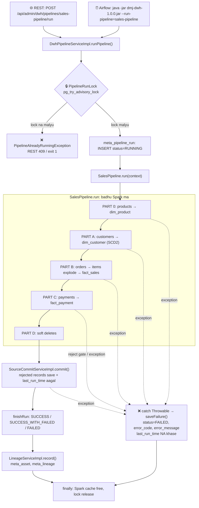
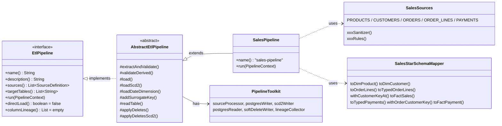
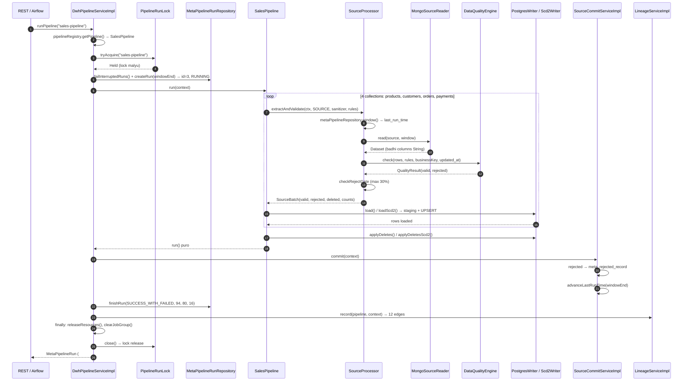
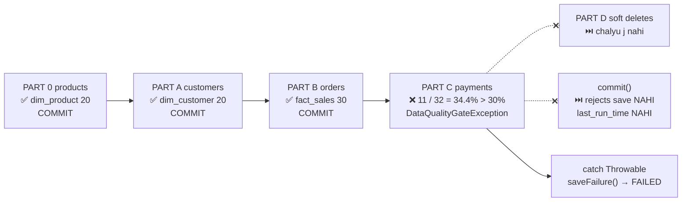

# 🛒 sales-pipeline: End-to-End Flow (real data sathe)

> `sales-pipeline` run karo tyare **kyathi start thay**, **kai class / interface / method call thay**, ane **darek step par data kevo dekhay** e aa file ma che. Success ane failed banne flow che.
>
> **Badho data real che.** Data `silver` DB (`localhost:5433`) ane Mongo `bronze_db` mathi lidho che, 2026-11-24 na full-flow test pachhi.
> - Run **#3** = pehlo run (full load).
> - Run **#9** = incremental run.
> - Failed flow alag temp DB (`dwh_failtest` / `bronze_failtest`) par sacho run karine joyo, pachhi e DB drop kari didha.
>
> 📌 Diagrams Mermaid ma che. GitHub / GitLab par direct dekhay. VS Code ma *"Markdown Preview Mermaid Support"* extension joie.

---

## 📑 Index

1. [Ek najar ma: aakho flow](#1--ek-najar-ma-aakho-flow)
2. [Trigger: 2 rasta (REST / Airflow)](#2--trigger-2-rasta)
3. [Class / Interface map](#3--class--interface-map)
4. [Sequence diagram (method calls)](#4--sequence-diagram)
5. [Step-by-step: SUCCESS flow (Run #3, real data)](#5--step-by-step-success-flow-run-3)
6. [Incremental run: SCD2, SCD1, soft delete (Run #9)](#6--incremental-run-9)
7. [FAILED flow (real test)](#7--failed-flow)
8. [Bija failure cases](#8--bija-failure-cases)
9. [Data kya kyare pohchyo (summary)](#9--summary-data-kya-kyare-pohchyo)
10. [Jate joi shako: SQL](#10--jate-joi-shako-sql)

---

## 1. 🗺️ Ek najar ma: aakho flow



Data ni disha:

```
MongoDB bronze_db                 Spark (JVM memory)                       PostgreSQL silver DB
─────────────────                 ──────────────────                       ────────────────────
products   (24 docs) ──read──▶  sanitize ▶ validate ▶ dedupe ──upsert──▶  curated.dim_product    (20)
customers  (23 docs) ──read──▶  sanitize ▶ validate ▶ dedupe ──SCD2────▶  curated.dim_customer   (20)
orders     (24 docs) ──read──▶  validate ▶ items[] explode ▶ keys ─────▶  curated.fact_sales     (30 lines)
payments   (23 docs) ──read──▶  sanitize ▶ validate ▶ keys ────────────▶  curated.fact_payment   (20)
                                        │                                  silver.dim_date        (shared)
                                        └── rejected (16) ─────────────▶  meta.meta_rejected_record
                                                                           meta.meta_pipeline_run / meta_lineage
```

---

## 2. 🚦 Trigger: 2 rasta

Banne rasta ante **ek j method** `DwhPipelineService.runPipeline("sales-pipeline")` par aave che. Pachhi no flow 100% same che.

### 2a. REST (web server chalu hoy tyare)

```
POST http://localhost:8080/api/admin/dwh/pipelines/sales-pipeline/run
```

| # | Class | Method | Shu kare |
|---|---|---|---|
| 1 | `web/rest/DwhPipelineResource` | `runPipeline(@PathVariable pipelineName)` | URL mathi `"sales-pipeline"` le |
| 2 | `service/DwhPipelineService` (**interface**) | `runPipeline(String)` | contract |
| 3 | `service/impl/DwhPipelineServiceImpl` (**implementation**) | `runPipeline(String)` | aakho run chalave. Run pure thay pachhi j response aape (synchronous) |

Response = puro thayelo run (real run #3, `MetaPipelineRun` record):

```json
{
  "pipelineRunId": 3,
  "pipelineId": 4,
  "pipelineName": "sales-pipeline",
  "lastRunTime": "2026-11-24T00:57:08.870+05:30",
  "startTime":   "2026-11-24T00:57:08.872+05:30",
  "endTime":     "2026-11-24T00:57:36.114+05:30",
  "pipelineStatus": "SUCCESS_WITH_FAILED",
  "totalRecords": 94, "successRecords": 80, "failedRecords": 16,
  "errorCode": null, "errorMessage": null
}
```

> FAILED run hoy to pan HTTP **200** j aave. Kem fail thayo e `errorCode` / `errorMessage` ma hoy.

### 2b. Airflow (batch mode, web server vagar)

```
java -jar dmj-dwh-1.0.0.jar --spring.profiles.active=prod --run-pipeline=sales-pipeline
```

| # | Class | Method | Shu kare |
|---|---|---|---|
| 1 | `DmjDwhApp` | `main(args)` | `PipelineBatchRunner.isBatchMode(args)` true hoy to `WebApplicationType.NONE`, etle Tomcat start nathi thatu |
| 2 | Spring Boot | context start | beans bane: `SparkConfig` (SparkSession `local[*]`), `PipelineRegistry` (badhi 6 pipelines) |
| 3 | `DwhPipelineServiceImpl` | `onStartup()` (`@EventListener(ApplicationStartedEvent)`) | darek pipeline `meta.meta_pipeline` ma register thay. Pehla marela process e `RUNNING` chhodela runs `FAILED` thay |
| 4 | `batch/PipelineBatchRunner` | `run(ApplicationArguments)` | `--run-pipeline` vanche, pachhi `pipelineService.runPipeline("sales-pipeline")` call kare |
| 5 | `PipelineBatchRunner` | `getExitCode()` | `SUCCESS` / `SUCCESS_WITH_FAILED` hoy to **0**, `FAILED` hoy to **1** |
| 6 | `DmjDwhApp` | `System.exit(SpringApplication.exit(context))` | JVM bandh, ane Airflow ne exit code male |

Real log (run #3, batch mode):

```
00:57:02.686 Starting DmjDwhApp v1.0.0 using Java 17.0.19
00:57:05.150 SparkConfig: Starting SparkSession (master=local[*], app=dmj-dwh)
00:57:08.413 Started DmjDwhApp in 6.608 seconds
00:57:08.800 Batch mode: running sales-pipeline
...
00:57:36.184 DWH_RESULT pipeline=sales-pipeline pipelineRunId=3 status=SUCCESS_WITH_FAILED total=94 success=80 failed=16 errorCode=null exitCode=0
```

---

## 3. 🧩 Class / Interface map



| Layer | Interface / class | Implementation | Kaam |
|---|---|---|---|
| Entry | `DwhPipelineResource` / `PipelineBatchRunner` | | REST / Airflow trigger |
| Service | `DwhPipelineService` (interface) | `DwhPipelineServiceImpl` | run nu orchestration: lock, run row, try/catch, finish |
| Service | `SourceCommitService` (interface) | `SourceCommitServiceImpl` | rejects save, `last_run_time` aagal |
| Service | `LineageService` (interface) | `LineageServiceImpl` | `meta_asset` / `meta_lineage` |
| Service | | `PipelineRunLock` | Postgres advisory lock |
| Core | `EtlPipeline` (interface) | `AbstractEtlPipeline` → **`SalesPipeline`** | pipeline nu contract → base helpers → sales logic |
| Core | | `PipelineRegistry` | `"sales-pipeline"` naam thi `SalesPipeline` bean shodhe (Spring list inject kare) |
| Core | | `PipelineContext` | ek run ni state: `pipelineRunId`, `windowEnd`, metrics, batches, lineage edges, cache |
| Core | | `LineageCollector` | Spark plan mathi table lineage shodhe |
| Connector source | | `SourceProcessor` | window → read → sanitize → soft delete split → validate → dedupe → reject gate |
| Connector source | | `MongoSourceReader` | Mongo `$match` sathe read |
| Connector target | | `PostgresWriter` | staging table, pachhi `INSERT ... ON CONFLICT DO UPDATE` |
| Connector target | | `Scd2Writer` | SCD2: SCD1 update, close, insert (3 SQL, ek transaction) |
| Connector target | | `PostgresReader` | dim tables vanche (lookup / ORPHAN check) |
| Connector target | | `SoftDeleteWriter` | `is_deleted = TRUE` |
| Validation | | `DataSanitizer`, `DataQualityRules`, `DataQualityEngine` | clean, rules, valid/rejected split |
| Repository | | `MetaPipelineRepository`, `MetaPipelineRunRepository`, `RejectedRecordRepository` ... | meta tables nu SQL |

---

## 4. 🔁 Sequence diagram



---

## 5. 🟢 Step-by-step: SUCCESS flow (Run #3)

### Step 1: Pipeline shodhvi

```java
// DwhPipelineServiceImpl.runPipeline
EtlPipeline pipeline = pipelineRegistry.getPipeline("sales-pipeline");   // → SalesPipeline bean
```

`PipelineRegistry` ne Spring badha `EtlPipeline` beans aape che (`@Component` vaala 6 class). Naam khotu hoy to `PipelineNotFoundException` aave: REST ma 404, batch ma exit 1.

### Step 2: Lock 🔒

```sql
-- PipelineRunLock.tryAcquire: alag DriverManager connection par (pool par nahi)
SELECT pg_try_advisory_lock(hashtext('dmj-dwh:pipeline:sales-pipeline'));   -- true = lock malyu
```

Lock run pure thay tya sudhi rahe. JVM mare to Postgres connection bandh thay ane lock aapo-aap chhuti jaay.

### Step 3: Run row banavvi

```java
Instant windowEnd = Instant.now().truncatedTo(MILLIS);          // 2026-11-23T19:27:08.870Z  (= 00:57:08.870 IST)
long pipelineRunId = pipelineRunRepository.createRun("sales-pipeline", windowEnd);   // → 3
```

`meta.meta_pipeline_run` ma aa row tarat j dekhay:

| pipeline_run_id | pipeline_id | pipeline_status | start_time | last_run_time (= window end) | end_time |
|---|---|---|---|---|---|
| 3 | 4 | **RUNNING** | 00:57:08.872 | 00:57:08.870 | NULL |

### Step 4: Context

```java
PipelineContext context = new PipelineContext(3, "sales-pipeline", windowEnd, directLoad=false);
spark.sparkContext().setJobGroup("etl-job-3", "sales-pipeline until 2026-11-23T19:27:08.870Z", true);
```

`directLoad() = false` (sales staging pipeline che), etle mota transaction vagar `pipeline.run()` ane `commit()` chale. Darek table potanu alag commit kare.

### Step 5: `SalesPipeline.run(context)`

#### PART 0: products → `curated.dim_product`

```java
SourceBatch products = extractAndValidate(context, SalesSources.PRODUCTS,
        SalesSources.productSanitizer(), SalesSources.productRules());
load(context, toDimProduct(products.valid()), DIM_PRODUCT, "product_code");
```

**5.0.a WINDOW**: `MetaPipelineRepository.window()`

```sql
SELECT last_run_time FROM meta.meta_pipeline WHERE pipeline_name = 'sales-pipeline';   -- NULL → first run
```

**5.0.b EXTRACT**: `MongoSourceReader.read()`. Real `$match` (log mathi):

```json
[{"$match": {"updated_at": {"$lte": {"$date": "2026-11-23T19:27:08.87Z"}}}}]
```

First run hovathi `$gt` nathi. Incremental run ma `$gt: last_run_time` umerase.

Schema = `_id` + `SourceDefinition.fields(...)`, **badhi columns String**. Mongo document ane Spark row (P012):

```
MongoDB document                                   Spark row (raw)  — badhu String
{                                                  _id          = "6b04...0b0..."
  product_code: "P012",                            product_code = "P012"
  name: "Electric Kettle",                         name         = "Electric Kettle"
  brand: {code:"B07", name:"KitchenPro"},          brand        = "{\"code\": \"B07\", \"name\": \"KitchenPro\"}"
  category: {code:"C-HOM-KIT",                     category     = "{\"code\": \"C-HOM-KIT\", \"name\": \"Kitchen Appliances\",
             name:"Kitchen Appliances",                            \"parent\": {... \"name\": \"Home & Kitchen\"}}"
             parent:{name:"Home & Kitchen"}},
  price: "₹1,200",                                 price        = "₹1,200"
  is_active: true,                                 is_active    = "true"
  updated_at: ISODate("2026-10-06T03:30:00Z")      updated_at   = "2026-10-06T03:30:00Z"
  supplier, stock ...  ← fields() ma nathi         (vanchata j nathi)
}                                                  _raw_record  = JSON copy (rejected table mate)
```

**5.0.c SANITIZE**: `DataSanitizer.apply()`. Steps je order ma umerya e j order ma chale:

| Step | P012 pachhi | Bija real example |
|---|---|---|
| `fromJson("brand_name","brand","$.name")` | `brand_name = KitchenPro` | P007 `"urbanwear"` |
| `fromJson("category_name",...)`, `parent_category_name` | `Kitchen Appliances`, `Home & Kitchen` | P021: category `null`, etle `category_name = NULL` |
| `trimAllAndBlankToNull()` | | P013 `"  non-stick tawa "` → `"non-stick tawa"` |
| `toUpperCase("product_code")`, `toLowerCase("is_active")` | `P012`, `true` | |
| `custom("price", amountText)` | `"₹1,200"` → **`"1200"`** | P022 `"abc"` → `"abc"` (rule pakdase) |

**5.0.d SOFT DELETE SPLIT**: `isDeleted = true` vaala keys alag kadhe. Run #3 ma ek pan nathi.

**5.0.e VALIDATE + DEDUPE**: `DataQualityEngine.check()`

1. Rules evaluate thay. Darek row ne fail thayela rules no array male.
2. Error vaali rows rejected ma jaay.
3. Bachi rows `product_code` par `row_number() OVER (ORDER BY updated_at DESC)` thi dedupe thay. 2 jo number hoy to `DUPLICATE`.

| product | value | rule | error_type |
|---|---|---|---|
| P003 (10-05 version) | 2 copies | latest `updated_at` (10-20) rahe | DUPLICATE |
| P021 | `category_name = NULL` | `required(...)` | VALIDATION |
| P022 | `price = "abc"` | `mustBeDecimal("price")` | CORRUPT |
| P023 | `price = "-150"` | `mustBePositive("price")` | VALIDATION |

**5.0.f REJECT GATE**: `checkRejectGate()`. Bad rows = rejected − duplicates = 3, etle 3 / 24 = **12.5% ≤ 30%**, gate pass ✅.

Log:
```
[job 3] products: read=24, valid=20, rejected=4 (of which duplicates=1), deleted at source=0
```

**5.0.g TRANSFORM + LOAD**: `toDimProduct()` columns rename + cast kare. Pachhi `AbstractEtlPipeline.load()`:

1. `LineageCollector.record()` Spark plan mathi shodhe ke data `products` collection mathi aavyo. Edge `products → dim_product` context ma save thay (DB ma haju nahi).
2. `PostgresWriter.upsert()`:
   - `is_deleted=false`, `deleted_at=NULL`, `job_run_id=3`, `loaded_at=now()` umerase;
   - `dropDuplicates(product_code)`;
   - Spark JDBC staging table `etl_staging.stg_curated_dim_product_3_1` ma lakhe;
   - pachhi ek SQL chale:

```sql
INSERT INTO curated.dim_product (product_code, product_name, brand_name, category_name, parent_category_name,
                                 current_price, is_active, is_deleted, deleted_at, job_run_id, loaded_at)
SELECT ... FROM etl_staging.stg_curated_dim_product_3_1
ON CONFLICT (product_code) DO UPDATE SET product_name = EXCLUDED.product_name, ...;
DROP TABLE IF EXISTS etl_staging.stg_curated_dim_product_3_1;      -- finally
```

Aa statement auto-commit che, etle **dim_product have DB ma dekhay che** (run haju chalu che tyare pan).

Result (`curated.dim_product`, real):

| product_key | product_code | product_name | brand_name | category_name | parent_category_name | current_price | job_run_id |
|---|---|---|---|---|---|---|---|
| 9 | P001 | Smartphone Pro 5G | Volt | Mobiles | Electronics | 25000.00 | 3 |
| 18 | P012 | Electric Kettle | KitchenPro | Kitchen Appliances | Home & Kitchen | **1200.00** | 3 |
| 19 | P013 | non-stick tawa | CookEasy | Cookware | Home & Kitchen | 700.00 | 3 |

```
[job 3] loaded curated.dim_product: 20 rows
```

#### PART A: customers → `curated.dim_customer` (SCD2)

```java
SourceBatch customers = extractAndValidate(context, SalesSources.CUSTOMERS, customerSanitizer(), customerRules());
loadScd2(context, toDimCustomer(customers.valid()), CUSTOMER_SCD2);
// CUSTOMER_SCD2 = Scd2Spec("curated.dim_customer", "customer_code",
//                          scd2Columns = [city, state, pincode, tier], "changed_at", "first_valid_from")
```

Sanitize, real values:

| customer | Mongo ma | sanitize pachhi | step |
|---|---|---|---|
| C002 | `"  PRIYA.SHAH@MAIL.COM "` | `priya.shah@mail.com` | trim + `toLowerCase` |
| C004 | `"+91-98765 00004"` | `9876500004` | `normalizeIndianPhone` |
| C007 | state `"RJ"` | `Rajasthan` | `mapValues(STATE_CODES)` |
| C013 | city `"lucknow "` | `Lucknow` | trim + `toProperCase` |
| C011 | tier `null` | `Bronze` | `defaultIfNull` |

Rejected: C005 (DUPLICATE, 09-01 vaalu juno version), C021 (`test@@mail`, `mustBeValidEmail`), C022 (name NULL, `required`).

`toDimCustomer()` be technical columns umere:
- `changed_at = updated_at`;
- `first_valid_from = signup_date`.

`Scd2Writer.load()`: staging `stg_curated_dim_customer_3_2`, pachhi **3 SQL ek nana transaction ma**:

```
1. SCD1  UPDATE: name/email/phone/signup_date badlaya hoy tya overwrite        → 0  (first run)
2. CLOSE UPDATE: current version nu city/state/pincode/tier badlayu hoy to close → 0
3. INSERT: jena current version nathi e key mate navu version                    → 20
```
```
[job 3] SCD2 curated.dim_customer: scd1Updated=0, closed=0, inserted=20
```

#### PART B: orders → items explode → `curated.fact_sales`

```java
SourceBatch orders = extractAndValidate(context, ORDERS, orderSanitizer(),
        orderRules(readTable(DIM_CUSTOMER, "customer_code")));      // ← ORPHAN check mate DB mathi dim_customer
```

`readTable` JDBC thi `curated.dim_customer` vanche. PART A commit thai gayu che, etle C001-C020 dekhay che.

| order | problem | rule | type |
|---|---|---|---|
| O1005 (10-03 copy) | 2 copies | latest rahe | DUPLICATE |
| O1021 | customer `C099` | `mustExistIn(customer_code, dim_customer)` | **ORPHAN** |
| O1022 | order_ts `"2026-13-45"` | `mustBeTimestamp` | CORRUPT |
| O1023 | `items: []` | `custom: size(items) <= 0` | VALIDATION |

```
[job 3] orders: read=24, valid=20, rejected=4 (of which duplicates=1), deleted at source=0
```

**items[] explode**: `SalesStarSchemaMapper.toOrderLines()`. Ek order mathi darek line ni ek row bane:

```
orders.valid() ma 1 row (O1008):
  order_no=O1008, customer_code=C007, status=RETURNED, payment_method=COD,
  items = '[{"product_code":"P017","qty":2,"unit_price":1800},{"product_code":"P018","qty":0,"unit_price":900}]'

            ▼ posexplode(from_json(items))

  line_id        | _id                         | order_no | line_no | product_code | qty | unit_price
  O1008/line-1   | 6b04...0b2d#1               | O1008    | 1       | P017         | 2   | 1800
  O1008/line-2   | 6b04...0b2d#2               | O1008    | 2       | P018         | 0   | 900      ← qty 0
```

Pachhi `validateDerived(context, ORDER_LINES, lines, orderLineRules(readTable(DIM_PRODUCT,"product_code")))`. **Kharab line ekli j reject thay. Order ni baaki lines load thay.**

| line | problem | type |
|---|---|---|
| O1008/line-2 | qty 0 | VALIDATION (`mustBePositive`) |
| O1012/line-2 | product P022 `dim_product` ma nathi (PART 0 ma reject thayo hato) | ORPHAN |

```
[job 3] orders.items: lines=32, valid=30, rejected=2
```

**Surrogate keys umervi**:

```java
Dataset<Row> typedLines = toTypedOrderLines(lines.valid());          // String → INT / DECIMAL / TIMESTAMP
loadDateDimension(context, typedLines, "order_ts");                  // silver.dim_date: 16 dates
linesWithKeys = withCustomerKeyAt(typedLines, dim_customer versions, "order_ts");   // SCD2 point-in-time
linesWithKeys = addSurrogateKey(linesWithKeys, DIM_PRODUCT, "product_key", "product_code");
linesWithKeys = addSurrogateKey(linesWithKeys, DIM_ORDER_STATUS, "order_status_key", "status_code");
linesWithKeys = addSurrogateKey(linesWithKeys, DIM_PAYMENT_METHOD, "payment_method_key", "method_code");
load(context, toFactSales(linesWithKeys), FACT_SALES, "order_no", "line_no");
```

`withCustomerKeyAt` evu version shodhe jema `customer_code` match thay ane `valid_from <= order_ts < valid_to` hoy. E na male to current version le.

O1001 ni ek line, step-by-step:

```
order_no  line_no  customer_code  product_code  status_code  method_code  order_ts              quantity  unit_price
O1001     1        C001           P001          DELIVERED    UPI          2026-10-01 10:15 IST  1         25000.00
   ▼ withCustomerKeyAt      → customer_key       = 1     (C001 nu version, valid 2025-01-10 .. 9999-12-31)
   ▼ addSurrogateKey x3     → product_key        = 9     (P001)
                              order_status_key   = 3     (DELIVERED, seeded)
                              payment_method_key = 1     (UPI, seeded)
   ▼ toFactSales            → order_date_key = 20261001, line_amount = 1 × 25000 = 25000.00
```

Result (`curated.fact_sales`, real):

| sales_key | order_no | line_no | order_date_key | customer_key | product_key | payment_method_key | order_status_key | quantity | unit_price | line_amount |
|---|---|---|---|---|---|---|---|---|---|---|
| 12 | O1001 | 1 | 20261001 | 1 | 9 | 1 | 3 | 1 | 25000.00 | 25000.00 |
| 8 | O1001 | 2 | 20261001 | 1 | 13 | 1 | 3 | 2 | 2000.00 | 4000.00 |
| 9 | O1008 | 1 | 20261005 | 3 | 11 | 4 | 5 | 2 | 1800.00 | 3600.00 |
| 30 | O1012 | 1 | 20261008 | 9 | 1 | 3 | 3 | 1 | 12000.00 | 12000.00 |

O1008 ane O1012 ni line 2 table ma nathi. E bane `meta_rejected_record` ma che.

```
[job 3] loaded silver.dim_date: 16 rows
[job 3] loaded curated.fact_sales: 30 rows
```

#### PART C: payments → `curated.fact_payment`

```java
SourceBatch payments = extractAndValidate(context, PAYMENTS, paymentSanitizer(),
        paymentRules(readTable(FACT_SALES, "order_no")));   // ← AAKHU fact_sales (aa run + juna runs)
Dataset<Row> typedPayments = toTypedPayments(payments.valid());
loadDateDimension(context, typedPayments, "paid_at");
paymentsWithKeys = withOrderCustomerKey(typedPayments, readTable(FACT_SALES, "order_no", "customer_key"));
paymentsWithKeys = addSurrogateKey(paymentsWithKeys, DIM_PAYMENT_METHOD, "payment_method_key", "method_code");
load(context, toFactPayment(paymentsWithKeys), FACT_PAYMENT, "payment_id");
```

| payment | Mongo | pachhi | result |
|---|---|---|---|
| PAY01 | amount `"₹29,000"` | `29000.00` | ✅ loaded |
| PAY12 | method `"Net Banking"` | `NETBANKING` (key 3) | ✅ loaded |
| PAY05 | callback 2 vaar | latest rahe | ❌ DUPLICATE |
| PAY21 | order O1021 | O1021 PART B ma reject thayo, etle fact_sales ma nathi | ❌ ORPHAN |
| PAY22 | amount `"abc"` | | ❌ CORRUPT |

Payment ne customer nathi, etle `withOrderCustomerKey` order nu `customer_key` fact_sales mathi le.

| payment_key | payment_id | order_no | payment_date_key | customer_key | payment_method_key | payment_status | amount |
|---|---|---|---|---|---|---|---|
| 1 | PAY01 | O1001 | 20261001 | 1 | 1 | SUCCESS | 29000.00 |
| 12 | PAY12 | O1012 | 20261008 | 9 | 3 | SUCCESS | 12999.00 |

#### PART D: soft deletes

```java
applyDeletes(context, products, DIM_PRODUCT, "product_code");
applyDeletesScd2(context, customers, CUSTOMER_SCD2);
applyDeletes(context, orders, FACT_SALES, "order_no");
applyDeletes(context, payments, FACT_PAYMENT, "payment_id");
```

Run #3 ma `deletedCount = 0`, etle fakt `context.markDeletesApplied(collection)` thay. Commit ma aa ek safety check che. Run #9 ma sacha deletes che ([section 6](#6--incremental-run-9)).

### Step 6: Commit: `SourceCommitServiceImpl.commit(context)`

`pipeline.run()` kai pan exception vagar puru thay **pachhi j** aa chale:

1. **Safety**: koi collection na deletes aavya hoy pan `applyDeletes` call na thayu hoy to `IllegalStateException` aave.
2. **Rejected records**: darek `SourceBatch` mate (products, customers, orders, orders.items, payments):

   ```
   rejected Dataset ─▶ QualityColumns.oneRowPerError ─▶ etl_staging.stg_rejected_<collection>_3_N
                   ─▶ RejectedRecordRepository.saveFromStaging():
                        a) nava error messages → meta.meta_error_master (error_id)
                        b) CTE: ARRAY_AGG(error_id), STRING_AGG(message), JSONB_OBJECT_AGG(field → value)
                           → INSERT meta.meta_rejected_record ... ON CONFLICT (pipeline, collection, source_id) DO UPDATE
   ```
3. **Watermark**: `UPDATE meta.meta_pipeline SET last_run_time = '2026-11-23T19:27:08.870Z'`, etle next run ahi thi vanchse.

Real `meta.meta_rejected_record` (sales, 16 rows):

| id | source_collection | business_key | error_ids | error_messages | field_values |
|---|---|---|---|---|---|
| 20 | products | P003 | {102} | another record with the same product_code was kept (latest updated_at wins) | `{"product_code": "P003"}` |
| 21 | products | P021 | {112} | category_name is required | `{"category_name": null}` |
| 22 | products | P022 | {105} | price is not a valid number | `{"price": "abc"}` |
| 23 | products | P023 | {135} | price must be greater than 0 | `{"price": "-150"}` |
| 24 | customers | C005 | {104} | another record with the same customer_code was kept ... | `{"customer_code": "C005"}` |
| 25 | customers | C021 | {19} | email is not a valid email address | `{"email": "test@@mail"}` |
| 26 | customers | C022 | {113} | name is required | `{"name": null}` |
| 27 | orders | O1005 | {115} | another record with the same order_no was kept ... | `{"order_no": "O1005"}` |
| 28 | orders | O1021 | {132} | customer_code not found in dim_customer | `{"customer_code": "C099"}` |
| 29 | orders | O1022 | {116} | order_ts is not a valid timestamp (expected yyyy-MM-ddTHH:mm:ss) | `{"order_ts": "2026-13-45"}` |
| 30 | orders | O1023 | {128} | items must contain at least one line | |
| 31 | orders.items | O1008/line-2 | {134} | qty must be greater than 0 | `{"qty": "0"}` |
| 32 | orders.items | O1012/line-2 | {141} | product_code not found in dim_product | `{"product_code": "P022"}` |
| 33 | payments | PAY05 | {124} | another record with the same payment_id was kept ... | `{"payment_id": "PAY05"}` |
| 34 | payments | PAY21 | {106} | order_no not found in fact_sales | `{"order_no": "O1021"}` |
| 35 | payments | PAY22 | {110} | amount is not a valid number | `{"amount": "abc"}` |

`raw_record` ma original document hoy, example O1008/line-2:
```json
{"qty": "0", "line_no": 2, "order_no": "O1008", "unit_price": "900", "product_code": "P018"}
```

### Step 7: Run row puri karvi

```java
long successRecords = valid(80) + deleted(0);              // 80
PipelineStatus status = PipelineStatus.of(80, 16);         // rejected > 0 ane success > 0 → SUCCESS_WITH_FAILED
pipelineRunRepository.finishRun(3, status, 94, 80, 16, null, null);
```

| total_records | gani |
|---|---|
| 94 | products 24 + customers 23 + orders 24 + payments 23 (lines ganata nathi) |
| 80 | 20 + 20 + 20 + 20 valid documents |
| 16 | 4 + 3 + 4 + **2 lines** + 3 |

`PipelineStatus.of` no niyam:

```
rejected == 0                → SUCCESS
rejected > 0, success > 0    → SUCCESS_WITH_FAILED
rejected > 0, success == 0   → FAILED  (error_code = ALL_RECORDS_REJECTED)
```

### Step 8: Lineage: `LineageServiceImpl.record()`

Run dauran context ma bhega karela edges have DB ma lakhay (potana transaction ma). Fail thay to fakt warning aave, run SUCCESS j rahe.

| source | type | → target |
|---|---|---|
| products | COLLECTION | dim_product |
| customers | COLLECTION | dim_customer |
| orders | COLLECTION | fact_sales, dim_date |
| dim_customer, dim_product, dim_order_status, dim_payment_method | TABLE | fact_sales |
| payments | COLLECTION | fact_payment, dim_date |
| fact_sales, dim_payment_method | TABLE | fact_payment |

ORPHAN check mate vanchela tables (example: orders mate `dim_customer.customer_code`) lineage ma nathi. Ema thi koi column output ma jati nathi. `fact_sales` mate `dim_customer` che, kem ke `customer_key` output ma jaay che.

### Step 9: finally

```java
context.releaseResources();             // badha persist() karela Datasets unpersist
spark.sparkContext().clearJobGroup();
// try-with-resources: lock.close() → advisory lock release
```

### Run #3 no aakho real log

```
00:57:08.877 ========== Job 3 STARTED: pipeline=sales-pipeline, windowEnd=2026-11-23T19:27:08.870Z ==========
00:57:12.150 [job 3] extract products (updated_at <= 2026-11-23T19:27:08.870Z (first run))
00:57:19.564 [job 3] products: read=24, valid=20, rejected=4 (of which duplicates=1), deleted at source=0
00:57:20.537 [job 3] loaded curated.dim_product: 20 rows
00:57:20.598 [job 3] extract customers (updated_at <= 2026-11-23T19:27:08.870Z (first run))
00:57:22.678 [job 3] customers: read=23, valid=20, rejected=3 (of which duplicates=1), deleted at source=0
00:57:23.170 [job 3] SCD2 curated.dim_customer: scd1Updated=0, closed=0, inserted=20
00:57:23.175 [job 3] loaded curated.dim_customer: 20 rows
00:57:23.400 [job 3] extract orders (updated_at <= 2026-11-23T19:27:08.870Z (first run))
00:57:26.003 [job 3] orders: read=24, valid=20, rejected=4 (of which duplicates=1), deleted at source=0
00:57:28.393 [job 3] orders.items: lines=32, valid=30, rejected=2
00:57:29.067 [job 3] loaded silver.dim_date: 16 rows
00:57:30.547 [job 3] loaded curated.fact_sales: 30 rows
00:57:30.650 [job 3] extract payments (updated_at <= 2026-11-23T19:27:08.870Z (first run))
00:57:32.859 [job 3] payments: read=23, valid=20, rejected=3 (of which duplicates=1), deleted at source=0
00:57:33.312 [job 3] loaded silver.dim_date: 15 rows
00:57:34.277 [job 3] loaded curated.fact_payment: 20 rows
00:57:36.113 ========== Job 3 SUCCESS_WITH_FAILED in 27236 ms: read=94, valid=80, rejected=16, deleted=0, loaded=121 ==========
00:57:36.161 [job 3] lineage: 12 edge(s) saved, 0 old edge(s) deactivated
00:57:36.184 DWH_RESULT pipeline=sales-pipeline pipelineRunId=3 status=SUCCESS_WITH_FAILED total=94 success=80 failed=16 errorCode=null exitCode=0
```

---

## 6. 🔄 Incremental run (#9)

`02_mongo_incremental.js` e 12 documents badlya (`updated_at = NOW`). Pachhi run #9 chalyo.

**Window**: `last_run_time` = run #3 no window end.

```json
[{"$match": {"updated_at": {"$gt": {"$date": "2026-11-23T19:27:08.87Z"}, "$lte": {"$date": "2026-11-23T19:30:28.669Z"}}}}]
```

Etle fakt badlayela documents j aave: products 2, customers 4, orders 4, payments 2 = 12.

### 6a. SCD2: C003 Mumbai/Gold thi Pune/Platinum

```
staging row: C003 | city=Pune | pincode=411001 | tier=Platinum | changed_at = 2026-11-24 01:00:19.23

2. CLOSE : current version (key 14) nu city/pincode/tier badlayu ane changed_at > valid_from
           → valid_to = 01:00:19.23, is_current = 'N'
3. INSERT: C003 ne current version nathi → navu version key 21, valid_from = changed_at
```

| customer_key | customer_code | city | tier | valid_from | valid_to | is_current |
|---|---|---|---|---|---|---|
| 14 | C003 | Mumbai | Gold | 2025-03-05 00:00 | 2026-11-24 01:00:19.23 | N |
| 21 | C003 | **Pune** | **Platinum** | 2026-11-24 01:00:19.23 | 9999-12-31 | **Y** |

**Point-in-time**: juno order O1003 (2026-10-02) haju `customer_key = 14` (Mumbai) par j che ✅. Nava order ne key 21 malse.

### 6b. SCD1: C002 no phone badlayo

Phone SCD2 column nathi, etle step 1 (SCD1 UPDATE) e j row overwrite kari: `phone = 9876511122`, `job_run_id = 9`. Navu version nathi banyu.

```
[job 9] SCD2 curated.dim_customer: scd1Updated=1, closed=1, inserted=2      ← inserted = C003 navu + C023 navo customer
```

### 6c. Soft delete

| Source | `SourceProcessor.splitSoftDeletes` | `SoftDeleteWriter` | Result |
|---|---|---|---|
| customer C020 `isDeleted: true` | validate nathi thatu, deleted list ma jaay | `applyDeletesScd2`: current version close | key 20: `is_current=N`, `is_deleted=t`, `valid_to = deleted_at` |
| order O1019 `isDeleted: true` | deleted list | `applyDeletes(FACT_SALES, "order_no")` | O1019 ni **banne lines** `is_deleted = t` |

```sql
-- staging pipeline: SoftDeleteWriter.stagingSql
UPDATE curated.fact_sales t SET is_deleted = TRUE, deleted_at = s.deleted_at, job_run_id = 9, loaded_at = now()
  FROM etl_staging.stg_deleted_curated_fact_sales_9_N s
 WHERE t.order_no = s.deleted_key AND NOT t.is_deleted;
```

| sales_key | order_no | line_no | line_amount | is_deleted | deleted_at |
|---|---|---|---|---|---|
| 26 | O1019 | 1 | 25000.00 | t | 2026-11-24 01:00:19.23 |
| 28 | O1019 | 2 | 2000.00 | t | 2026-11-24 01:00:19.23 |

### 6d. Upsert (update) ane navo data

| | before | after (run #9) |
|---|---|---|
| P003 price | 2000.00 | **1800.00** (`ON CONFLICT DO UPDATE`) |
| P024 | | navo product, key 22 |
| O1010 status | PLACED (key 1) | SHIPPED (key 2), banne lines update |
| O1024 | | navo order, 2 lines, customer C023 (key 22) |
| PAY10 | PENDING | SUCCESS, `payment_date_key` 20261021 |

### Run #9 real log

```
01:00:28.677 ========== Job 9 STARTED: pipeline=sales-pipeline, windowEnd=2026-11-23T19:30:28.669Z ==========
01:00:32.165 [job 9] extract products (updated_at > 2026-11-23T19:27:08.870Z AND <= 2026-11-23T19:30:28.669Z)
01:00:39.868 [job 9] products: read=2, valid=2, rejected=0 (of which duplicates=0), deleted at source=0
01:00:40.848 [job 9] loaded curated.dim_product: 2 rows
01:00:43.293 [job 9] customers: read=4, valid=3, rejected=0 (of which duplicates=0), deleted at source=1
01:00:43.730 [job 9] SCD2 curated.dim_customer: scd1Updated=1, closed=1, inserted=2
01:00:46.562 [job 9] orders: read=4, valid=3, rejected=0 (of which duplicates=0), deleted at source=1
01:00:48.844 [job 9] orders.items: lines=5, valid=5, rejected=0
01:00:51.114 [job 9] loaded curated.fact_sales: 5 rows
01:00:53.472 [job 9] payments: read=2, valid=2, rejected=0 (of which duplicates=0), deleted at source=0
01:00:54.764 [job 9] loaded curated.fact_payment: 2 rows
01:00:54.982 [job 9] soft delete curated.dim_customer: 1 deleted key(s) of customers -> 1 row(s) marked deleted
01:00:55.168 [job 9] soft delete curated.fact_sales: 1 deleted key(s) of orders -> 2 row(s) marked deleted
01:00:55.175 ========== Job 9 SUCCESS in 26498 ms: read=12, valid=10, rejected=0, deleted=2, loaded=17 ==========
01:00:55.247 DWH_RESULT pipeline=sales-pipeline pipelineRunId=9 status=SUCCESS total=12 success=12 failed=0 errorCode=null exitCode=0
```

`success = valid 10 + deleted 2 = 12`, `rejected = 0`, etle **SUCCESS**.

---

## 7. 🔴 FAILED flow

### 7a. Real test: payments reject gate fail

**Setup** (temp DB par): sales no sample data, ane payment gateway e 9 corrupt payments mokalya (`amount: "N/A"`). Etle payments 32 thaya.



**Kya fail thay che** (code):

```java
// SourceProcessor.process → checkRejectGate(batch)
double percent = 100.0 * batch.badRowCount() / batch.activeCount();   // 11 / 32 = 34.4
if (percent > maxPercent /* 30 */) {
    throw new DataQualityGateException(source.collection(), "Reject gate failed for payments: ...");
}
```

Exception upar jaay: `SourceProcessor` → `AbstractEtlPipeline.extractAndValidate` → `SalesPipeline.run` → `DwhPipelineServiceImpl.execute`, jya `catch (Throwable error)` ene pakde.

```java
} catch (Throwable error) {
    log.error("========== Job {} FAILED: {} ==========", ...);
    saveFailure(pipelineRunId, context, error);   // finishRun(FAILED, ..., errorCode(error), shortMessage(error))
    // directLoad=false → resetLoaded() nathi thatu (je tables commit thaya e rahe che)
} finally {
    context.releaseResources(); spark.sparkContext().clearJobGroup();
}
```

**Real log** (fail run):

```
23:17:09.702 ========== Job 1 STARTED: pipeline=sales-pipeline, windowEnd=2026-11-24T17:47:09.695Z ==========
23:17:22.701 [job 1] products: read=24, valid=20, rejected=4 (of which duplicates=1), deleted at source=0
23:17:23.761 [job 1] loaded curated.dim_product: 20 rows
23:17:26.264 [job 1] customers: read=23, valid=20, rejected=3 (of which duplicates=1), deleted at source=0
23:17:26.735 [job 1] SCD2 curated.dim_customer: scd1Updated=0, closed=0, inserted=20
23:17:29.729 [job 1] orders: read=24, valid=20, rejected=4 (of which duplicates=1), deleted at source=0
23:17:32.375 [job 1] orders.items: lines=32, valid=30, rejected=2
23:17:34.560 [job 1] loaded curated.fact_sales: 30 rows
23:17:36.905 [job 1] payments: read=32, valid=20, rejected=12 (of which duplicates=1), deleted at source=0
23:17:37.386 ========== Job 1 FAILED: Reject gate failed for payments: 11 of 32 rows rejected (34.4%), allowed at most 30.0%.
             Errors: CORRUPT=10, ORPHAN=1. Example: [ORPHAN] order_no not found in fact_sales (value: O1021).
             Nothing from this collection was loaded and the last_run_time did not move. Source owner: payments-team@demo.com. ==========
com.tcs.dmj.dwh.service.DataQualityGateException: Reject gate failed for payments: ...
23:17:37.429 DWH_RESULT pipeline=sales-pipeline pipelineRunId=1 status=FAILED total=103 success=80 failed=25 errorCode=DataQualityGateException exitCode=1
```

**DB state fail pachhi** (real):

| Shu | Value | Kem |
|---|---|---|
| `meta_pipeline_run` #1 | **FAILED**, total 103, success 80, failed 25, `error_code = DataQualityGateException` | `saveFailure()` |
| `meta_pipeline.last_run_time` | **NULL** (aagal nathi vadhyu) | `commit()` chalyu j nahi |
| `curated.dim_product` | **20** ⚠️ | PART 0 nu potanu commit thai gayu hatu |
| `curated.dim_customer` | **20** ⚠️ | PART A nu SCD2 transaction commit |
| `curated.fact_sales` | **30** ⚠️ | PART B commit |
| `curated.fact_payment` | **0** | gate load pehla j rokyu |
| `meta_rejected_record` | **0** | rejects commit ma save thay, ane commit chalyu nahi |
| `meta_lineage` | **0** | lineage fakt success par lakhay |
| `etl_staging` tables | **0** | `finally` e drop karya |
| Airflow | exit code **1**, task FAILED, retry | `PipelineBatchRunner` |

> ⚠️ **Staging pipeline ma partial data rahe che.** Dims ane `fact_sales` commit thai gaya, pan `fact_payment` khali che. Aa ek transaction nathi. Fakt `directLoad() = true` vaali pipeline (VAT) ma badhu rollback thay.

**Recovery (real)**: source team e 9 corrupt payments kadhi nakhya, pachhi run fari chalavyo:

```
23:18:08.422 ========== Job 2 STARTED ... (first run)          ← last_run_time NULL hatu, etle fari badhu vanche
23:18:22.285 [job 2] loaded curated.dim_product: 20 rows      ← upsert: same 20 rows update (duplicate nahi)
23:18:25.410 [job 2] SCD2 curated.dim_customer: scd1Updated=0, closed=0, inserted=0   ← kai badlyu nathi
23:18:33.193 [job 2] loaded curated.fact_sales: 30 rows       ← same 30 rows (order_no, line_no) par update
23:18:37.047 [job 2] loaded curated.fact_payment: 20 rows     ← have payments pan aavya
23:18:38.508 ========== Job 2 SUCCESS_WITH_FAILED in 30086 ms: read=94, valid=80, rejected=16, deleted=0, loaded=101 ==========
23:18:38.601 DWH_RESULT ... status=SUCCESS_WITH_FAILED ... exitCode=0
```

| | Fail pachhi | Re-run pachhi |
|---|---|---|
| dim_product / dim_customer / fact_sales | 20 / 20 / 30 | **20 / 20 / 30** (duplicate nahi) |
| fact_payment | 0 | **20** |
| rejected | 0 | **16** |
| last_run_time | NULL | 23:18:08.414 |

`last_run_time` na vadhe ane UPSERT idempotent che, etle re-run thi data aapo-aap sacho thai jaay.

---

## 8. 🧯 Bija failure cases

| # | Case | Kya thay | Class / exception | meta_pipeline_run | last_run_time | Tables | REST / Airflow |
|---|---|---|---|---|---|---|---|
| 1 | Pipeline naam khotu | `pipelineRegistry.getPipeline()` | `PipelineNotFoundException` | row j nathi banti | — | — | **404** / exit 1 |
| 2 | Same pipeline biju process chalave che | `runLock.tryAcquire()` null aape | `PipelineAlreadyRunningException` | navi row nathi | — | — | **409** / exit 1 |
| 3 | Reject gate (section 7) | `SourceProcessor.checkRejectGate` | `DataQualityGateException` | FAILED | NA vadhe | pehla commit thayela rahe | 200 (FAILED) / exit 1 |
| 4 | Mongo / Postgres down, SQL error | read / `jdbc.update` / Spark | e exception (`error_code = Class/RootClass`) | FAILED | NA vadhe | pehla commit thayela rahe | 200 (FAILED) / exit 1 |
| 5 | Badha records reject | exception nathi | `PipelineStatus.of(0, n)` | FAILED, `ALL_RECORDS_REJECTED` | **vadhe** (rejects save thaya) | kai nahi | 200 / exit 1 |
| 6 | Soft delete aavyu pan `applyDeletes` call na thayu | `SourceCommitServiceImpl.commit` | `IllegalStateException` | FAILED | NA vadhe | loads rahe | 200 (FAILED) / exit 1 |
| 7 | JVM kill (Airflow timeout, crash) | | | **RUNNING** rahe | NA vadhe | pehla commit thayela rahe | next start / run vakhte `failInterruptedRuns()` e row `FAILED`, `INTERRUPTED` kare |
| 8 | Lineage save fail | `LineageServiceImpl.record` | warning log | SUCCESS j rahe | vadhe | badhu ok | 200 / exit 0 |
| 9 | Rejected records hoy ane `DWH_FAIL_ON_REJECTED_RECORDS=true` | `PipelineBatchRunner` | | SUCCESS_WITH_FAILED | vadhe | loaded | 200 / **exit 1** |

> **Case 3, 4, 6 nu kaayam nu sutra:** `last_run_time` khasyu nathi, etle next run e j window fari vanche. UPSERT ane SCD2 "only changed rows" hovathi double data na bane.

---

## 9. 📦 Summary: data kya kyare pohchyo

| Kshan | Spark memory | etl_staging | curated / silver | meta |
|---|---|---|---|---|
| Step 3 createRun | | | | `meta_pipeline_run` RUNNING |
| PART 0 load | products batch (cache) | `stg_curated_dim_product_3_1` (thodi sec) | **dim_product commit** | |
| PART A loadScd2 | customers batch | `stg_curated_dim_customer_3_2` | **dim_customer commit** | |
| PART B load | orders + lines | `stg_silver_dim_date_3_3`, `stg_curated_fact_sales_3_4` | **dim_date, fact_sales commit** | |
| PART C load | payments | `..._3_5`, `..._3_6` | **dim_date, fact_payment commit** | |
| commit() | rejected Datasets | `stg_rejected_<collection>_3_N` | | `meta_error_master`, `meta_rejected_record`, `meta_pipeline.last_run_time` |
| finishRun | | | | `meta_pipeline_run` SUCCESS_WITH_FAILED |
| lineage | | | | `meta_asset`, `meta_lineage` |
| finally | **unpersist (khali)** | **badhu drop** | | lock release |

---

## 10. 🔍 Jate joi shako: SQL

Data `silver` DB ma che (`localhost:5433`, postgres / root):

```sql
-- pipeline ane watermark
SELECT pipeline_id, pipeline_name, last_run_time FROM meta.meta_pipeline WHERE pipeline_name = 'sales-pipeline';

-- runs
SELECT r.* FROM meta.meta_pipeline_run r JOIN meta.meta_pipeline p USING (pipeline_id)
 WHERE p.pipeline_name = 'sales-pipeline' ORDER BY r.pipeline_run_id;

-- rejected records + error type
SELECT r.source_collection, r.business_key, r.error_ids, r.error_messages, r.field_values, r.raw_record
  FROM meta.meta_rejected_record r WHERE r.pipeline_name = 'sales-pipeline' ORDER BY r.rejected_record_id;
SELECT * FROM meta.meta_error_master WHERE error_id IN (102,105,106,110,112,113,115,116,124,128,132,134,135,141,19,104);

-- SCD2 history
SELECT customer_key, customer_code, city, tier, valid_from, valid_to, is_current, is_deleted
  FROM curated.dim_customer WHERE customer_code IN ('C002','C003','C020','C023') ORDER BY customer_code, valid_from;

-- fact sathe dims (star join)
SELECT f.order_no, f.line_no, d.full_date, c.customer_code, c.city, p.product_name, s.status_code, m.method_code,
       f.quantity, f.unit_price, f.line_amount, f.is_deleted
  FROM curated.fact_sales f
  JOIN silver.dim_date d            ON d.date_key = f.order_date_key
  JOIN curated.dim_customer c       ON c.customer_key = f.customer_key
  JOIN curated.dim_product p        ON p.product_key = f.product_key
  JOIN curated.dim_order_status s   ON s.order_status_key = f.order_status_key
  JOIN curated.dim_payment_method m ON m.payment_method_key = f.payment_method_key
 ORDER BY f.order_no, f.line_no;

-- lineage
SELECT s.asset_name AS source, s.asset_type, t.asset_name AS target
  FROM meta.meta_lineage l
  JOIN meta.meta_asset s ON s.asset_id = l.source_asset_id
  JOIN meta.meta_asset t ON t.asset_id = l.target_asset_id
  JOIN meta.meta_pipeline p ON p.pipeline_id = l.pipeline_id
 WHERE p.pipeline_name = 'sales-pipeline';
```

Mongo source:

```js
use bronze_db
db.orders.find({ order_no: "O1008" })
db.customers.find({ customer_code: "C003" }).sort({ updated_at: -1 })
```
