# Spark ETL Pipeline Framework: Low Level Design (LLD)

| | |
|---|---|
| **System** | `spark-etl-pipeline` (MongoDB bronze → Spark → PostgreSQL silver star / snowflake schemas) |
| **Document type** | Low Level Design, production edition |
| **Version** | 1.0 (2026-11-09) |
| **Code baseline** | Spring Boot 3.5.16, Java 17, Spark 3.5.9 (Scala 2.12), MongoDB Spark Connector 10.7.0, Flyway, PostgreSQL 17/18, MongoDB 8 |
| **Audience** | Engineers who build, review, deploy or operate the framework and its pipelines |

How to read this document:

* Sections 1 to 20 describe the system **as implemented** in this repository. Every class, table,
  endpoint and setting named here exists in the code.
* Section 21 lists what must change before a **production go-live**, with a design for each item.
  Items there are marked **P0** (blocker), **P1** (needed soon after go-live) or **P2** (improvement).

---

## Table of contents

1. [Purpose, scope, goals](#1-purpose-scope-goals)
2. [Architecture overview](#2-architecture-overview)
3. [Runtime and deployment topology](#3-runtime-and-deployment-topology)
4. [Module and package design](#4-module-and-package-design)
5. [Component specifications](#5-component-specifications)
6. [Key flows (sequence diagrams)](#6-key-flows)
7. [State machines](#7-state-machines)
8. [Data design](#8-data-design)
9. [REST API design](#9-rest-api-design)
10. [Data quality design](#10-data-quality-design)
11. [Consistency, idempotency and failure recovery](#11-consistency-idempotency-and-failure-recovery)
12. [Concurrency and locking](#12-concurrency-and-locking)
13. [Configuration reference](#13-configuration-reference)
14. [Error handling](#14-error-handling)
15. [Observability](#15-observability)
16. [Security](#16-security)
17. [Performance and scalability](#17-performance-and-scalability)
18. [Deployment, orchestration and operations](#18-deployment-orchestration-and-operations)
19. [Testing strategy](#19-testing-strategy)
20. [Extensibility](#20-extensibility)
21. [Production readiness: gaps and target design](#21-production-readiness-gaps-and-target-design)
22. [Appendix](#22-appendix)

---

## 1. Purpose, scope, goals

### 1.1 Purpose

A reusable framework that moves operational data from **MongoDB (bronze, raw documents)** into
**PostgreSQL (silver, dimensional model)** with Apache Spark, and that makes every run
**traceable, repeatable and safe to re-run**. Business teams add a pipeline by writing three small
classes; the framework provides extraction, cleaning, validation, loading, auditing, rejected-record
handling, quality gates and the REST API.

### 1.2 Scope

| In scope | Out of scope |
|---|---|
| Batch ETL MongoDB → PostgreSQL | Streaming / CDC (change streams, Kafka) |
| Star and snowflake schemas (SCD type 1 upserts) | SCD type 2 history (see 21.3) |
| Data quality: sanitize, validate, de-duplicate, warn, gate | Data-quality dashboards (data is exposed via API/SQL) |
| Job / step / rejected / warning audit | Gold layer (aggregates for BI) |
| REST trigger (sync and async) | Scheduling and cross-pipeline dependencies (delegated to Airflow, see 18.3) |

### 1.3 Design goals (and how they are met)

| Goal | Mechanism |
|---|---|
| **Re-runnable (idempotent)** | Upsert on business keys via staging tables; source flags updated only after a successful load |
| **No silent data loss** | Every bad record goes to `etl_rejected_record` with all reasons and the original JSON |
| **Fail loudly on broken sources** | Reject gate, schema-drift check, volume check |
| **Traceable** | `etl_job_run`, `etl_job_step`, `etl_data_warning`; `job_run_id` + `loaded_at` on every silver row and in every MongoDB document |
| **Easy to extend** | Plugin pipelines (`@Component` + `AbstractEtlPipeline`), fluent `SourceDefinition` / `DataSanitizer` / `DataQualityRules` |
| **Privacy by default** | PII fields declared once per source are masked before anything is stored |

---

## 2. Architecture overview

### 2.1 Layers (medallion)

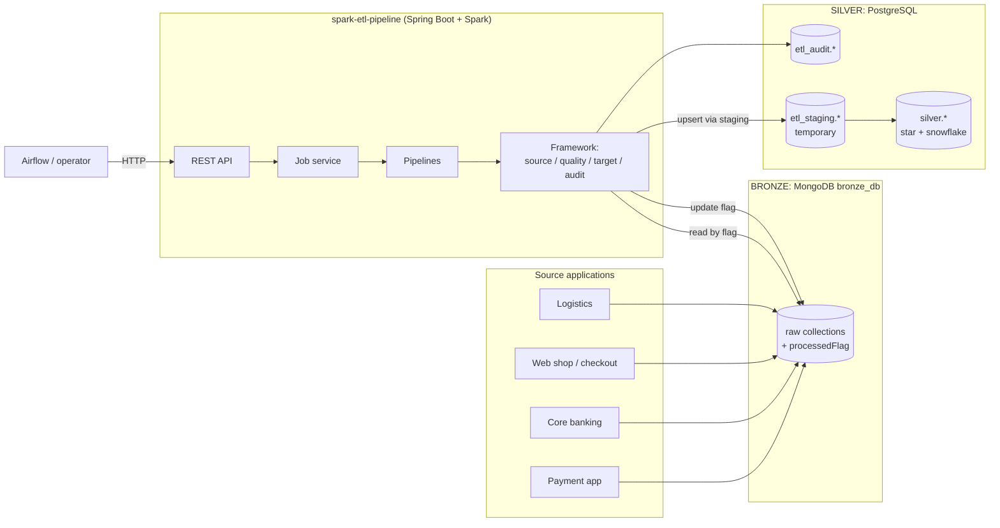

### 2.2 One job run in one picture

```
 trigger ─► lock ─► job_run(RUNNING) ─► [FULL: truncate facts]
          ─► pipeline.run():  for each source:  schema check ─► extract ─► volume check ─► sanitize
                                                ─► validate + dedup + warnings ─► mask PII ─► reject gate
                              transform (mapper) ─► upsert dimensions ─► surrogate keys ─► upsert facts
          ─► commit():        for each source:  save rejects ─► delete resolved ─► save warnings ─► update Mongo flags
          ─► job_run(SUCCESS | SUCCESS_WITH_REJECTS | FAILED) ─► unpersist cache ─► unlock
```

### 2.3 Technology stack

| Concern | Technology | Notes |
|---|---|---|
| Runtime | Java 17, Spring Boot 3.5.16 | Web, Actuator, JDBC, Data MongoDB |
| Processing | Apache Spark 3.5.9 (`spark-sql`, Scala 2.12) | Driver runs inside the Spring Boot JVM |
| Source connector | MongoDB Spark Connector 10.7.0 | Aggregation pipeline push-down (`$match`) |
| Target | PostgreSQL (JDBC), Spark JDBC writer | Upsert via `INSERT … ON CONFLICT` |
| Schema migration | Flyway (`db/migration/V1..V7`) | Runs at startup |
| SQL access | Spring `JdbcTemplate` | Explicit SQL, Postgres features (`RETURNING`, `clock_timestamp()`) |

---

## 3. Runtime and deployment topology

### 3.1 Current (single process)

```
┌──────────────────────── JVM: spark-etl-pipeline.jar ────────────────────────┐
│  Tomcat (HTTP :8080)  ──►  Controllers  ──►  EtlJobService                  │
│                                              │  sync: request thread        │
│                                              │  async: etlJobExecutor pool  │
│                                              ▼                              │
│                          SparkSession (local[*] or spark://master:7077)     │
│                          ONE session shared by all jobs (thread-safe)       │
│  HikariCP ──► PostgreSQL            MongoTemplate / MongoClient ──► MongoDB │
└─────────────────────────────────────────────────────────────────────────────┘
```

* The Spark **driver** lives in the API process. With `local[*]` the executors do too.
* The in-memory `JobLockManager` and the thread pool assume **exactly one instance**.

### 3.2 Production target

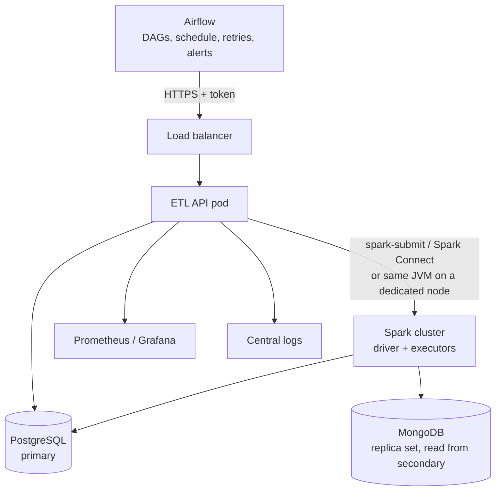

Production rules (details in section 21):

1. **One active job runner** until the lock moves to the database (P0-2).
2. Spark runs on dedicated capacity (a cluster, or at least a node sized for the driver); the API must not
   share memory with large jobs (P1-1).
3. Reads go to a MongoDB **secondary** (`readPreference=secondaryPreferred`) so ETL does not load the
   source application's primary.

---

## 4. Module and package design

### 4.1 Packages

```
com.demo.etl
├── SparkEtlApplication
├── config/        EtlProperties (etl.*), SparkConfig (SparkSession bean), AsyncConfig (job thread pool)
├── api/           REST controllers, GlobalExceptionHandler, dto/ (ApiError, PipelineInfo, SourceInfo)
├── framework/     ★ generic, knows NOTHING about business pipelines
│   ├── pipeline/  SPI: EtlPipeline, AbstractEtlPipeline, PipelineContext, PipelineRegistry,
│   │              PipelineToolkit, JobMetrics, LoadType
│   ├── job/       orchestration: EtlJobService, SourceCommitService, JobLockManager, JobRunDetails
│   ├── source/    SourceDefinition, MongoSourceReader, SchemaDriftDetector, SourceProcessor,
│   │              SourceBatch, MongoFlagUpdater, SourceFlag
│   ├── quality/   DataSanitizer, DataQualityRules, DataQualityEngine, ValidationRule, ReferenceRule,
│   │              QualityResult, QualityColumns, ErrorType, PiiType
│   ├── target/    PostgresWriter, PostgresReader, DateDimension
│   ├── audit/     StepTracker, JobRunRepository, JobStepRepository, RejectedRecordRepository,
│   │              DataWarningRepository + records/enums
│   ├── common/    SparkTypes, SparkUtils, ErrorMessages
│   └── exception/ EtlException hierarchy
├── pipelines/     ★ business code, one package per pipeline
│   ├── payment/                 PaymentPipeline, PaymentSource, PaymentStarSchemaMapper
│   ├── transaction/             TransactionPipeline, TransactionSources, TransactionStarSchemaMapper
│   └── ecommerce/order|fulfillment/  …Pipeline, …Sources, …SchemaMapper
├── ingestion/     sample JSON → MongoDB (bronze loader API)
└── devdata/       @Profile("dev"): startup sample loader, reset endpoint
```

### 4.2 Dependency rules

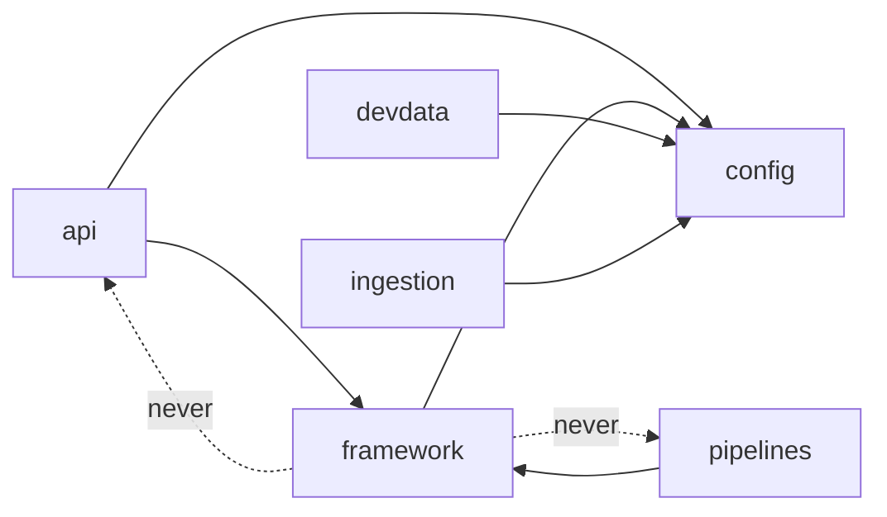

* `framework` must never import from `pipelines` or `api`. Pipelines are discovered at runtime through
  Spring (`List<EtlPipeline>`), not referenced.
* Inside a pipeline package the three classes are **package-private** except the pipeline itself,
  so one pipeline's rules cannot leak into another.

### 4.3 The three classes of a pipeline

| Class | Role | Contains |
|---|---|---|
| `XxxSources` / `XxxSource` | **Contract** of the input | `SourceDefinition` constants, `DataSanitizer` and `DataQualityRules` factories. No Spark logic. |
| `XxxSchemaMapper` | **Transform** | Pure functions `Dataset<Row> → Dataset<Row>` (rename, cast, derive measures, joins). Unit-testable without databases. |
| `XxxPipeline` | **Flow** | `@Component`, extends `AbstractEtlPipeline`; order of extract / load calls; declares `sources()`, `targetTables()`, `fullLoadTruncateTables()` |

---

## 5. Component specifications

### 5.1 Class diagram (core)

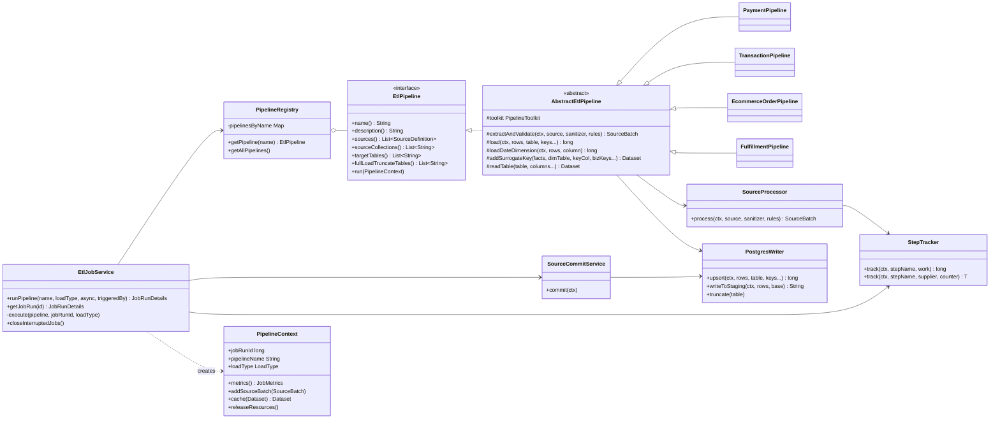

### 5.2 API layer

| Class | Responsibility | Notes |
|---|---|---|
| `EtlPipelineController` | `GET /api/etl/pipelines`, `POST /api/etl/pipelines/{name}/run` | Returns 200 (sync) or 202 (async) with `JobRunDetails` |
| `EtlJobController` | Job history, job details, job warnings | `limit` clamped to 1..500 |
| `RejectedRecordController` | Rejected records list + summary | `limit` clamped to 1..1000 |
| `SampleDataIngestionController` | Loads `sample-data/*.json` into MongoDB | **Must not be exposed in prod** (21, P0-4) |
| `DevDataController` | `POST /api/dev/reset` | `@Profile("dev")` only |
| `GlobalExceptionHandler` | Exception → `ApiError` JSON + HTTP status | See 14.2 |

### 5.3 Job orchestration (`framework.job`)

**`EtlJobService`**

| Method | Behaviour |
|---|---|
| `runPipeline(name, loadType, async, triggeredBy)` | 1. `PipelineRegistry.getPipeline` (404 if unknown) 2. `JobLockManager.acquire` (409 if running) 3. `JobRunRepository.createRun` → `job_run_id` (lock released if this fails) 4. async: submit `execute` to `etlJobExecutor`; queue full → release lock, mark run FAILED "Job queue is full", 503. sync: run `execute` on the request thread 5. return `getJobRun(id)` |
| `execute(pipeline, jobRunId, loadType)` (private) | Creates `PipelineContext`; sets Spark job group `etl-job-<id>`; FULL → truncate `fullLoadTruncateTables()` (one step each); `pipeline.run(ctx)`; `SourceCommitService.commit(ctx)`; status = `SUCCESS_WITH_REJECTS` if any rejected else `SUCCESS`; `finishRun`. `catch (Throwable)` → `finishRun(FAILED, shortMessage, stackTrace)`; `Error`s are re-thrown after saving. `finally`: unpersist cached datasets, clear job group, release lock |
| `closeInterruptedJobs()` | `@EventListener(ApplicationReadyEvent)`: every `RUNNING` job → `FAILED` "Application stopped while the job was running" |

**`SourceCommitService.commit(ctx)`**: for every `SourceBatch` of the run, in order, each as a step:
1. `Save rejected records [c]`: staging + `RejectedRecordRepository.upsertFromStaging` (new → insert, existing → update reason, `attempt_count + 1`)
2. `Remove fixed records from rejected table [c]`: staging of valid `_id`s + delete → `resolved_count`
3. `Save data warnings [c]` (only when the batch has warnings): staging + insert `RULE` warnings
4. `Update MongoDB flags [c]`: valid → `Y`, rejected (not duplicate) → `E`, duplicate → `D`

**`JobLockManager`**: `ConcurrentHashMap.newKeySet()` of running pipeline names. `acquire` throws
`PipelineAlreadyRunningException`; `release` removes; `isRunning` for the API. Single-instance only.

### 5.4 Pipeline SPI (`framework.pipeline`)

| Class | Specification |
|---|---|
| `EtlPipeline` | Contract (see class diagram). `sourceCollections()` is derived from `sources()`. |
| `AbstractEtlPipeline` | Building blocks; every block is a tracked step. `load()` adds the upserted count to `loaded_count`. |
| `PipelineRegistry` | Built from Spring's `List<EtlPipeline>`; `TreeMap` by `name()`; duplicate names fail startup (`IllegalStateException`). |
| `PipelineContext` | Per-run state: id, name, load type, `JobMetrics`, processed `SourceBatch`es, cached datasets (`persist(MEMORY_AND_DISK)`), step counter, staging-table counter. Thrown away after the run. |
| `JobMetrics` | `AtomicLong` counters: source, valid, rejected, duplicate, loaded, resolved, warning. |
| `PipelineToolkit` | Bundles `SourceProcessor`, `PostgresWriter`, `PostgresReader`, `StepTracker` so pipeline constructors take one argument. |
| `LoadType` | `FULL`, `INCREMENTAL`, `RETRY_REJECTED`; `from(String)` case-insensitive, 400 on invalid value. |

### 5.5 Source layer (`framework.source`)

**`SourceDefinition`** (record, immutable): the data contract of one collection.

| Component | Type | Validation at construction |
|---|---|---|
| `collection` | String | |
| `fields` | `List<String>` | Read as **String** (bronze practice: corrupt values stay visible) |
| `businessKey` | String | must be in `fields` |
| `latestRecordColumn` | String | must be in `fields` |
| `checks` | `QualityChecks(maxRejectPercent, minRows, maxRows, failOnSchemaDrift)` | percent in 0..100 |
| `pii` | `Map<String, PiiType>` | keys must be in `fields` |
| `sourceFilter` | String (MongoDB `$match` JSON) or null | |
| `ignoredFields` | `Set<String>` | not reported as drift |
| `metadata` | `SourceMetadata(description, owner, sla)` | |

**`MongoSourceReader`**

* `read(source, loadType)`: Spark `format("mongodb")` with explicit schema (`_id` + fields as String) and
  `aggregation.pipeline` = `matchStages(...)` serialized to JSON, so filtering happens **inside MongoDB**.
* `matchStages(source, loadType)`: `INCREMENTAL` → `{processedFlag: {$in: ["N", null]}}`,
  `RETRY_REJECTED` → `{processedFlag: "E"}`, `FULL` → none; plus `{$match: sourceFilter}` if set.
* `technicalFields()`: `_id`, flag field, `etlJobRunId`, `etlProcessedAt`.

**`SchemaDriftDetector.detect(source, loadType)`**: one aggregation inside MongoDB over the run's
documents: `matchStages` → `$limit schemaSampleSize` → `$objectToArray $$ROOT` → `$unwind` →
`$group by key`. New field = present but not in `fields ∪ ignoredFields ∪ technicalFields`;
missing field = in `fields` but in **no** sampled document. Returns `SchemaDrift(sampled, newFields, missingFields)`.

**`SourceProcessor.process(ctx, source, sanitizer, rules)`**: see sequence 6.3. Produces `SourceBatch`
(valid, rejected, warnings datasets, all cached, plus counts).

**`MongoFlagUpdater.updateFlag(collection, ids, flag, jobRunId)`**: `foreachPartition` on the executors;
each partition opens its own `MongoClient`, sends `bulkWrite` of `UpdateOne(_id)` in batches of 1000,
setting `processedFlag`, `etlJobRunId`, `etlProcessedAt`; a `LongAccumulator` returns matched counts.
No ids are collected on the driver, so it scales with the data.

### 5.6 Quality layer (`framework.quality`)

| Class | Specification |
|---|---|
| `DataSanitizer` | Ordered list of `Dataset → Dataset` steps: `trimAllAndBlankToNull`, `toUpperCase`, `toLowerCase`, `toProperCase`, `removeThousandSeparators`, `normalizeIndianPhone`, `custom(column, fn)`. Technical columns (`_…`) are never touched. |
| `DataQualityRules` | Fluent rule list. Severity ERROR by default; `warnings(w -> …)` adds WARNING rules. Rule kinds: CORRUPT (`mustBeDecimal/Integer/Date/Timestamp`), VALIDATION (`required`, `mustBePositive`, `mustNotBeNegative`, `mustNotBeMoreThan`, `mustBeBetween`, `mustNotBeInFuture`, `mustBeOneOf`, `mustMatch`, `mustBeValidEmail`, `custom`), ORPHAN (`mustExistIn`, not allowed as warning). |
| `ValidationRule` | `(errorType, failWhen: Column, text, valueColumn)`; `message(label, valueOf)` renders `"[LABEL] text (value: x)"` with PII-masked values. |
| `DataQualityEngine` | Algorithm in 10.2. Returns `QualityResult(valid, rejected, warnings)`. Stateless. |
| `PiiType` | `EMAIL`: `r****@domain`, no `@` → `****`. `PHONE`: all but last 4 chars → `X`. Shape-preserving, so existing column lengths still fit. |
| `ErrorType` | `CORRUPT` > `VALIDATION` > `ORPHAN` > `DUPLICATE` (order = priority of the main error type). |

### 5.7 Target layer (`framework.target`)

**`PostgresWriter.upsert(ctx, rows, targetTable, keys…)`**
1. `dropDuplicates(keys)` (ON CONFLICT cannot touch one row twice in a statement)
2. add `job_run_id = ctx.jobRunId`, `loaded_at = current_timestamp()`
3. `writeToStaging`: Spark JDBC `SaveMode.Overwrite` into `etl_staging.stg_<table>_<jobRunId>_<n>`, `batchsize` = `etl.postgres.batch-size`
4. one SQL statement: `INSERT INTO target (cols) SELECT cols FROM staging ON CONFLICT (keys) DO UPDATE SET c = EXCLUDED.c …` (`DO NOTHING` when all columns are keys)
5. `DROP TABLE staging` in `finally`
6. returns rows inserted + updated

**`PostgresReader`**: `readTable(table, cols…)` (Spark JDBC, full table); `addSurrogateKey(facts, dim, keyCol, bizKeys…)`:
left join on the business key(s), adds the surrogate key column. ORPHAN rules guarantee the key exists;
otherwise the `NOT NULL` FK in the fact table fails the load step (by design: no silent orphan rows).

**`DateDimension`**: `fromColumn(rows, col)` → one row per distinct date (`date_key` = `yyyyMMdd`, day/month/quarter/year/weekday/weekend); shared, conformed `silver.dim_date`.

### 5.8 Audit layer (`framework.audit`)

| Class | Specification |
|---|---|
| `StepTracker.track(ctx, name, work[, counter])` | `startStep` (INSERT RUNNING, `step_order = ctx.nextStepOrder()`), run `work`, `finishStep` SUCCESS with record count; on `RuntimeException` → FAILED with root-cause message and re-throw as `EtlStepException(stepName)` (unless already one). Each statement auto-commits, so progress is visible live. |
| `JobRunRepository` | `createRun` (`INSERT … RETURNING`), `finishRun` (end time, `duration_ms` computed by the DB clock, all counters, error), `findById`, `findRecent(name?, status?, limit)`, `failInterruptedRuns` |
| `JobStepRepository` | `startStep`, `finishStep`, `findByJobRunId` |
| `RejectedRecordRepository` | `upsertFromStaging`, `deleteResolvedFromStaging`, `find(filters, limit)`, `summary` |
| `DataWarningRepository` | `insert` (collection-level), `insertRuleWarningsFromStaging`, `findByJobRunId` |

### 5.9 Configuration (`config`)

| Bean | Specification |
|---|---|
| `EtlProperties` | Immutable record bound to `etl.*` (section 13) |
| `SparkConfig.sparkSession` | One `SparkSession`; `appName`, `master`, every `etl.spark.config.*` entry; `destroyMethod = stop` |
| `AsyncConfig.etlJobExecutor` | `ThreadPoolTaskExecutor`: core = max = `thread-pool-size`, queue = `queue-capacity`, prefix `etl-job-`, waits up to 60 s for running jobs on shutdown |

---

## 6. Key flows

### 6.1 Trigger (sync and async)

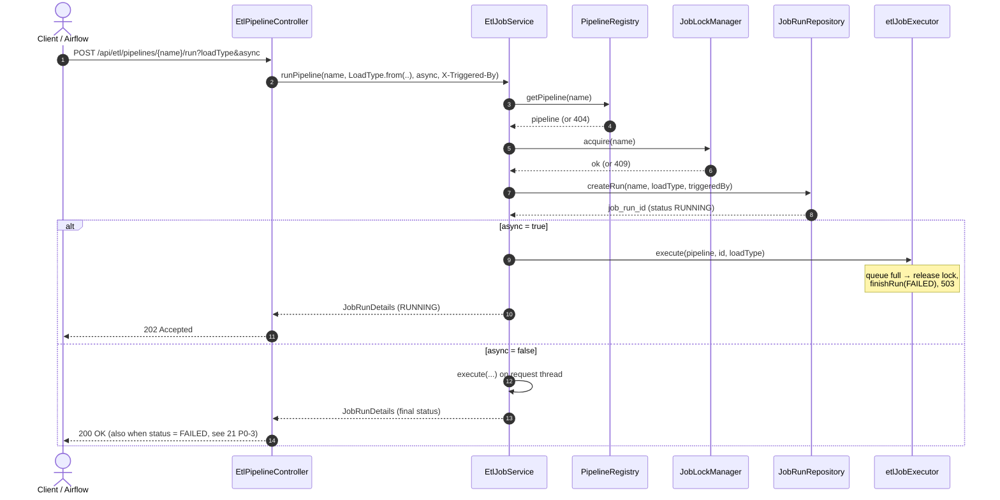

### 6.2 Job execution

```mermaid
sequenceDiagram
    autonumber
    participant JS as EtlJobService.execute
    participant ST as StepTracker
    participant PW as PostgresWriter
    participant P as Pipeline.run
    participant CS as SourceCommitService
    participant JR as JobRunRepository
    JS->>JS: new PipelineContext; setJobGroup("etl-job-id")
    opt loadType = FULL
        loop fullLoadTruncateTables
            JS->>ST: track("Truncate t (FULL load)")
            ST->>PW: TRUNCATE t
        end
    end
    JS->>P: run(ctx)
    Note over P: per source: SourceProcessor.process (6.3)<br/>then mapper + load() upserts (6.4)
    JS->>CS: commit(ctx) (6.5)
    JS->>JR: finishRun(SUCCESS | SUCCESS_WITH_REJECTS, metrics)
    Note over JS: catch Throwable → finishRun(FAILED, message, stack trace)
    Note over JS: finally → unpersist cache, clearJobGroup, release lock
```

### 6.3 Source processing (`SourceProcessor.process`)

```mermaid
sequenceDiagram
    autonumber
    participant SP as SourceProcessor
    participant SD as SchemaDriftDetector
    participant MR as MongoSourceReader
    participant QE as DataQualityEngine
    participant WR as DataWarningRepository
    SP->>SD: [step] Schema check c: detect(source, loadType)
    alt drift and failOnSchemaDrift
        SD-->>SP: throw DataQualityGateException → job FAILED
    else drift
        SP->>WR: insert SCHEMA_DRIFT warning per field (immediately)
    end
    SP->>MR: read(source, loadType) + _raw_record = to_json(fields, PII masked)
    SP->>SP: cache(raw); [step] Extract c: count
    opt INCREMENTAL and count outside expectedRows
        SP->>WR: insert VOLUME warning (immediately)
    end
    SP->>SP: [step] Validate c: sanitizer.apply(raw)
    SP->>QE: check(cleaned, rules, businessKey, latestRecordColumn, pii)
    QE-->>SP: valid, rejected, warnings
    SP->>SP: valid = mask PII; cache valid / rejected / warnings; count
    SP->>SP: metrics += source, valid, rejected, duplicates; ctx.addSourceBatch
    opt maxRejectPercent set and loadType ≠ RETRY_REJECTED
        SP->>SP: [step] Reject gate c: bad% = (rejected − duplicates) / read
        Note over SP: batch ≥ reject-gate-min-records and bad% > max<br/>→ DataQualityGateException (reasons, example, owner)
    end
```

**Why `cache()` matters.** Spark is lazy. Without `persist`, a later action would re-read MongoDB
**after** flags changed and see different data. Caching `raw`, `valid`, `rejected`, `warnings` freezes
the snapshot of the run; `PipelineContext.releaseResources()` unpersists them at the end.

### 6.4 Upsert via staging

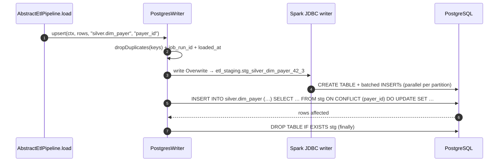

The final `INSERT … ON CONFLICT` is **one statement = one transaction**: a target table is never half
updated by one upsert.

### 6.5 Commit phase

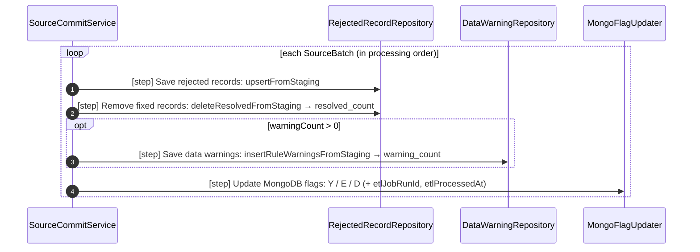

Flags are written **last**. Anything that fails before this point leaves MongoDB unchanged, so the next
run reads the same documents again and the upserts make the re-run safe.

### 6.6 Fix-and-retry of rejected records

```mermaid
sequenceDiagram
    actor U as Data steward
    participant M as MongoDB
    participant API as ETL API
    U->>API: GET /api/etl/rejected-records?pipelineName=…
    API-->>U: reasons + raw_record (PII masked)
    U->>M: fix document (flag stays "E")
    U->>API: POST …/run?loadType=RETRY_REJECTED
    Note over API: reads only flag = E; reject gate is skipped
    API->>M: valid → flag Y
    Note over API: its row is DELETED from etl_rejected_record (resolved_count + 1);<br/>still bad → attempt_count + 1
```

### 6.7 Startup recovery

On `ApplicationReadyEvent`, `EtlJobService.closeInterruptedJobs()` sets every `RUNNING` job to
`FAILED` ("Application stopped while the job was running"). Nothing else is needed for data
consistency because of 11.2. (Known gap: their `RUNNING` steps and leftover staging tables are not
cleaned; 21 P1-5.)

---

## 7. State machines

### 7.1 Job run (`etl_job_run.status`)

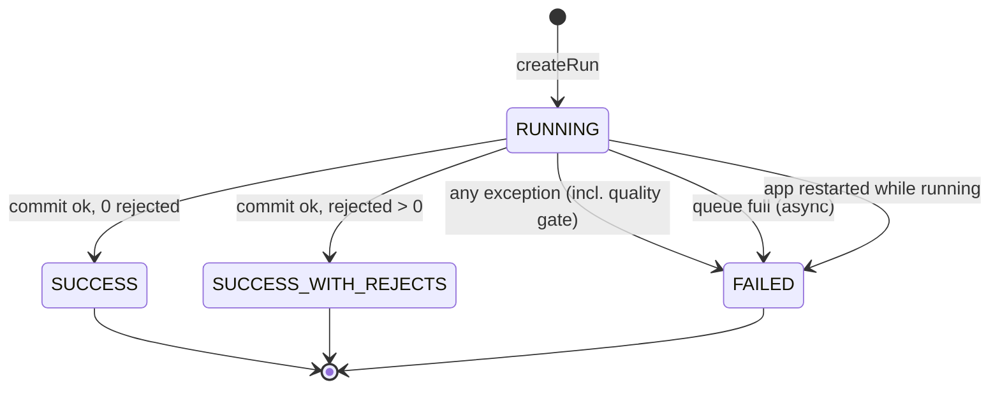

### 7.2 Step (`etl_job_step.status`)

`RUNNING → SUCCESS | FAILED`. A step left `RUNNING` means the process died during that step.

### 7.3 Source document (`processedFlag` in MongoDB)

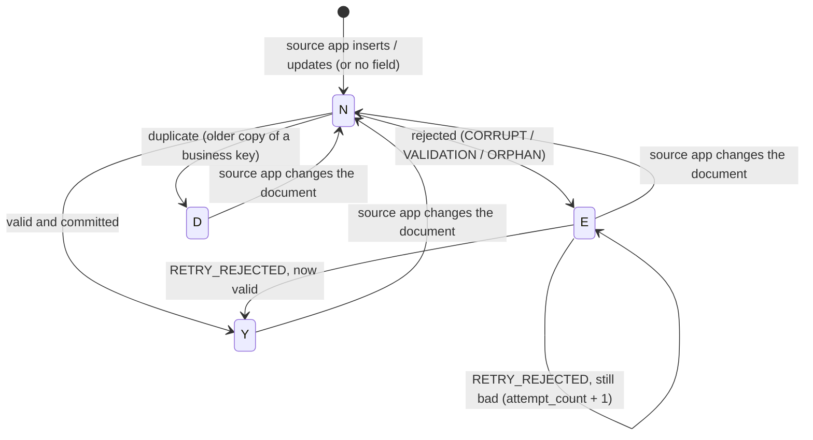

Source-system contract: **any change to a document must set `processedFlag` back to `N`**.
`isTest: true` documents (with `excludeTestRecords()`) never leave `N` because they are never read.

---

## 8. Data design

### 8.1 Bronze conventions (MongoDB `bronze_db`)

| Item | Convention |
|---|---|
| Collection | One per business entity: `payments`, `ecom_orders`, … |
| Business key | String field, unique per entity (`paymentId`, `orderId`) |
| Change marker | `updatedAt` (`yyyy-MM-ddTHH:mm:ss`); the latest wins on duplicates |
| Load control | `processedFlag` (`N`/missing, `Y`, `E`, `D`) |
| Written by ETL | `processedFlag`, `etlJobRunId`, `etlProcessedAt` |
| Test data | `isTest: true` (skipped by `excludeTestRecords()`) |
| Required index (prod) | `{processedFlag: 1}` on every collection (see 17.3) |

### 8.2 PostgreSQL schemas

| Schema | Purpose | Owner |
|---|---|---|
| `silver` | Star / snowflake tables | ETL writes; BI / downstream read |
| `etl_audit` | Job, step, rejected, warning tables | ETL writes; API / ops read |
| `etl_staging` | Temporary upsert tables, dropped after each statement | ETL only |
| `public` | `flyway_schema_history` | Flyway |

### 8.3 Audit model

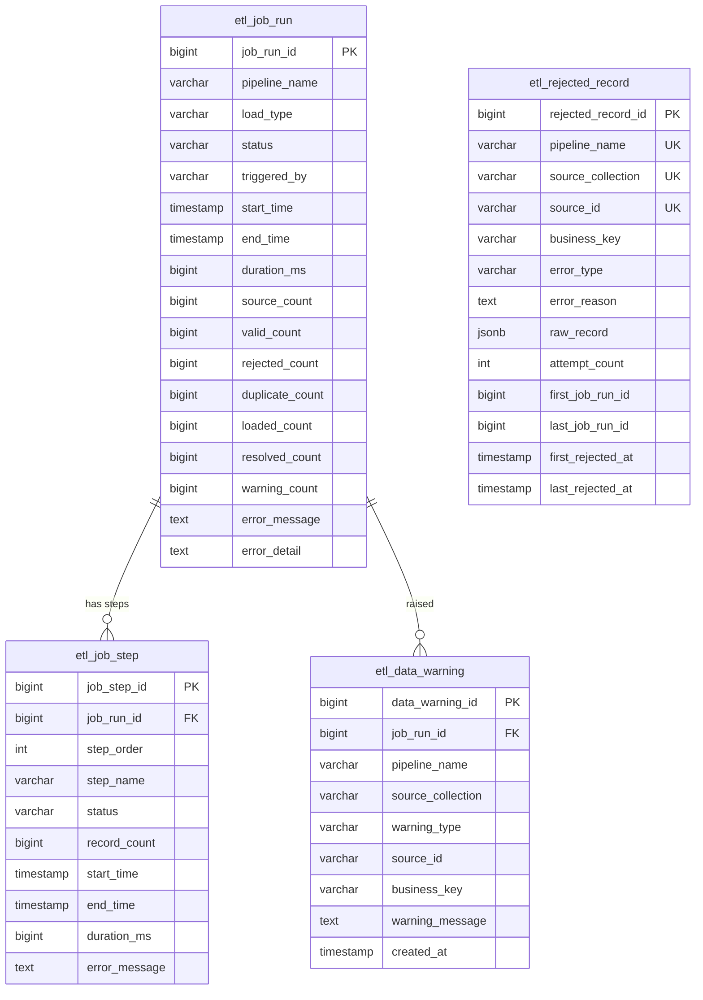

| Table | Semantics | Indexes |
|---|---|---|
| `etl_job_run` | One row per run; counters written once at the end | `(pipeline_name, start_time DESC)`, `(status)` |
| `etl_job_step` | One row per tracked step, live progress | `(job_run_id, step_order)` |
| `etl_rejected_record` | **Current state**: one row per bad source document; deleted when fixed | `UNIQUE (pipeline_name, source_collection, source_id)`, `(pipeline_name, source_collection, error_type)` |
| `etl_data_warning` | **History**: rows added per run (`RULE`, `SCHEMA_DRIFT`, `VOLUME`) | `(job_run_id)`, `(pipeline_name, source_collection, warning_type)` |

Counter semantics: `rejected_count` includes `duplicate_count`; `loaded_count` = sum of rows
inserted or updated over all target tables (so it can be larger than `valid_count`);
`warning_count` = saved rule warnings + drift + volume warnings.

### 8.4 Silver model conventions

| Rule | Example |
|---|---|
| Surrogate key `BIGSERIAL PRIMARY KEY` named `<entity>_key` | `payer_key` |
| Business key `NOT NULL UNIQUE` = upsert conflict target | `payer_id`, composite `(payment_method, payment_provider)` |
| Facts reference dimensions by surrogate key, `NOT NULL REFERENCES` | `fact_payment.payer_key` |
| Every table has `job_run_id BIGINT`, `loaded_at TIMESTAMP` | lineage to the run that last wrote the row |
| Conformed `dim_date` (`date_key = yyyyMMdd`), shared by all pipelines | role-playing in `fact_shipment` (shipped / delivered) |
| Money `NUMERIC(18,2)`; timestamps `TIMESTAMP` | `SparkTypes.MONEY` |
| Degenerate dimension kept on the fact | `fact_order_item.order_id` |
| SCD type 1 (overwrite) | dimension upserts replace attribute values |

### 8.5 Silver schemas per pipeline

| Pipeline | Shape | Dimensions | Facts (grain) | Truncated on FULL |
|---|---|---|---|---|
| `payment-pipeline` | Star | `dim_payer`, `dim_payment_method`, `dim_biller`, `dim_date` | `fact_payment` (payment) | `fact_payment` |
| `transaction-pipeline` | Star | `dim_customer`, `dim_account`, `dim_merchant`, `dim_date` | `fact_transaction` (transaction) | `fact_transaction` |
| `ecommerce-order-pipeline` | **Snowflake** | `dim_category` ← `dim_product`, `dim_ecom_customer`, `dim_date` | `fact_order` (order), `fact_order_item` (order line) | `fact_order_item`, `fact_order` |
| `ecommerce-fulfillment-pipeline` | Star | `dim_warehouse`, `dim_carrier`, `dim_ecom_customer` (conformed), `dim_date` ×2 | `fact_shipment` (shipment) | `fact_shipment` |

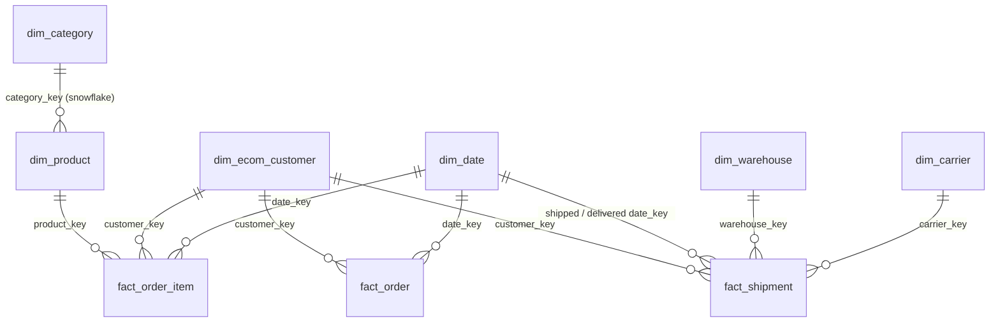

Cross-pipeline dependency: `fact_shipment` rows require `silver.fact_order` (ORPHAN check on `orderId`
and `customer_key` lookup), so `ecommerce-order-pipeline` must run before
`ecommerce-fulfillment-pipeline` (Airflow: `order >> fulfillment`).

### 8.6 Staging tables

* Name: `etl_staging.stg_<base>_<jobRunId>_<n>` (`n` = per-run counter): unique per run and per write,
  so concurrent pipelines never collide.
* Lifetime: created by Spark (`Overwrite`), dropped in `finally` right after the SQL that uses it.
* A crash between create and drop leaves a table behind (cleanup: 21 P1-5).

### 8.7 Migration policy

* Flyway versioned scripts `V<n>__<description>.sql`; current V1..V7.
* **Never edit an applied script** (checksum failure at startup). Every change is a new version.
* Changes must be backward compatible with the running version during a rolling deploy
  (add columns with defaults, never rename in place).

---

## 9. REST API design

Base path `/api`. JSON in and out. Timestamps ISO-8601 local time.

### 9.1 Endpoints

| Method | Path | Parameters | Success | Errors |
|---|---|---|---|---|
| GET | `/etl/pipelines` | | 200 `PipelineInfo[]` (name, description, sourceCollections, **sources** = data contracts, targetTables, fullLoadTruncateTables, loadTypes, running) | |
| POST | `/etl/pipelines/{name}/run` | `loadType` = FULL / INCREMENTAL (default) / RETRY_REJECTED; `async` (default false); header `X-Triggered-By` (default `api`) | 200 `JobRunDetails` (sync), 202 (async) | 400 bad loadType, 404 unknown pipeline, 409 already running, 503 queue full |
| GET | `/etl/jobs` | `pipelineName?`, `status?`, `limit` (20, max 500) | 200 `JobRun[]` newest first | |
| GET | `/etl/jobs/{id}` | | 200 `JobRunDetails {job, steps[]}` | 404 |
| GET | `/etl/jobs/{id}/warnings` | | 200 `DataWarning[]` | 404 |
| GET | `/etl/rejected-records` | `pipelineName?`, `collection?`, `errorType?`, `limit` (100, max 1000) | 200 `RejectedRecord[]` | |
| GET | `/etl/rejected-records/summary` | | 200 counts per pipeline / collection / error type | |
| GET | `/ingestion/sample-data/files` | | 200 file names | |
| POST | `/ingestion/sample-data[/{file}]` | `mode` = REPLACE / APPEND / SKIP_IF_EXISTS | 200 / 207 partial / 500 | 400 |
| POST | `/dev/reset` (dev profile only) | `cleanPostgres` | 200 | |
| GET | `/actuator/health`, `/actuator/info` | | 200 | |

### 9.2 Contracts

`JobRunDetails`:

```json
{
  "job": {
    "jobRunId": 5, "pipelineName": "ecommerce-fulfillment-pipeline", "loadType": "INCREMENTAL",
    "status": "SUCCESS_WITH_REJECTS", "triggeredBy": "airflow:scheduled__2026-11-09T02:00:00",
    "startTime": "2026-11-09T14:31:02.1", "endTime": "2026-11-09T14:31:12.4", "durationMs": 10302,
    "sourceCount": 75, "validCount": 66, "rejectedCount": 9, "duplicateCount": 1,
    "loadedCount": 147, "resolvedCount": 0, "warningCount": 5,
    "errorMessage": null, "errorDetail": null
  },
  "steps": [
    {"jobStepId": 101, "stepOrder": 1, "stepName": "Schema check ecom_warehouses", "status": "SUCCESS",
     "recordCount": 0, "startTime": "…", "endTime": "…", "durationMs": 35, "errorMessage": null}
  ]
}
```

`ApiError` (every 4xx / 5xx):

```json
{"timestamp": "2026-11-09T14:30:00", "status": 409, "error": "Conflict",
 "message": "Pipeline 'payment-pipeline' is already running. Wait for it to finish and try again.",
 "path": "/api/etl/pipelines/payment-pipeline/run"}
```

### 9.3 Semantics an orchestrator must respect

* A **job** failing is **not** an HTTP error: the response carries `job.status = FAILED`. Orchestrators
  must check the status field (or use async + poll), never only the HTTP code (21 P0-3).
* `POST …/run` is **not idempotent** (each call creates a run). Safe retries are guaranteed by the data
  design (11), not by the HTTP layer; 409 protects against parallel duplicates.
* Long jobs must use `async=true` and poll `GET /etl/jobs/{id}` until the status is not `RUNNING`.

---

## 10. Data quality design

### 10.1 Rule taxonomy

| Severity / type | Effect | Examples |
|---|---|---|
| ERROR / `CORRUPT` | rejected, flag `E` | `"12abc"` as amount, `"2025-13-45"` as date |
| ERROR / `VALIDATION` | rejected, flag `E` | required field missing, bad email, value not in list, custom cross-field rule |
| ERROR / `ORPHAN` | rejected, flag `E` | `customerId` not in `dim_customer` (lookup includes earlier runs) |
| automatic / `DUPLICATE` | older copy rejected, flag `D`, never retried | same business key twice in a batch |
| WARNING | **loaded**, row in `etl_data_warning` (`RULE`) | phone missing, amount above review limit |
| Source-level | warning (`SCHEMA_DRIFT`, `VOLUME`) or job FAILED (reject gate, `failOnSchemaDrift`) | new field `color`, 0 rows in an INCREMENTAL run |

### 10.2 Engine algorithm (`DataQualityEngine.check`)

```
input: cleaned rows (all String) + _id + _raw_record
1. for each ORPHAN rule i: LEFT JOIN broadcast(distinct lookup keys AS _dq_ref_i)
       add rule: value IS NOT NULL AND _dq_ref_i IS NULL
2. _dq_errors     = concat_ws(" | ", when(failWhen_k, message_k) for every error rule)   -- "" when clean
   _dq_error_type = first ErrorType (CORRUPT > VALIDATION > ORPHAN) whose rules failed
3. failed  = rows with _dq_errors <> ""
4. passed  = rows with _dq_errors = ""
   row_number() OVER (PARTITION BY businessKey ORDER BY latestRecordColumn::timestamp DESC NULLS LAST, _id ASC)
   duplicates = row_number > 1  → DUPLICATE
5. valid   = row_number = 1
   _dq_warnings = concat_ws(" | ", when(warnFail_k, "[WARNING] …"))
   warnings = valid rows with _dq_warnings <> ""  → (source_id, business_key, warning_message)
output: valid (input columns), rejected (source_id, business_key, error_type, error_reason, raw_record), warnings
```

Properties: all rules of a row are reported at once; a casting failure makes dependent rules evaluate
to NULL (not fired), so a corrupt value produces one clear `[CORRUPT]` message; the tie-break on `_id`
makes de-duplication deterministic.

### 10.3 Processing order per source

`schema check → extract (+raw JSON, PII masked) → volume check → sanitize → validate/dedup/warn →
mask PII on valid rows → reject gate → (pipeline) transform + load → (commit) rejects, resolved, warnings, flags`.

Sanitizing happens **before** validation so messy-but-correct values are fixed instead of rejected;
masking happens **after** validation so rules see real values, and **before** anything is persisted.

### 10.4 Quality gates

| Gate | Rule | Not applied when | Outcome |
|---|---|---|---|
| Reject gate | `(rejected − duplicates) / read × 100 > maxRejectPercent` | `RETRY_REJECTED`; batch < `reject-gate-min-records` | Step `Reject gate c` FAILED → job FAILED; the message lists counts, reasons per type, one example, the owner; collection not loaded; flags unchanged |
| Schema drift (fail mode) | any new / missing field and `failOnSchemaDrift()` | sample is empty | job FAILED before extract |

Configured today: every source of all 4 pipelines has `maxRejectPercent(30)`; drift is in warning mode.

### 10.5 PII handling

| Where | How |
|---|---|
| Declaration | `SourceDefinition.maskEmail(...)`, `maskPhone(...)` |
| `_raw_record` (rejected table) | built from masked expressions at extract time |
| `error_reason`, `warning_message` | `ValidationRule.message` renders masked values for PII columns |
| Silver | valid rows masked before caching; mappers only see masked values |
| Declared today | `payments.payerEmail/payerPhone`, `customers.email/phone`, `ecom_customers.email/phone` |

Masking is irreversible. If analytics needs to join on a person's identity, add a **keyed hash**
(HMAC-SHA256 with a secret from the vault) as a separate column, not plain SHA (21 P2-4).

---

## 11. Consistency, idempotency and failure recovery

### 11.1 Guarantees

| # | Guarantee | Mechanism |
|---|---|---|
| G1 | Re-running any job converges to the same silver state | Business-key upserts; `dropDuplicates` before upsert; deterministic dedup |
| G2 | A failed job never marks source documents as processed | Flags updated in the last commit step |
| G3 | Each target-table upsert is atomic | Single `INSERT … SELECT … ON CONFLICT` statement |
| G4 | No orphan fact rows | ORPHAN rules + `NOT NULL` FK constraints |
| G5 | Every non-loaded record is explainable | `etl_rejected_record` with all reasons and the (masked) original |
| G6 | A run's snapshot is stable | Spark `persist` of every source dataset |

**Not guaranteed:** atomicity across tables of one run (dimensions may be updated while a later fact
load fails). Downstream consumers treat a pipeline's data as complete only when its latest run is
`SUCCESS` / `SUCCESS_WITH_REJECTS` (21 P1-6 adds a published "watermark").

### 11.2 Crash-point analysis

| Crash during | State left behind | Recovery |
|---|---|---|
| Before `createRun` | nothing | retry |
| After `createRun`, before `execute` | job `RUNNING` | startup → `FAILED`; retry |
| Truncate (FULL) | fact table empty | **re-run FULL** (gap: 21 P0-5) |
| Loading dimensions / facts | some tables upserted, flags unchanged | re-run: same documents, upserts converge (G1) |
| Reject gate failure | earlier sources' tables upserted, flags unchanged | fix source or raise the limit, re-run |
| Commit: after rejects saved, before flags | rejects saved, flags `N` | re-run: rejects re-upserted (`attempt_count` over-counts by one), loads converge |
| Commit: in the middle of flag updates | some documents `Y/E/D`, some `N` | re-run reads only the remaining `N` documents |
| Any time | step rows `RUNNING`, staging tables | cleanup job (21 P1-5) |

### 11.3 Idempotency of the API call vs. the data

The data path is idempotent (G1, G2). The HTTP call is not; the orchestrator retries a **failed job**
by calling run again, which is safe. It must not retry on 409 blindly in a tight loop (back off).

---

## 12. Concurrency and locking

| Aspect | Current design |
|---|---|
| Same pipeline twice | Rejected with 409 by the in-memory `JobLockManager` |
| Different pipelines | Run in parallel (async pool, `thread-pool-size` threads; sync calls use request threads) |
| SparkSession | One shared session; each run has its own job group (`etl-job-<id>`); default FIFO scheduler |
| Staging tables | Unique names per run and write → no collisions |
| Shared targets (`dim_date`, `dim_ecom_customer`) | Concurrent `ON CONFLICT` upserts from two pipelines can wait on row locks or deadlock (PostgreSQL detects and aborts one) → that job FAILS and is safe to re-run |
| PipelineContext / metrics | Per run; counters are `AtomicLong` |

Production rules: run pipelines that write the same shared dimension **sequentially** (Airflow pool of
size 1, or a table-level advisory lock, 21 P1-3); enable `spark.scheduler.mode=FAIR` when several jobs
share one Spark driver (21 P1-1).

---

## 13. Configuration reference

| Key | Default (common / dev) | Prod | Meaning |
|---|---|---|---|
| `spring.datasource.url / username / password` | `jdbc:postgresql://localhost:5433/silver`, `postgres`, env `POSTGRES_PASSWORD` | env `POSTGRES_URL/USER/PASSWORD` | Silver + audit database |
| `spring.datasource.hikari.maximum-pool-size` | Spring default (10) | 10 | JDBC pool (API + audit SQL) |
| `spring.data.mongodb.uri / database` | `mongodb://localhost:27017`, `bronze_db` | env `MONGO_URI`, `MONGO_DATABASE` | Bronze |
| `etl.spark.master` | `local[*]` | env `SPARK_MASTER` | Spark master |
| `etl.spark.config.*` | `shuffle.partitions=4`, `ui.enabled=false`, `ansi.enabled=false`, `timeParserPolicy=CORRECTED` | `shuffle.partitions=${SPARK_SHUFFLE_PARTITIONS:50}` | Passed to `SparkConf` as-is |
| `etl.postgres.staging-schema` | `etl_staging` | | Schema for upsert staging |
| `etl.postgres.batch-size` | 1000 | 5000 | Spark JDBC `batchsize` |
| `etl.source.flag-field` | `processedFlag` | | Flag field name in every document |
| `etl.job.thread-pool-size` | 2 | env `ETL_THREAD_POOL_SIZE` (4) | Parallel async jobs |
| `etl.job.queue-capacity` | 10 | | Waiting async jobs before 503 |
| `etl.quality.reject-gate-min-records` | 10 | | Gate skipped below this batch size |
| `etl.quality.schema-sample-size` | 1000 | | Documents inspected by the drift check |
| `etl.sample-data.load-on-startup` | false (dev: true) | false | Dev sample loader |
| `management.endpoints.web.exposure.include` | `health,info` | | Actuator |

`spark.sql.ansi.enabled=false` is **required**: invalid casts must return NULL so CORRUPT rules can
detect them instead of the job failing.

---

## 14. Error handling

### 14.1 Exception hierarchy

```
RuntimeException
└── EtlException                         base, unchecked
    ├── EtlStepException                 "Step '<name>' failed: <root cause>" (thrown by StepTracker)
    ├── DataQualityGateException         reject gate / schema drift (fail mode)
    ├── PipelineNotFoundException        unknown pipeline name
    ├── PipelineAlreadyRunningException  lock taken
    └── JobRunNotFoundException          unknown job id
```

### 14.2 HTTP mapping (`GlobalExceptionHandler`)

| Exception | HTTP |
|---|---|
| `PipelineNotFoundException`, `JobRunNotFoundException` | 404 |
| `PipelineAlreadyRunningException` | 409 |
| `IllegalArgumentException`, `MethodArgumentTypeMismatchException` | 400 |
| other `EtlException` (e.g. queue full) | 503 |
| any other `Exception` | 500 |

### 14.3 Inside a job

* Every step catches `RuntimeException`, marks the step FAILED with the **root-cause** message, re-throws
  as `EtlStepException` (so the job message names the step).
* `execute` catches `Throwable`, so even an `OutOfMemoryError` ends the job as `FAILED` (then the
  `Error` is re-thrown); `error_message` ≤ 1000 chars, `error_detail` = stack trace ≤ 4000 chars.
* If saving the FAILED status itself fails (database down), it is logged; startup recovery closes the run later.

---

## 15. Observability

### 15.1 What exists

| Signal | Where |
|---|---|
| Job / step progress and durations | `etl_job_run`, `etl_job_step`, `GET /api/etl/jobs/{id}` |
| Data problems | `etl_rejected_record`, `etl_data_warning`, summary endpoint |
| Lineage | `job_run_id` + `loaded_at` on every silver row; `etlJobRunId` + `etlProcessedAt` in MongoDB |
| Logs | `[job <id>] >> step` / `<< step : n records`, `SCHEMA DRIFT …`, `VOLUME …`, `== Job <id> <status> …` summary line |
| Spark | Job group `etl-job-<id>` (Spark UI is disabled: javax/jakarta servlet conflict, 21 P2-2) |
| Health | `/actuator/health` |

### 15.2 Operational SQL

```sql
-- Failed jobs in the last 24 h
SELECT job_run_id, pipeline_name, error_message
  FROM etl_audit.etl_job_run
 WHERE status = 'FAILED' AND start_time > now() - interval '24 hours';

-- Slowest steps of a pipeline (last 7 days)
SELECT s.step_name, round(avg(s.duration_ms)) avg_ms, max(s.duration_ms) max_ms
  FROM etl_audit.etl_job_step s JOIN etl_audit.etl_job_run r USING (job_run_id)
 WHERE r.pipeline_name = 'transaction-pipeline' AND r.start_time > now() - interval '7 days'
 GROUP BY 1 ORDER BY avg_ms DESC LIMIT 10;

-- Reject rate trend per collection
SELECT date_trunc('day', last_rejected_at) day, source_collection, error_type, count(*)
  FROM etl_audit.etl_rejected_record GROUP BY 1, 2, 3 ORDER BY 1 DESC;

-- Stale pipeline (no successful run in 2 h)
SELECT pipeline_name, max(end_time) last_ok
  FROM etl_audit.etl_job_run WHERE status IN ('SUCCESS', 'SUCCESS_WITH_REJECTS')
 GROUP BY 1 HAVING max(end_time) < now() - interval '2 hours';
```

### 15.3 Production target (21 P1-4)

Micrometer + Prometheus (`/actuator/prometheus`):

| Metric | Type | Labels |
|---|---|---|
| `etl_job_duration_seconds` | timer | pipeline, load_type, status |
| `etl_job_total` | counter | pipeline, status |
| `etl_records_total` | counter | pipeline, collection, outcome = read / valid / rejected / duplicate / warning |
| `etl_quality_gate_failures_total` | counter | pipeline, collection, gate |
| `etl_jobs_running` | gauge | pipeline |

Alerts: job FAILED; quality-gate failure (page the source **owner** from `SourceDefinition`); no
successful run within SLA; reject rate above normal; `SCHEMA_DRIFT` warning (ticket, not page).

Logging: JSON logs with `jobRunId`, `pipeline` in MDC so every line of a run can be filtered.

---

## 16. Security

| Area | Current | Required for production |
|---|---|---|
| API authentication | **none** | OAuth2 resource server (JWT) or mTLS; roles `etl-operator` (run) and `etl-viewer` (read) (P0-1) |
| Dangerous endpoints | `/api/ingestion/**` available in every profile | Disable outside dev (`@Profile("dev")` or a feature flag) (P0-4) |
| Secrets | env vars in prod profile | Vault / Kubernetes secrets; never in YAML or images |
| Database privileges | single user | `etl_writer`: DML on `silver`, `etl_audit`, DDL only on `etl_staging`; Flyway runs with a separate migration user; BI gets read-only on `silver` |
| MongoDB privileges | | read on bronze collections + `update` limited to the flag fields' collections; TLS |
| PII | masked in silver, rejected table, messages | Keep the list of PII fields reviewed per source; access to `raw_record` limited to data stewards |
| SQL injection | Table and column names come from code, not from requests; values are bind parameters | Keep it so: never build SQL from request input |
| Transport | HTTP | TLS everywhere (API, Postgres `sslmode=verify-full`, MongoDB TLS) |
| Audit of operators | `triggered_by` from a header | Take the identity from the authenticated principal, not the header |

---

## 17. Performance and scalability

### 17.1 Design choices that matter

| Choice | Effect |
|---|---|
| `$match` pushed into MongoDB | only the run's documents travel to Spark |
| Fields read as String with an explicit schema | no schema inference pass |
| `persist(MEMORY_AND_DISK)` per source | each source read once per run |
| `broadcast` lookup keys in ORPHAN joins | no shuffle for dimension-key checks |
| Staging + single set-based SQL | no row-by-row upserts; Postgres does one merge |
| Flag updates on executors in bulks of 1000 | no driver bottleneck |

### 17.2 Known limits

| Limit | Impact | Mitigation |
|---|---|---|
| `readTable` reads whole dimension tables over one JDBC connection | slow for multi-million-row dimensions | read only key columns (already done), add `partitionColumn` / `numPartitions`, or cache dimension keys per run |
| `count()` after every step | extra Spark actions | acceptable because data is cached; remove for very large batches if needed |
| Window de-dup over the batch | shuffle on business key | `spark.sql.shuffle.partitions` sized to the data (prod default 50) |
| One driver for all jobs | memory pressure, noisy neighbours | separate Spark capacity (21 P1-1) |
| FULL load re-reads everything | long runs on big collections | use FULL only for rebuilds |

### 17.3 Required indexes outside this repository

* MongoDB: `{processedFlag: 1}` on every source collection (INCREMENTAL / RETRY scans), optionally
  compound with `isTest`.
* PostgreSQL: unique business-key indexes exist (from `UNIQUE`); add FK-column indexes on facts used by
  BI joins (some exist: date and customer keys).

### 17.4 Tuning knobs

`etl.spark.config.spark.sql.shuffle.partitions`, `spark.executor.memory/cores`, `spark.driver.memory`,
`etl.postgres.batch-size`, `etl.job.thread-pool-size`, `etl.quality.schema-sample-size`.
Reference point: on a dev laptop (`local[*]`) the e-commerce fulfillment run (75 documents, 19 steps)
takes about 10 s, dominated by fixed per-step overhead, not data volume.

---

## 18. Deployment, orchestration and operations

### 18.1 Build and run

```bash
mvn clean package                                   # runs unit tests (Spark local[1])
java -jar target/spark-etl-pipeline-1.0.0.jar --spring.profiles.active=prod
```

Java 17 needs the `--add-opens` flags listed in `pom.xml` (`spark.jvm.add-opens`); the packaged jar and
`mvn spring-boot:run` add them. Container images must pass them in `JAVA_TOOL_OPTIONS`.

Startup order: Flyway migrations → Spring context (pipelines registered, duplicate names fail fast) →
SparkSession → `closeInterruptedJobs()`.

### 18.2 Deployment checklist

1. Database exists; migration user configured; `V<n>` scripts reviewed.
2. Secrets present (`POSTGRES_*`, `MONGO_URI`, Spark master).
3. Exactly one replica of the job runner (until 21 P0-2 is done).
4. `/actuator/health` UP; `GET /api/etl/pipelines` lists the expected pipelines.
5. Graceful shutdown: running async jobs get up to 60 s; longer jobs end as FAILED at next startup and
   are re-run by the orchestrator.

### 18.3 Airflow integration (dependencies live here)

```python
# dags/etl_ecommerce.py
from airflow import DAG
from airflow.providers.http.operators.http import HttpOperator
from airflow.providers.http.sensors.http import HttpSensor
import json, pendulum

def run_and_wait(pipeline, load_type="INCREMENTAL"):
    start = HttpOperator(
        task_id=f"start_{pipeline}",
        http_conn_id="etl_api",
        method="POST",
        endpoint=f"/api/etl/pipelines/{pipeline}/run?loadType={load_type}&async=true",
        headers={"X-Triggered-By": "airflow:{{ run_id }}"},
        response_filter=lambda r: r.json()["job"]["jobRunId"],
        do_xcom_push=True,
    )
    wait = HttpSensor(
        task_id=f"wait_{pipeline}",
        http_conn_id="etl_api",
        endpoint=f"/api/etl/jobs/{{{{ ti.xcom_pull(task_ids='start_{pipeline}') }}}}",
        response_check=lambda r: _finished_ok(r.json()["job"]["status"]),
        poke_interval=30, timeout=3 * 3600, mode="reschedule",
    )
    start >> wait
    return start, wait

def _finished_ok(status):
    if status == "FAILED":
        raise ValueError("ETL job FAILED")          # fails the task -> retries / alerts
    return status in ("SUCCESS", "SUCCESS_WITH_REJECTS")

with DAG("etl_ecommerce", schedule="0 2 * * *", start_date=pendulum.datetime(2026, 11, 1),
         catchup=False, default_args={"retries": 2}) as dag:
    _, order_done = run_and_wait("ecommerce-order-pipeline")
    fulfillment_start, _ = run_and_wait("ecommerce-fulfillment-pipeline")
    order_done >> fulfillment_start
```

Policy decisions for the DAG: `SUCCESS_WITH_REJECTS` counts as success (rejects are handled by data
stewards); pipelines that share a dimension get the same Airflow `pool` (size 1); a 409 is retried with back-off.

### 18.4 Runbook

| Symptom | Check | Action |
|---|---|---|
| Job `FAILED` at `Reject gate <c>` | `error_message` (reasons, example, owner) | Contact the owner; after the source is fixed re-run INCREMENTAL. A dependency not yet loaded shows up as ORPHAN reasons: run the upstream pipeline first |
| Job `FAILED` at `Load silver.x` | step `error_message` (root cause) | DB issue → fix and re-run (safe, 11.2) |
| 409 on run | `GET /api/etl/pipelines` (`running`) | wait; if the process died, a restart clears the in-memory lock |
| Many `ORPHAN` rejects | rejected summary | load parents first; then `RETRY_REJECTED` |
| `SCHEMA_DRIFT` warning | `GET /api/etl/jobs/{id}/warnings` | new field needed → add to `fields(...)` + mapper + migration; not needed → `ignoreFields(...)` |
| `VOLUME` warning | warning message (owner) | check the source feed; 0 rows repeatedly = source stopped |
| FULL load failed half way | fact table possibly empty | re-run FULL immediately (21 P0-5 removes this risk) |
| Leftover `etl_staging.stg_*` tables | `\dt etl_staging.*` | safe to drop when no job is running |

---

## 19. Testing strategy

| Level | What | Where / how |
|---|---|---|
| Unit (Spark local[1], no Spring, no DB) | Engine: valid / corrupt / validation / orphan / duplicate | `DataQualityEngineTest` |
| Unit | Warnings, PII masking in messages, mask functions, orphan-as-warning guard | `DataQualityWarningAndPiiTest` |
| Unit | Mappers: measures, header keys, role-playing dates | `EcommerceOrderSchemaMapperTest`, `FulfillmentStarSchemaMapperTest` |
| Integration (manual today) | Full runs against real MongoDB + PostgreSQL with planted bad data | `POST /api/dev/reset`, then the requests in `api-requests.http`; expected counts in README §9 |
| Data fixtures | Deterministic generators with one planted problem per bad record | `scripts/SampleDataGenerator.java`, `scripts/generate-ecommerce-sample-data.js` |

Production target (21 P1-7): Testcontainers (MongoDB + PostgreSQL) integration tests per pipeline in
CI asserting job status, counts, rejected reasons and idempotency (run twice → same silver state).

---

## 20. Extensibility

| To add | Do | Framework change? |
|---|---|---|
| A pipeline | migration `V<n>`, package with `Sources` + `Mapper` + `Pipeline` (`@Component`, `sources()`, `run()`) | no |
| A rule | `DataQualityRules.custom(...)` in the Sources class; a reusable one as a new method in `DataQualityRules` | optional |
| A cleaning step | `DataSanitizer.custom(column, fn)` or a new method | optional |
| A PII type | new `PiiType` constant with `mask(Column)` + builder method | small |
| A new source system (e.g. PostgreSQL → gold) | a `SourceReader` abstraction with Mongo and JDBC/watermark implementations; `SourceDefinition` gets a `sourceType` | yes (21 P1-6) |
| SCD type 2 | `PostgresWriter.upsertScd2(...)` (close current row, insert new version) | yes (P2) |

---

## 21. Production readiness: gaps and target design

### 21.1 P0: blockers before go-live

| ID | Gap | Target design |
|---|---|---|
| **P0-1** | No API authentication / authorization | Spring Security OAuth2 resource server; `POST /run` needs role `etl-operator`, `GET` needs `etl-viewer`; `triggered_by` = principal name |
| **P0-2** | In-memory lock: a second instance could run the same pipeline twice | PostgreSQL advisory lock: `SELECT pg_try_advisory_lock(hashtext(pipeline_name))` on a dedicated connection held for the run (or ShedLock table); release in `finally`; the lock dies with the session if the process crashes |
| **P0-3** | Sync run returns HTTP 200 even when the job FAILED | Keep the body; return **500** (or 422 for quality-gate failures) when `job.status = FAILED`; document `async=true` + polling as the orchestrator contract |
| **P0-4** | `/api/ingestion/**` (can drop collections with `mode=REPLACE`) active in prod | `@Profile("dev")` on the ingestion controller/service, or `etl.ingestion.enabled=false` by default |
| **P0-5** | FULL load truncates facts **before** loading: a failure leaves BI with empty tables | Build into `silver.<fact>__new` (or load into the fact inside one transaction: `TRUNCATE` + `INSERT … SELECT FROM staging` in the same transaction), then swap with `ALTER TABLE … RENAME` in one transaction |
| **P0-6** | One shared `processedFlag` per document: two pipelines reading the same collection steal each other's documents | Flags per consumer: `etlFlags.<pipelineName>` (`$in: ["N", null]` on that path), or move load state to Postgres (`etl_source_watermark(pipeline, collection, last_updated_at)`) |

### 21.2 P1: soon after go-live

| ID | Gap | Target design |
|---|---|---|
| P1-1 | Spark driver inside the API JVM | Run jobs through `spark-submit` / Spark Connect on a cluster, or a separate "runner" deployment that only consumes queued runs; at minimum set `spark.scheduler.mode=FAIR` with one pool per job |
| P1-2 | No job timeout / cancellation | `etl.job.timeout` per pipeline; a watchdog calls `sparkContext.cancelJobGroup("etl-job-<id>")` and marks FAILED; `POST /api/etl/jobs/{id}/cancel` |
| P1-3 | Concurrent upserts on shared dimensions | Table-level advisory lock around `PostgresWriter.upsert` for shared tables (`dim_date`, conformed dims), or Airflow pool |
| P1-4 | No metrics / alerting | Micrometer metrics and alerts in 15.3; JSON logs with MDC |
| P1-5 | Crash leftovers: steps `RUNNING`, `etl_staging.stg_*` | On startup: `UPDATE etl_job_step SET status='FAILED' WHERE status='RUNNING'`; drop staging tables whose `jobRunId` is not `RUNNING` |
| P1-6 | Downstream (gold) cannot read silver incrementally | `etl_pipeline_watermark(pipeline, last_success_job_run_id, completed_at)` published at commit; a JDBC source reader with `job_run_id > watermark` |
| P1-7 | No automated integration tests | Testcontainers suite in CI (19) |
| P1-8 | Audit tables grow forever | Retention job: `etl_job_step` / `etl_data_warning` older than 90 days deleted or partitioned by month; `etl_rejected_record` stays (current state) |
| P1-9 | Gate failure hides which records were bad (commit not run) | Save the batch's rejects with a `gate_failed` marker in a separate table, or include the top N business keys in the error detail |

### 21.3 P2: improvements

| ID | Item |
|---|---|
| P2-1 | SCD type 2 for dimensions that need history (customer segment, product price) |
| P2-2 | Spark UI / history server (resolve the javax / jakarta servlet conflict or run Spark outside Spring) |
| P2-3 | `SUCCESS_WITH_WARNINGS` status or a warnings threshold per source |
| P2-4 | Keyed hash (HMAC) column next to masked PII when joins on identity are needed |
| P2-5 | Data contracts as versioned YAML (generated `SourceDefinition`), reviewed by source owners |
| P2-6 | Partitioned JDBC reads for large dimension lookups (17.2) |

### 21.4 Suggested order of work

```
P0-4, P0-3 (hours) ─► P0-1, P0-2 (days) ─► P0-5, P0-6 (days) ─► P1-5, P1-4, P1-2 ─► P1-1, P1-6 ─► rest
```

---

## 22. Appendix

### 22.1 Glossary

| Term | Meaning |
|---|---|
| Bronze / silver | Raw source copy / cleaned, modelled data |
| Business key | Natural id from the source (`paymentId`) |
| Surrogate key | Database-generated id (`payer_key`) used by facts |
| Grain | What one fact row represents (one order line) |
| Conformed dimension | Dimension shared by several facts with the same meaning (`dim_date`, `dim_ecom_customer`) |
| Role-playing dimension | The same dimension used twice with different meanings (shipped / delivered date) |
| Degenerate dimension | An id kept on the fact without its own table (`order_id`) |
| Snowflake | Dimension that references another dimension (`dim_product → dim_category`) |
| Reject gate | Job-stopping limit on the share of bad rows of a source |
| Schema drift | Difference between the fields a source sends and the contract |

### 22.2 File map (where to find each part)

| Part | Path |
|---|---|
| REST | `src/main/java/com/demo/etl/api/` |
| Orchestration | `framework/job/EtlJobService.java`, `SourceCommitService.java`, `JobLockManager.java` |
| Source contract + processing | `framework/source/SourceDefinition.java`, `SourceProcessor.java`, `SchemaDriftDetector.java` |
| Data quality | `framework/quality/` |
| Upsert | `framework/target/PostgresWriter.java` |
| Audit | `framework/audit/`, `db/migration/V1__…`, `V7__…` |
| Pipelines | `pipelines/payment`, `pipelines/transaction`, `pipelines/ecommerce/order`, `pipelines/ecommerce/fulfillment` |
| Configuration | `src/main/resources/application*.yml`, `config/` |
| Requests | `api-requests.http` |
